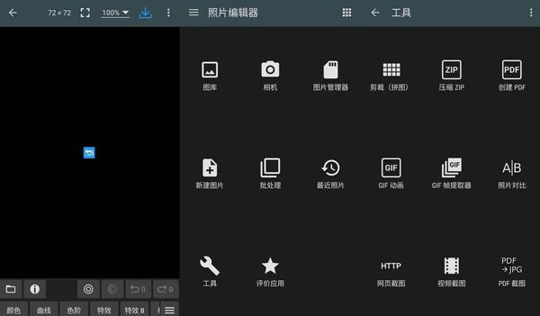

## Windows

[2026-11-08 18:03] 来自：综合网盘资源频道

名称：Windows 使命召唤4现代战争 豪华中文 移植版，经典第一人称射击游戏

描述：重温历史上最经典的单人战役之一，你将被带往全球各地，执行包括“双人成行”、“高空俱乐部”和“强行登船”在内的众多备受粉丝喜爱的明星任务。你将化身为令人难忘的角色——“肥皂”约翰·麦克塔维什中士、约翰·普莱斯上尉等，深入东欧、 俄罗斯乡村乃至中东等

夸克网盘：https://pan.quark.cn/s/aad6d75fb81f

📁 大小：3.8G

🏷 标签：#游戏 #Windows #使命召唤 #战争 #第一人称 #射击游戏 #使命召唤4现代战争 #豪华中文 #移植版 #经典 #第一人称射击游戏 #quark

---

## AdGuard

[2026-11-08 00:06] 来自：综合网盘资源频道

名称：AdGuard v4.15.2 广告拦截跟踪器，去广告大杀器

描述：AdGuard，最受欢迎的广告拦截程序，堪称去广告大杀器。Adguard安卓版无需ROOT权限，可拦截所有应用和浏览器的广告。具有广告内容拦截跟踪器(包括：广告拦截过滤器、社交过滤器、隐私过滤器、安全过滤器、自定义过滤器)、DNS过滤、HTTPS过滤、节省应用流量数据管理及隐身模式保护个人隐私功能。

夸克网盘：https://pan.quark.cn/s/5da1fa0b2698

📁 大小：886.8MB

🏷 标签：#Android #广告拦截 #广告拦截跟踪器 #去广告大杀器 #quark

---

## NP管理器

[2026-11-08 00:05] 来自：综合网盘资源频道

名称：NP管理器 v3.2.7 Apk逆向反编译修改工具

描述：NP管理器是一款永久免费且无广告的安卓文件管理器和APK逆向修改工具。与MT管理器类似，它提供了强大的文件管理功能，如Apk反编译、Dex、Jar、Smali互相转换等逆向功能，还支持字符串加密、去签名效验等高级操作。该工具界面简洁，操作便捷，无需付费即可享受全面功能，是Android用户进行APK分析和修改的理想选择。

夸克网盘：https://pan.quark.cn/s/89b76005f6b8

📁 大小：538.3MB

🏷 标签：#Android #管理 #逆向 #工具 #NP管理器 #Apk逆向反编译修改工具 #quark

---

## Photo

[2026-11-08 00:04] 来自：综合网盘资源频道

名称：Photo Editor v14.3 最强照片编辑器，P图神器

描述：Photo Editor v10.4，顶级照片编辑利器，集专业P图功能与创意工具于一身。解锁高级版后，尽享无限滤镜、高级编辑选项及独家特效，轻松打造专业级美图。无论是人像美化、风景修饰还是创意合成，一键操作，瞬间提升照片质感，让你的每一张作品都令人惊艳。

夸克网盘：https://pan.quark.cn/s/51f34ab7c345

📁 大小：111.0MB

🏷 标签：#Android #P图 #高级 #解锁 #编辑 #最强照片编辑器 #P图神器 #quark

---

## 爱笔思画X

[2026-11-08 00:01] 来自：综合网盘资源频道

名称：爱笔思画X v14.1.5 专业插画绘图工具

描述：爱笔思画X app 是一款流行的多功能绘图应用程序，作为一个系列，总下载量超过 3.7 亿次，它提供了 15000 多种画笔、21000 多种材料、2100 多种字体、84 种滤镜、46 种网纹、27 种混合模式、记录绘图过程、描边稳定功能，各种标尺功能，例如径向线标尺或对称标尺，以及剪贴蒙版功能。

夸克网盘：https://pan.quark.cn/s/8f23880405dc

📁 大小：1.3GB

🏷 标签：#Android #插画 #工具 #绘图 #爱笔思画X #专业插画绘图工具 #quark

---

## Device

[2026-11-08 00:00] 来自：综合网盘资源频道

名称：Device Info v3.4.4.3 查看移动设备的完整信息，解锁专业高级版

描述：Device Info是一款强大的移动设备信息检测工具，可查看包括处理器、内存、电池状态、系统版本等在内的完整设备信息。其界面简洁，分类清晰，支持黑暗主题，方便用户快速上手。此外，它还具备设备测试、应用分析等功能，是开发者和普通用户了解和管理Android设备的理想选择。

夸克网盘：https://pan.quark.cn/s/6967a2965fc1

📁 大小：23.1MB

🏷 标签：#Android #硬件 #工具 #信息 #查看移动设备的完整信息 #解锁专业高级版 #quark

---

## 3115160

[2026-11-07 23:34] 来自：综合网盘资源频道

名称：3115160 战锤40K：爆矢枪2 v1.3.0.0-P2P

描述：在《战锤40K：爆矢枪2》中以帝皇之名消灭异端！体验复古第一人称射击游戏《战锤40K：爆矢枪》的续作，扮演极限战士马鲁姆·凯多或战斗修女奈拉·维拉思，迎战更多敌人，尝试更多武器，探索新的净化方式！

夸克网盘：https://pan.quark.cn/s/b69f5a03ec9c

📁 大小：NG

🏷 标签：#Windows #Windows游戏 #PC游戏 #电脑游戏 #Steam #战锤40K #爆矢枪2 #quark

---

## 3105440

[2026-11-07 23:32] 来自：综合网盘资源频道

名称：3105440 魔法门之英雄无敌：上古纪元 v0.82.08

描述：《魔法门之英雄无敌：上古纪元》是誉满全球的回合制策略经典《英雄无敌》系列的正统前传。集结浩荡大军，施展撼天动地的法术，在单人战役与多人对战中荡平群敌。

夸克网盘：https://pan.quark.cn/s/f885eac90dca

📁 大小：NG

🏷 标签：#Windows #Windows游戏 #PC游戏 #电脑游戏 #Steam #魔法门之英雄无敌 #上古纪元 #quark

---

## 2523770

[2026-11-07 23:25] 来自：综合网盘资源频道

名称：2523770 指环王：北境之战 Build.25804416

描述：北方阴影再起。踏入一个更加黑暗与残酷的中土大陆吧。战火已蔓延至远离护戒使者旅途的疆域。《指环王：北境之战》传世版扩展了托尔金的史诗传说，揭示了阿甘达尔的残酷秘史——这个黑暗努门诺尔人也是索伦的仆从，如今在佛诺斯特的废墟中集结起了一支庞大军队。

夸克网盘：https://pan.quark.cn/s/a2a92afef71a

📁 大小：NG

🏷 标签：#Windows #Windows游戏 #PC游戏 #电脑游戏 #Steam #指环王 #北境之战 #quark

---

## 2300320

[2026-11-07 23:23] 来自：综合网盘资源频道

名称：2300320 Farming Simulator 25 v1.25.1.0-P2P

描述：《Farming Simulator 25》邀请你加入回报丰厚的农场生活，无论你是独自游戏，还是多人合作，你都将打造属于你的农场！

夸克网盘：https://pan.quark.cn/s/9e646b0a145b

📁 大小：NG

🏷 标签：#Windows #Windows游戏 #PC游戏 #电脑游戏 #Steam #quark

---

## 2155180

[2026-11-07 23:22] 来自：综合网盘资源频道

名称：2155180 帕格尼物语 v1.5.4-13144+202370-P2P

描述：为这个失落于迷雾之中的世界重建希望。在新的任务故事中，率领你的帕戈尼亚人穿越帕戈尼亚群岛，将散落各处的部落联合起来，建立起繁荣的社区，探索你人民的历史，最终夺回属于你的世界。

夸克网盘：https://pan.quark.cn/s/21b2db82a6ba

📁 大小：NG

🏷 标签：#Windows #Windows游戏 #PC游戏 #电脑游戏 #Steam #帕格尼物语 #quark

---

## 2080690

[2026-11-07 23:19] 来自：综合网盘资源频道

名称：2080690 沉没之地 v0.9.36 Build.26376704

描述：在被海水淹没的地球上求生。探索沉没的都市，搜集材料，模块化建造基地，制造道具和武器，和海盗争夺有限的陆地资源。单机或者和朋友一起在充满挑战的海洋末世生存下去！

夸克网盘：https://pan.quark.cn/s/885010df4905

📁 大小：NG

🏷 标签：#Windows #Windows游戏 #PC游戏 #电脑游戏 #Steam #沉没之地 #quark

---

## 1962700

[2026-11-07 15:13] 来自：综合网盘资源频道

名称：1962700 Subnautica 2：异星水域 v0.2.0.0-136704 Build.26283380

描述：《Subnautica 2：异星水域》是背景设定在全新外星世界的水下生存冒险游戏，由Unknown Worlds倾力打造。可以单人游玩，也可以与好友组队开启四人合作模式。建造专属基地，制作不同工具，适应环境，水下求生。探索未知世界，揭开深海中隐藏的谜团。

夸克网盘：https://pan.quark.cn/s/e392661f6fcf

📁 大小：NG

🏷 标签：#Windows #Windows游戏 #PC游戏 #电脑游戏 #Steam #异星水域 #quark

---

## 1551980

[2026-11-07 15:11] 来自：综合网盘资源频道

名称：1551980 Clive Barker's Hellraiser：Revival v1.2.0.227791-P2P

描述：置身传奇惊悚系列，体验前所未有的全新篇章。《克里夫·巴克猛鬼追魂：复苏》将第一人称动作恐怖生存游戏提升到了全新高度。

夸克网盘：https://pan.quark.cn/s/f636d6d58b83

📁 大小：NG

🏷 标签：#Windows #Windows游戏 #PC游戏 #电脑游戏 #Steam #quark

---

## 1461980

[2026-11-07 15:05] 来自：综合网盘资源频道

名称：1461980 九州：立志 v1.0.1044

描述：《九州：立志》是一款以古代中国为背景的开放模拟养成游戏，您可以选择成为商贩四处贸易，与九州一同成长发展。又或是以专精武艺，游历在九州各地，挑战强敌。

夸克网盘：https://pan.quark.cn/s/b4d3ee2448a7

📁 大小：NG

🏷 标签：#Windows #Windows游戏 #PC游戏 #电脑游戏 #Steam #九州 #立志 #quark

---

## 1336490

[2026-11-07 15:01] 来自：综合网盘资源频道

名称：1336490 风暴之城 Against the Storm v1.11.5R

描述：这是一款黑暗奇幻风格的城市建造模拟游戏，在游戏中，你将在席卷而来的灾变之中担起重建文明的使命。作为女王的总督，你将带领人类、海狸、狐狸、蜥蜴以及鸟身女怪们开拓荒野，为文明的遗民们构筑崭新的未来。

夸克网盘：https://pan.quark.cn/s/596f689b7c5e

📁 大小：NG

🏷 标签：#Windows #Windows游戏 #PC游戏 #电脑游戏 #Steam #风暴之城 #quark

---

## 1297900

[2026-11-07 14:58] 来自：综合网盘资源频道

名称：1297900 Gothic 1 Remake 哥特王朝1重制版 v1.1a CL176207-P2P

描述：传奇归来——在这款定义了一个类别的经典角色扮演游戏的忠实重制版中，重返采矿之谷。探索一个手把手打造的、栩栩如生的开放世界，这个世界会对您的各种行动做出动态反应，为您带来无与伦比、不受拘束的体验。

夸克网盘：https://pan.quark.cn/s/21478ab8f11a

📁 大小：NG

🏷 标签：#Windows #Windows游戏 #PC游戏 #电脑游戏 #Steam #哥特王朝1重制版 #quark

---

## PiliPlus

[2026-11-07 00:07] 来自：综合网盘资源频道

名称：PiliPlus v2.2.0 第三方哔哩哔哩客户端，界面极简无广告，支持1080P+

描述：PiliPlus是一款基于Flutter开发的第三方哔哩哔哩客户端，主打极简界面与无广告体验，彻底移除开屏、信息流及视频悬浮广告，仅保留推荐、热门、动态等核心功能模块；支持账号登录同步收藏、历史记录与追番进度，播放画质最高达1080P及以上，具备弹幕互动、倍速播放、离线缓存及主题自定义能力，适用于追求清爽、高效、专注观影环境的B站用户。

夸克网盘：https://pan.quark.cn/s/c237f589542e

📁 大小：1.4GB

🏷 标签：#Android #极简 #哔哩哔哩 #第三方哔哩哔哩客户端 #界面极简无广告 #quark

---

## ADM

[2026-11-07 00:06] 来自：综合网盘资源频道

名称：ADM v14.0.44 多线程下载工具，百度无限速

描述：ADM是一款功能强大的多线程下载工具，专为追求高效下载体验的用户设计。该版本具备百度网盘无限速下载的专业特性，无需额外设置即可享受满速下载服务，极大地提升了下载效率。作为专业直装版，ADM提供了丰富的下载管理和优化功能，如界面定制、文件夹选择、自动操作、错误恢复等，确保用户能够轻松管理下载任务并享受稳定可靠的下载体验。

夸克网盘：https://pan.quark.cn/s/2c88ec205bd5

📁 大小：201.2MB

🏷 标签：#Android #下载 #多线程 #工具 #多线程下载工具 #百度无限速 #quark

---

## LockMyPix

[2026-11-07 00:04] 来自：综合网盘资源频道

名称：LockMyPix v6.1.5.7 一款私人照片、视频和笔记文件夹保管箱应用

描述：一款私人照片和视频保管箱应用，使用 LockMyPix Pro 照片和视频保险库隐藏您的私人物品是最完全控制谁看到东西的最简单方法。您的朋友，家人和同事仍然可以使用您的公共画廊，但是您的秘密在私人照片和视频库中受到保护。

夸克网盘：https://pan.quark.cn/s/e2ca49a970ae

📁 大小：130.2MB

🏷 标签：#Android #应用 #隐私 #一款私人照片 #视频和笔记文件夹保管箱应用 #quark

---

## 4317690

[2026-11-06 18:17] 来自：综合网盘资源频道

名称：4317690 Crimson Moon v1.1.0.174375

描述：你将化身拿非利人：一个诞生于人间的天使混血种族，以超凡之力守护人类为己任。孤身奋战或与好友并肩，在永不停歇的近身肉搏中迎战恶魔与残暴的首领。崛起吧，暴戾之子。预言正待你来实现。

夸克网盘：https://pan.quark.cn/s/c1c0f2957246

📁 大小：NG

🏷 标签：#Windows #Windows游戏 #PC游戏 #电脑游戏 #Steam #quark

---

## 4134600

[2026-11-06 16:00] 来自：综合网盘资源频道

名称：4134600 EverRail v0.3.5.Early.Access

描述：每一位乘客都是一条生命。每一次死亡都让终局更近。这个开放世界生存制造游戏，让您能够探索、回收、制作，在冰封的系外卫星”伊娜拉“上坚持下去。永不停歇的列车要由你来指挥、升级。支持单人或最多4人合作。不前进，就冻僵。

夸克网盘：https://pan.quark.cn/s/e044e8aedf96

📁 大小：NG

🏷 标签：#Windows #Windows游戏 #PC游戏 #电脑游戏 #Steam #quark

---

## 3985950

[2026-11-06 15:48] 来自：综合网盘资源频道

名称：3985950 轮回保险公司 R.I.P. v1.0.4-P2P

描述：重生之我在末世超度丧尸?在这款融合了射击割草与暗黑刷宝的Roguelike游戏中，与神秘的主神系统签署"轮回协议"，成为轮回保险公司的精英员工。你将凭借无限复活的能力深入感染区，搜集传奇装备、汲取神明之力，在无尽的轮回中不断成长——直至成为真正的救世传奇。

夸克网盘：https://pan.quark.cn/s/4cf8d717ebf7

📁 大小：NG

🏷 标签：#Windows #Windows游戏 #PC游戏 #电脑游戏 #Steam #轮回保险公司 #quark

---

## 3751260

[2026-11-06 15:24] 来自：综合网盘资源频道

名称：3751260 The Blood of Dawnwalker 黎明行者之血 v1.1.0-P2P

描述：《The Blood of Dawnwalker》为开放世界的黑暗奇幻动作RPG。 故事背景在14世纪的欧洲，你将扮演科恩，一名白昼时为人类，黑夜时为吸血鬼的年轻人。在为了拯救家人的奋斗之中，所做出的各种抉择与揭露的秘密，将塑造成属于你的故事。

夸克网盘：https://pan.quark.cn/s/3a2278b3c6a7

📁 大小：NG

🏷 标签：#Windows #Windows游戏 #PC游戏 #电脑游戏 #Steam #黎明行者之血 #quark

---

## 3064810

[2026-11-06 15:22] 来自：综合网盘资源频道

名称：3064810 Strategos 战略家 v2029.Early.Access

描述：《将军：古典时代》是一款以古典时代为背景的即时战术战争游戏。使用超过120种势力和250种单位模拟古代世界的大规模战斗。创建自定义战斗或指挥历史战斗。

夸克网盘：https://pan.quark.cn/s/47f5860c0c16

📁 大小：NG

🏷 标签：#Windows #Windows游戏 #PC游戏 #电脑游戏 #Steam #战略家 #quark

---

## 2827820

[2026-11-06 15:16] 来自：综合网盘资源频道

名称：2827820 The Relic：First Guardian v01.000.029-P2P

描述：在这款独具匠心的动作角色扮演游戏中，开启一场东方奇幻世界的英雄史诗冒险。

夸克网盘：https://pan.quark.cn/s/64609ba18eb8

📁 大小：NG

🏷 标签：#Windows #Windows游戏 #PC游戏 #电脑游戏 #Steam #quark

---

## 2543830

[2026-11-06 15:13] 来自：综合网盘资源频道

名称：2543830 Way of the Hunter 2 猎人之道2 Build.26294232

描述：体验最先进、最逼真、视觉效果超群的狩猎冒险，让你的足迹遍布北美洲与非洲的荒野之地。体验无比真实的动物行为、高度动态的生态系统，以及危险的野生动物，为你的狩猎屋积累战利品收藏

夸克网盘：https://pan.quark.cn/s/b9e5fba4aece

📁 大小：NG

🏷 标签：#Windows #Windows游戏 #PC游戏 #电脑游戏 #Steam #猎人之道2 #quark

---

## 2397320

[2026-11-06 15:12] 来自：综合网盘资源频道

名称：2397320 巴士模拟器 27 v1.20.55473-P2P

描述：驾驶由知名制造商官方授权的巴士，经营自己的巴士公司并迈向成功。Felicia Bay的公共交通就仰赖你了！

夸克网盘：https://pan.quark.cn/s/8a74dde86ed2

📁 大小：NG

🏷 标签：#Windows #Windows游戏 #PC游戏 #电脑游戏 #Steam #巴士模拟器 #quark

---

## 1669000

[2026-11-06 15:09] 来自：综合网盘资源频道

名称：1669000 Age of Wonders 4 奇迹时代4 v1.017.001.126767

描述：统治你自己设计的幻想王国！在《Age of Wonders》标志性的4X战略和回合制战斗中探索新的魔法世界。以回合为单位控制你的帝国，亲眼目睹你的派系的成长与变化！

夸克网盘：https://pan.quark.cn/s/9e6986948af7

📁 大小：NG

🏷 标签：#Windows #Windows游戏 #PC游戏 #电脑游戏 #Steam #奇迹时代4 #quark

