## 野性俄罗斯

[2026-10-29 23:51] 来自：纪录片资源频道

名称：野性俄罗斯 (2009) 1080P 全6集 外挂简中字幕

描述：巧妙地选取了俄罗斯北部极地、高加索、勘察加半岛、西伯利亚、乌拉尔山、乌苏里地区这六大最具代表性的野性区域。镜头随这些典型地点的转移清晰地划分叙事脉络，在此基础上，以凝练诗意的叙事手法，简洁明快的叙事节奏，将俄罗斯大地上各类动物奇迹般的生存故事娓娓道来。

夸克网盘：https://pan.quark.cn/s/bc3a95d30117

📁 大小：26GB

🏷 标签：#纪录片 #野性俄罗斯 #猪儿虫

---

## 野性印度卡纳塔克邦

[2026-10-29 23:49] 来自：纪录片资源频道

名称：野性印度卡纳塔克邦 (2019) 1080P 中英硬字幕

描述：一部史无前例的超高清电影，讲述 Karnataka 丰富的生物多样性，由大卫·艾登堡解说。用最新的技术描绘了数量最多的老虎和大象的国家——这是一个展示国家、动植物的杰作。

夸克网盘：https://pan.quark.cn/s/1ea72b02043d

📁 大小：2.3GB

🏷 标签：#纪录片 #野性印度卡纳塔克邦 #猪儿虫

---

## 野性南美洲

[2026-10-29 23:47] 来自：纪录片资源频道

名称：野性南美洲 (2000)  480P 国英双音轨 中字外挂字幕

描述：一连六集，探索南美洲大陆上繁杂独特、惊险刺激的野生生态。从赤道几乎伸展至南极，广袤的南美大陆地貌悬殊，既有热带海洋，也有冰冠雪山。地球上最大的河系、最长的山系、最大的雨林和最乾的沙漠，都在南美洲。

夸克网盘：https://pan.quark.cn/s/6c2bbda01def

📁 大小：4.09GB

🏷 标签：#纪录片 #野性南美洲

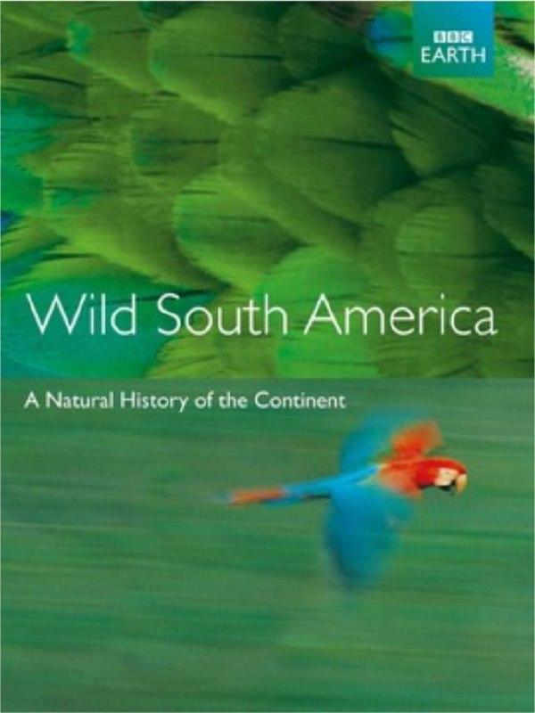

---

## 齐心协力三冠王

[2026-10-29 14:19] 来自：综合网盘资源频道

名称：齐心协力：三冠王 Together：Treble Winners (2024)

描述：这部系列纪录片回顾了曼城足球俱乐部空前绝后的 2022-23 赛季，见证蓝色军团赢得史无前例的三连冠。

夸克网盘：https://pan.quark.cn/s/93715a0e438d

阿里云盘：https://www.alipan.com/s/jXN5LvuRh3y

📁 大小：NG

🏷 标签：#纪录片 #运动 #齐心协力 #三冠王 #quark #ali

---

## 卡洛斯阿尔卡拉斯我的网球之道

[2026-10-29 12:10] 来自：影视动漫分享|SeedHub|夸克|网盘|🧲

名称：卡洛斯·阿尔卡拉斯：我的网球之道 (2025)

#电视剧 #纪录片 #夸克

主演: 卡洛斯·阿尔卡拉斯 

豆瓣: [8.2](https://movie.douban.com/subject/37271014/)

这部纪录片剧集跟拍卡洛斯·阿尔卡拉斯，了解他如何平衡辉煌网球事业带来的压力与20岁的年轻人所渴望的放松与自由。..

夸克网盘：https://pan.quark.cn/s/c166004313e9

---

## 马修派瑞老友最后的传记

[2026-10-27 16:40] 来自：综合网盘资源频道

名称：马修·派瑞：老友最后的传记 The One About Matthew Perry (2026) 【更新至03集全】【1080p】【内嵌中英字幕】【网飞纪录片】

描述：纪录片主要聚焦于亲友的私密讲述，派瑞的妹妹米娅·派瑞·鲍威克是这部纪录片的主要配音演员，片中还收录了派瑞家族档案馆中从未公开过的照片和视频。这部纪录片回顾了凭借钱德勒这一经典角色成为备受喜爱的喜剧明星的历程，也直面了他药物与酒精成瘾的隐秘挣扎。

链接：

夸克网盘：https://pan.quark.cn/s/3a5631ee6996

📁 大小：NA

🏷 标签：#纪录片 #传记 #马修 #派瑞 #老友最后的传记 #马修·派瑞 #quark

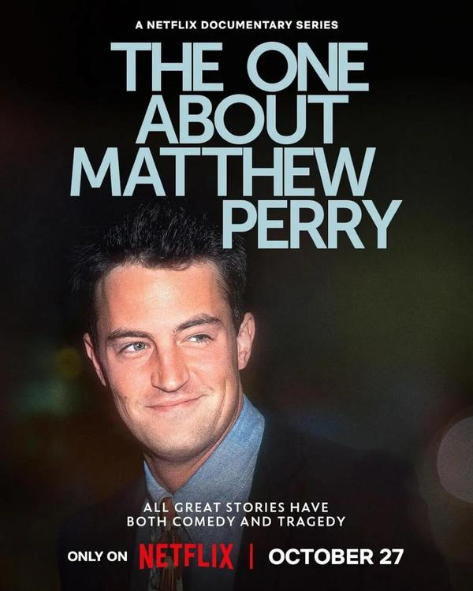

---

## 生死航班

[2026-10-27 14:50] 来自：纪录片资源频道

名称：生死航班 (2022) 4K HDR 外挂中文字幕

描述：8月28日早上，尾皆航空JD5759北京—澳门航班，机组9人，旅客157人，正在澳门机场下降时，疑似遭受风切变，备降深圳机场。 迫降齐程：11面16分：正在澳门机场落天未乐成，机组申请备降深圳机场，发布MAYDAY状况（松要状况）、开应问机7700，申报左发战起落架妨碍。 11面58分：正在34号跑讲落天，后发明前起落架2个轮胎悉数缺失落，飞机正在跑讲上松要疏集旅客。 12面13分：旅客撤离终了，撤离中5名旅客身体没有适送医院搜检。

夸克网盘：https://pan.quark.cn/s/96f6d1638ee4

📁 大小：10.41GB

🏷 标签：#纪录片 #生死航班

---

## 河西走廊

[2026-10-27 11:24] 来自：综合网盘资源频道

名称：河西走廊 (2015)

描述：《河西走廊》是一部由中共甘肃省委宣传部、中央电视台科教频道联合出品，北京伯璟文化传播有限公司承制的十集系列纪录片。该片以位于中国西部的重要通道，丝绸之路的黄金段——河西走廊为讲述对象，从政治、军事、经济、文化、宗教等多角度呈现了从汉代开始直至今天，河西走廊及其连接的中国 西部 的历史，以及它对中国历史和文明进程中所发挥的独特作用。“河西走廊关乎国家经略”是贯穿全篇的主题。

夸克网盘：https://pan.quark.cn/s/5436788a5b13

阿里云盘：https://www.alipan.com/s/J47LJGu8NvY

📁 大小：NG

🏷 标签：#纪录片 #河西走廊 #quark #ali

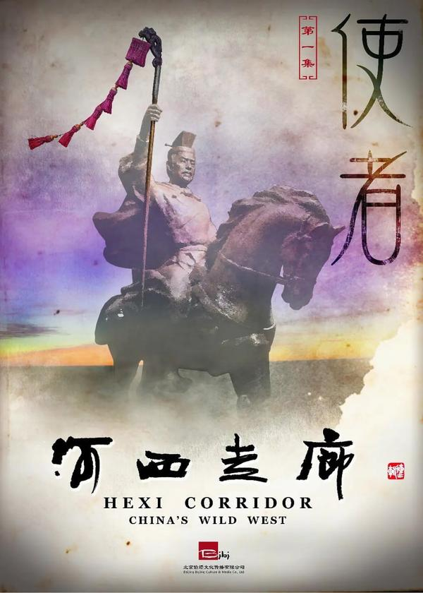

---

## 狂野巴西

[2026-10-27 09:46] 来自：纪录片资源频道

名称：狂野巴西 (2014) 1080P 全3集 中字硬字幕

描述：这里有最壮丽最秀美的风景，这里有数量庞大的野生动物。季节更替，季风带来雨水，也带来勃勃生机。动物们在这里繁衍、成长，面对洪水、忍受干旱。这里是一片充满活力的大陆，这里是它们的家。让我们跟着镜头一起，进入这个神奇的国度。领略自然的魅力，感受野性的巴西。

夸克网盘：https://pan.quark.cn/s/75c928eac277

📁 大小：13.1GB

🏷 标签：#纪录片 #狂野巴西 #猪儿虫

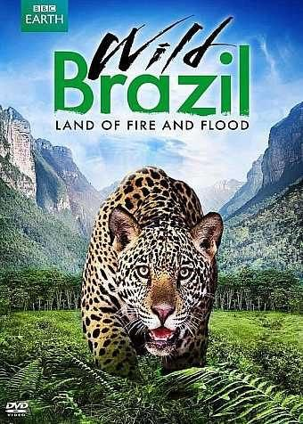

---

## 掬水月在手

[2026-10-26 23:43] 来自：纪录片资源频道

名称：掬水月在手 (2020) 4K 高码 60帧

描述：《掬水月在手》记录了中国古典诗词大师叶嘉莹（1924-）传奇的人生。她一生历经战乱、政治迫害、海外飘零，晚年回归改革开放的中国，持续创作、传承教学，重系文革中断的古典诗词命脉。影片交织了叶嘉莹个人生命和千年中国古典诗词，表现她在诗词长河中寻求存在的意义轨迹。《杜甫〈秋兴〉八首集说》为叶嘉莹最重要的研究代表作，〈秋兴〉八首描绘中国盛唐兴衰，本片借此隐喻叶先生经历的动荡岁月，并邀请音乐家佐藤聪明以〈秋兴〉八首为本，结合雅乐及现代乐，创作电影音乐，为杜甫诗歌带来新的生命。

夸克网盘：https://pan.quark.cn/s/c41d9d953828

📁 大小：21.1GB

🏷 标签：#纪录片 #传记 #掬水月在手

---

## 海狼之岛

[2026-10-26 23:43] 来自：纪录片资源频道

名称：海狼之岛 (2022) 1080P HDR 全3集 外挂简英双语字幕

描述：探索狂野又奇妙的温哥华岛。在这里，从捕鱼的白头海雕到遨游在冰冷水域到海狼，海洋孕育万物生灵。

夸克网盘：https://pan.quark.cn/s/0725547978cf

📁 大小：5.85GB

🏷 标签：#纪录片 #海狼之岛 #NF

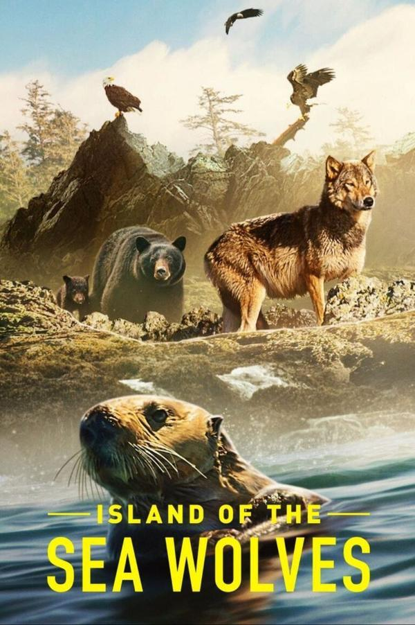

---

## 比尔拉塞尔传奇中锋

[2026-10-26 23:39] 来自：纪录片资源频道

名称：比尔·拉塞尔：传奇中锋 (2023) 4K HDR 全2集 内封简繁字幕

描述：在这部传记纪录片中，美国职业篮球联赛总冠军数量最多的球员兼民权运动领袖比尔·拉塞尔在球场内外均创下传奇功勋。

夸克网盘：https://pan.quark.cn/s/46d709ddb7d2

📁 大小：23.9GB

🏷 标签：#纪录片 #传记 #运动 #比尔·拉塞尔：传奇中锋

---

## 黎明墙

[2026-10-26 13:31] 来自：综合网盘资源频道

名称：黎明墙 (2017)【1080p 原盘REMUX】【内封简繁】【纪录片/冒险】

描述：豆瓣9.3高分

讲述两名男子徒手征服“世界最难攀登绝壁”黎明墙的经历，热血沸腾鼓舞人心[并不简单] 2015年1月，Tommy Caldwell和Kevin Jorgeson开始攀登，两人在陡峭的垂直悬崖上生活了数周，引发了全球媒体的狂热关注。对Caldwell来说，这不仅仅是一次攀登，也是证明自己的强大之处的机会：22岁时，Caldwell被吉尔吉斯斯坦叛军挟持为人质，不久后他在一次事故中失去食指。两人耗时将近20天，成功登顶加利福利亚约塞米蒂国家公园的埃尔卡皮坦山，创下了徒手攀上黎明墙的世界纪录。 在此之前，两人花费了6年的时间规划路线，于2010和2011年两次尝试攀爬，均以失败告终。1958年首次有人征服黎明墙，目前约有100多条攀登路线，但从未有人徒手登顶。奥巴马也曾在两人成功后表示祝贺，称“一切皆有可能”。

夸克网盘：https://pan.quark.cn/s/ce6d8ae66dbd

百度网盘：https://pan.baidu.com/s/1Xm8im5aCk3dN2qra_Z0Gvw?pwd=Yu88

迅雷网盘：https://pan.xunlei.com/s/VP4qfKJ1_B-Bf_sgkIrZ-5sJA1?pwd=jj6d

光鸭云盘：https://www.guangyapan.com/s/1961688218236342337_aeWw8Ru726g3wcPx

📁 大小：16.5GB

🏷 标签：#冒险 #黎明墙 #1080p #原盘REMUX #内封简繁 #纪录片 #quark #baidu #xunlei #guangyapan

---

## 北极熊

[2026-10-25 22:41] 来自：纪录片资源频道

名称：北极熊 (2022) 4K HDR 外挂简英双语字幕

描述：讲述一只初为熊母的北极熊带孩子的故事，在这个日益艰难的世界中，年幼时的记忆帮助如今的它做好当母亲的准备，每一天都是新的冒险。

夸克网盘：https://pan.quark.cn/s/5d03ee726f33

📁 大小：13.1GB

🏷 标签：#纪录片 #北极熊

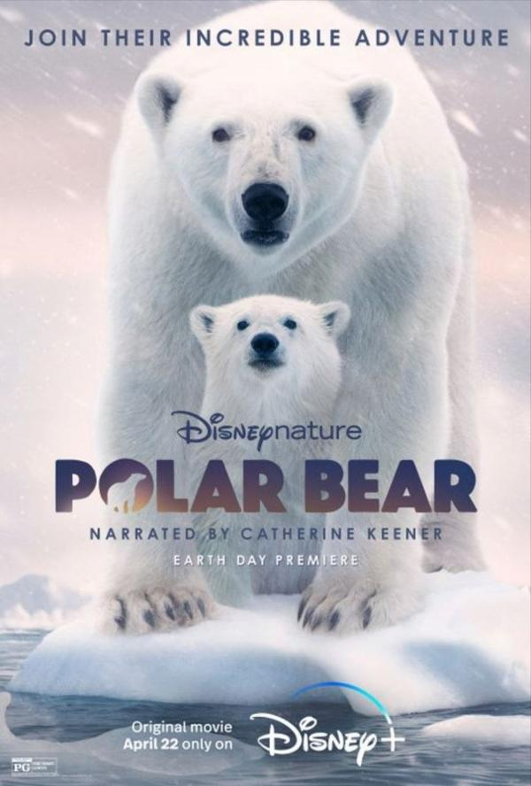

---

## 我们的故宫

[2026-10-25 12:10] 来自：影视动漫分享|SeedHub|夸克|网盘|🧲

名称：我们的故宫 (2025)

#电视剧 #纪录片 #夸克 #百度

主演: 张扬 王旭东 吴志华 

豆瓣: [0](https://movie.douban.com/subject/37650025/)

2025年故宫博物院迎来建院百年，本片通过新华社记者张扬的视角，记录这座从帝王宫殿走向人民博物馆的紫禁城在百年节点上的全新面貌：镜头见证数字技术让文物跨越宫墙栖身方..

夸克网盘：https://pan.quark.cn/s/6168b3ad8b5c

百度网盘：https://pan.baidu.com/s/1lFtGbXGAqesd4i0Qc8_8MQ?pwd=98vg

---

## 怪物工厂

[2026-10-24 22:35] 来自：纪录片资源频道

名称：怪物工厂 (2023) 4K HDR 全6集 内封简中字幕

描述：该剧讲聚焦职业摔角培训机构「怪物工厂」，讲五个摔角手努力进入WWE的故事。

夸克网盘：https://pan.quark.cn/s/c968f72186d7

📁 大小：34.1GB

🏷 标签：#纪录片 #运动 #怪物工厂

---

## 地球神奇的一天

[2026-10-24 22:32] 来自：纪录片资源频道

名称：地球：神奇的一天 (2017) 4K HDR 外挂简中字幕

描述：曾成功推出电影《地球》的BBC地球影业带来了令人期待已久的续集——《地球：神奇的一天》，一段揭示自然界惊人力量的神奇旅程。一天内，我们跟随太阳的脚步从世界上最高的山到最远的岛、从野外的丛林走到繁华的城市。由于在电影制作技术上取得的惊人突破，从而我们可以让你能与一群难忘的角色亲密接触；幼年的斑马宝宝想要穿过一条湍急的河流， 英勇的企鹅爸爸每天都要从事一项与大海以性命相搏的工作来抚养家人，一个喜欢在大海里垂直着打瞌睡的抹香鲸家族，还有走在寻找真爱路上的树懒。

夸克网盘：https://pan.quark.cn/s/ca63f8053b8d

📁 大小：22.28GB

🏷 标签：#纪录片 #地球：#神奇的一天

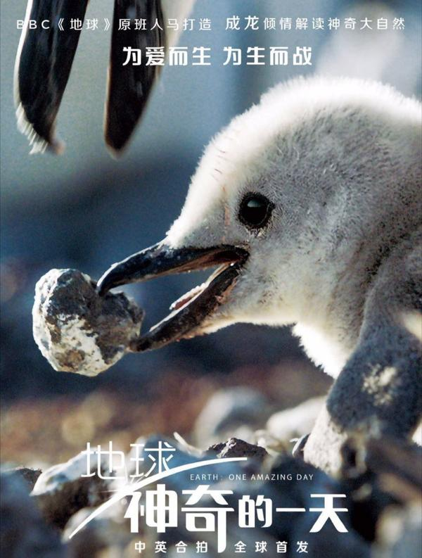

---

## 食贫道B站充电专属视频合集

[2026-10-24 16:31] 来自：综合网盘资源频道

名称：食贫道《B站充电专属视频合集》 (更20261023-《柬埔寨电诈Reaction)

描述：B站UP主食贫道高质量纪录片，跟随饼叔一起看看不一样的世界，体验不同地域的风土人文。

夸克网盘：https://pan.quark.cn/s/db984532e128

📁 大小：N/A

🏷 标签：#人文社科 #纪录片 #食贫道 #B站充电专属视频合集 #更20261023 #柬埔寨电诈Reaction #quark

---

## 海底大揭秘

[2026-10-23 22:27] 来自：纪录片资源频道

名称：海底大揭秘 (2018) 1080P 全10集 外挂简中字幕

描述：《海底大揭秘》揭开了我们的大海里隐藏的秘密和失落的世界。这一创新系列运用突破性的技术、惊险的摄影和顶级海洋考古学家的评论，对人类文明的史诗和地球本身的深层历史提供了深刻的新见解，揭露了沉没的城市、沉船、宝藏和深海令人惊叹的自然奇观。从中国海、墨西哥湾和地中海，到尼罗河、波罗的海和大西洋，这个系列将解释船只是如何沉没的，现代科技如何在充满挑战的气候中运作，古代地质构造可以告诉我们地球上的生命，纳粹的秘密可能在哪里，以及为什么对亚特兰蒂斯的搜索还在进行。以墨西哥湾为例，本纪录片绘制贸易、奴隶制、战争和石油工业的图表，以证明北美的故事只能通过观察海浪来理解；中国海下面藏着有史以来最大战舰的残骸，环太平洋地区的勘探则揭示了破坏性自然灾害背后的致命地质力量，并提供了下一个“大”战舰可能于何时何地出击的线索。

夸克网盘：https://pan.quark.cn/s/f44a78f2b0f7

📁 大小：34.8GB

🏷 标签：#纪录片 #海底大揭秘 #AMZN

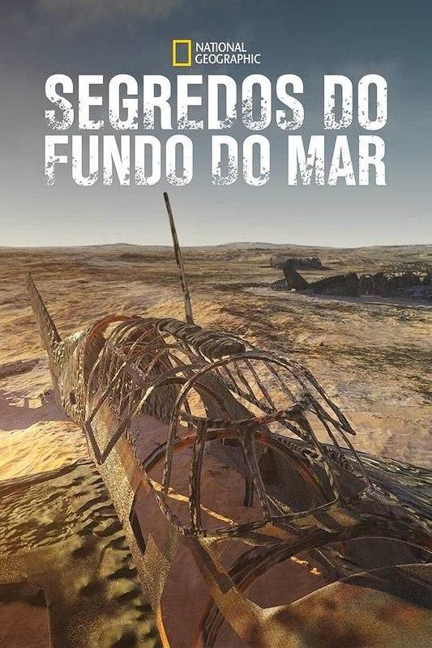

---

## 再会长江

[2026-10-23 22:25] 来自：纪录片资源频道

名称：再会长江 (2024) 4K

描述：十年前，竹内亮导演在NHK拍摄纪录片《长江天地大纪行》时留下了一个遗憾：未能拍摄到“长江源头的第一滴水”。十年后，迁居中国南京的他决心弥补这一遗憾。经过两年的精心准备，他在2021年再次踏上了6300公里的长江之旅，与旧友们重逢。竹内亮的镜头下，不仅有壮美的自然风光，更有普通百姓的朴实笑容和令人潸然泪下的动人故事。他捕捉了长江沿岸的风土人情和百姓的真实生活，展现了中国经济腾飞后的十年巨变。作为在中国生活近十年的外国人，竹内亮导演在完成十年之约的同时，也希望让世界看到真实的中国人、真实的中国。电影版由竹内导演的重新剪辑，将带给观众全新的视听体验。

夸克网盘：https://pan.quark.cn/s/e79cccc4529f

📁 大小：22.4GB

🏷 标签：#纪录片 #再会长江

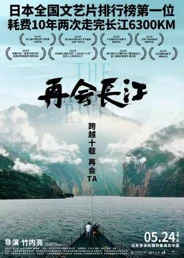

---

## 我的美食向导

[2026-10-23 13:59] 来自：综合网盘资源频道

名称：我的美食向导 第二季(2026)4K 10bit 50FPS 更至EP04

描述：六座城市，六种活法。乐山、天津、上海、拉萨、北海、漳州——陈晓卿带着李诞、罗永浩、王笛、曹雨、高文麒，开启新一轮美食探索之旅。真正定义一个地方的，从来不是那些声名远播的符号，而是烟火人间寻常巷陌。《我的美食向导》第二季，每一口都值得你停下。

夸克网盘：https://pan.quark.cn/s/854889f70627

百度网盘：https://pan.baidu.com/s/1gkAQKAk1nRfW9XE4xIhSfA?pwd=5c3h

📁 大小：6.4G

🏷 标签：#我的美食向导 #纪录片 #4K #10bit #50FPS #quark #baidu

---

## 最后的棒棒

[2026-10-22 22:48] 来自：纪录片资源频道

名称：最后的棒棒 (2018) 1080P 全13集

描述：改革开放之初，山城重庆特殊的地理环境孕育了一个特殊的行业——山城棒棒军。爬坡上坎，负重前行的三十多年，数十万棒棒大军不仅挑走了汗水浸泡的年华，也挑走了属于自己的年代。癸巳岁末，几个佝偻背影即将道别正在消逝的行业，一名退役中校扛起一根棒棒开始了自己的追寻——辉煌与尴尬，艰韧和无奈，他们的人生无须评说，他们的故事值得铭记。

夸克网盘：https://pan.quark.cn/s/c5906ee90b67

📁 大小：7.6GB

🏷 标签：#纪录片 #最后的棒棒

---

## 七个世界一个星球

[2026-10-22 22:46] 来自：纪录片资源频道

名称：七个世界一个星球 (2019) 4K HDR 全7集 中英外挂字幕

描述：从郁郁葱葱的南美洲丛林深处到冰雪覆盖的亚洲山峦之巅，从欧洲熙熙攘攘的都市到非洲的广袤平原，《七个世界 一个星球》将开启一次七大洲之旅，呈现匪夷所思的动物行为，讲述鲜为人知的动物故事。我们将探索在这七个世界，丰富多样的生命如何在地球上生长繁衍，同时揭示在人类主导的世界，动物们所面临的不同挑战。

夸克网盘：https://pan.quark.cn/s/bbb884de8706

📁 大小：65.4GB

🏷 标签：#纪录片 #BBC #七个世界一个星球

---

## 卡曼家族死亡谜案

[2026-10-22 21:40] 来自：综合网盘资源频道

名称：卡曼家族死亡谜案  (2025) 中文字幕 1080P

描述：内森・卡曼是一名年轻男子，他与母亲琳达在新英格兰海岸附近捕鱼后，独自在救生筏上存活了一周，而母亲则在海上失踪。这起轰动性事件重新唤起了人们对多年前卡曼那位富有的祖父遭人谋杀且案件至今未破的关注，引发媒体狂热报道、巨额家族财产争夺战、多起调查，最终联邦政府以公海谋杀罪对卡曼提起指控。影片前所未有地接触到卡曼的家人、朋友及调查人员，作为一部航海惊悚片，它深入探索了关于家庭、贪婪、认知、心理健康的人性隐秘谜题，以及这位神秘年轻人难以捉摸的内心世界。

夸克网盘：https://pan.quark.cn/s/b332190beeb3

📁 大小：3.1G

🏷 标签：#犯罪 #惊悚 #纪录片 #卡曼家族死亡谜案 #中文字幕 #1080P #quark

---

## 缅北电诈覆灭纪实

[2026-10-22 01:36] 来自：肯德基の4K影视综合电影云盘站

名称：缅北电诈覆灭纪实 (2026) 哔哩哔哩 1080p 高码率 3集全

描述：纪录片全面展现了中国公安机关会同有关部门开展打击缅北电诈集团犯罪专项工作、彻底铲除缅北“四大家族”及明家等犯罪集团的历程。全片共分三集。

夸克网盘：https://pan.quark.cn/s/41241e1e1b48

百度网盘：https://pan.baidu.com/s/18MuhmWU858xV7IUiqZCdVw?pwd=84z4

📁 大小：NG

🏷 标签：#纪录片 #缅北电诈覆灭纪实

---

## 本草中华

[2026-10-21 23:07] 来自：综合网盘资源频道

名称：本草中华 第二季 (2019) 1080P 全6集

描述：“躬行大地、翻山越岭、只为遇见疗愈生命的中国智慧。” 纪录片《本草中华》由国药大师金世元提供专业指导，讲述中草药的生命轮回和中国人的处世智慧。由创造纪录片收视传奇云集将来传媒团队倾力打造，走向远方倾听本草的故事，只为回归初心，理解生命的本真。《刚柔》、《轻重》、《黑白》、《进退》、《新陈》、《甘苦》，这是本草的哲学，也是我们与这个世界相处的方式。草木以仰望的姿态，洞悉人间，参透山川的密语，将万物点化融合，这是我们的先辈交还给自然的答案。

阿里云盘：https://www.alipan.com/s/Xc3tPzhvmvX

夸克网盘：https://pan.quark.cn/s/edd4c546c946

百度网盘：https://pan.baidu.com/s/11vnhBmy1a9CCyWVagg9VVQ?pwd=o1f8

📁 大小：3.3GB

🏷 标签：#本草中华 #纪录片 #1080P #ali #quark #baidu

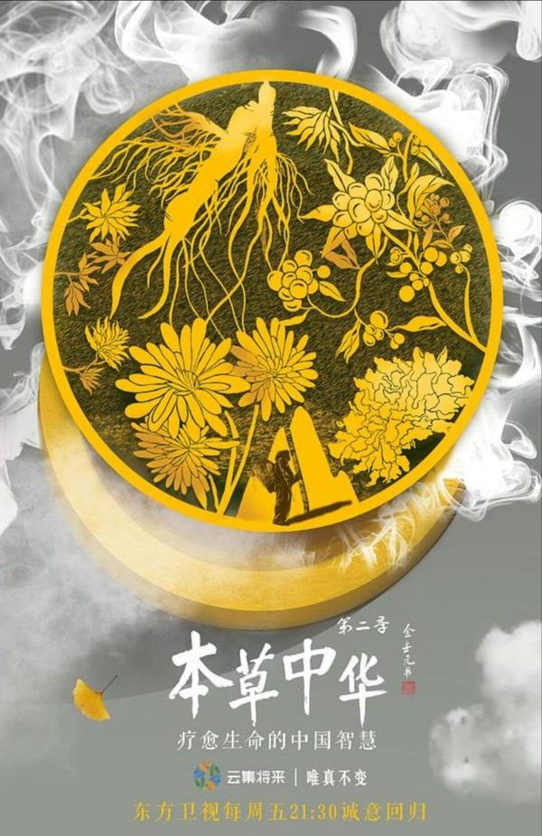

---

## 人生七年

[2026-10-21 21:51] 来自：综合网盘资源频道

名称：人生七年 合集

描述：本部纪录片是导演迈克尔·艾普特从1964年开始拍摄的纪录片系列的第一部。迈克尔·艾普特在1964年为英国BBC电视台拍摄了记录片《7 Up》，采访来自英国不同阶层的十四个七岁的小孩子，他们有的来自孤儿院有的是上层社会的小孩。此后每隔七年，艾普特都会重新采访当年的这些孩子，倾听他们的梦想，畅谈他们的生活。人生的轮回从这十四个七岁的孩子真实生活开始，他们天真无邪的脸上写满对生活的憧憬和渴望。“七岁看老”，在这童言无忌的问与答中，人生七年又七年，震撼上演。

1964年，导演迈克尔·艾普特首拍此纪录片时，还是只是个助手。此后在他的不断努力下，积累了丰富的拍摄经验，成为知名导演。

夸克网盘：https://pan.quark.cn/s/e1a1ef3cba73

迅雷网盘：https://pan.xunlei.com/s/VP4Ob6PO47Uk8uiILruKtH0tA1?pwd=id89

📁 大小：AA

🏷 标签：#纪录片 #人生七年 #合集 #quark #xunlei

---

## 我的美食向导

[2026-10-21 19:37] 来自：肯德基の4K影视综合电影云盘站

名称：我的美食向导 第二季（2026）4K 10bit 50FPS 更至EP02

描述：六座城市，六种活法。乐山、天津、上海、拉萨、北海、漳州——陈晓卿带着李诞、罗永浩、王笛、曹雨、高文麒，开启新一轮美食探索之旅。真正定义一个地方的，从来不是那些声名远播的符号，而是烟火人间寻常巷陌。《我的美食向导》第二季，每一口都值得你停下。

夸克网盘：https://pan.quark.cn/s/854889f70627

百度网盘：https://pan.baidu.com/s/1gkAQKAk1nRfW9XE4xIhSfA?pwd=5c3h

📁 大小：3.8G

🏷 标签：#我的美食向导 #纪录片

---

## 我的美食向导

[2026-10-21 15:23] 来自：综合网盘资源频道

名称：我的美食向导 (2023)【8集全】【4K.HLG UHDTV】【高码率】【纪录片/美食】

描述：本节目是陈晓卿导演从摄影机背后走到镜头前，用自己的视角，寻访美食，并探讨食物背后的故事。在本节目中，陈晓卿前往中国八个不同的地区，他和不同的向导一起，完成自己的风味探索之旅。向导中，有陈晓卿的老朋友，也有新相识。他们背景身份各异，有哲学家、考古学者、人类学家、 音乐人、职业厨师、经济学家、作家等。陈晓卿用食物把更多的人聚集在一起，他认为，“美食不仅是美味，更是一种粘合剂，能让人有更多的理解和沟通”。

夸克网盘：https://pan.quark.cn/s/e8fe8ae93429

📁 大小：98.7GB

🏷 标签：#纪录片 #我的美食向导 #4K #高码率 #quark

---

## 猎捕

[2026-10-21 11:46] 来自：纪录片资源频道

名称：猎捕 (2015) 1080P 全7集 外挂简英双语字幕

描述：David Attenborough再次联合BBC推出全新纪录片，由《行星地球》团队倾力打造，全方位展现动物在觅食过程中的戏剧性一刻，并首次披露南美水濑，座头鲸的猎食行为，更借用了电影、戏剧中的片段，力求给观众一个具有说服力的印象。摄制组的足迹遍布雨林，冻土层，海洋，草原，极地，典型生态环境一网打尽，还记录了各路科学家以及环保人士对保护濒危动物所做出的努力。

夸克网盘：https://pan.quark.cn/s/b3acb2943b07

📁 大小：47.6GB

🏷 标签：#纪录片 #捕猎 #BBC

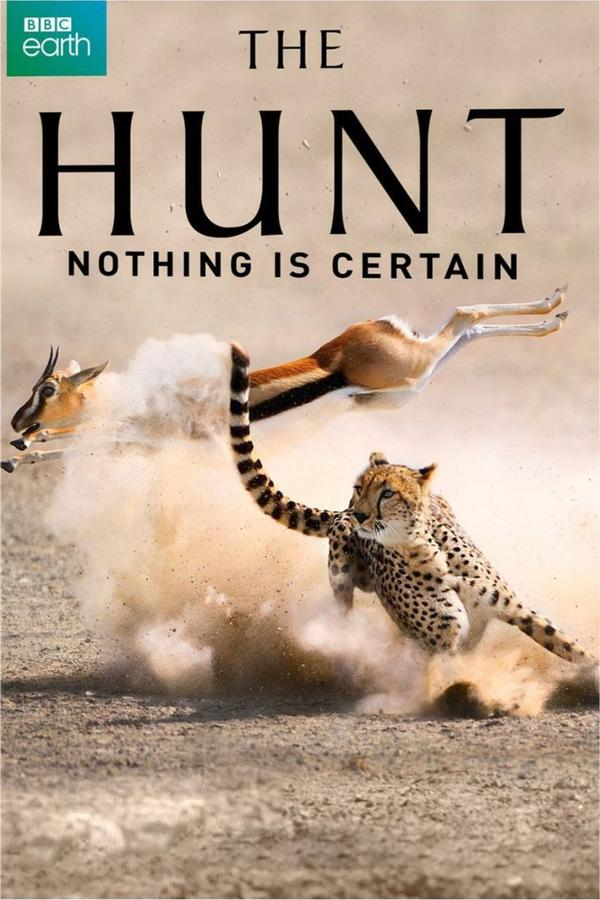

---

## 野性加拿大

[2026-10-21 11:45] 来自：纪录片资源频道

名称：野性加拿大 (2014) 1080P 外挂简英双语字幕

描述：野生加拿大从备受赞誉的系列电影《人类星球和地球》的制片人来到野生加拿大，这个壮观的五部分系列的野生动物和加拿大的荒地揭示了一个很少有人见过的加拿大。在这个系列的基础上，是一个史诗般的叙事穿越时间和加拿大的景观的广阔规模，提供了令人兴奋的新故事的植物和野生动物的加拿大。新的研究表明，加拿大许多独特而令人惊叹的自然景观是古代人类活动的直接结果。每一集都讲述了两个平行的故事: 加拿大的自然历史，以及过去的人类如何塑造了加拿大的风景，以及我们今天看到的野生动物奇观。

夸克网盘：https://pan.quark.cn/s/ba2a7c32e87f

📁 大小：17.4GB

🏷 标签：#纪录片 #野性加拿大

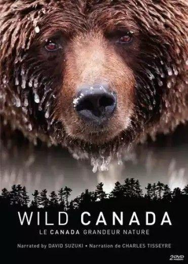

---

## 本草中华

[2026-10-20 20:39] 来自：综合网盘资源频道

名称：本草中华 第一季 (2017) 4K 全6集

描述：中医药学凝聚着深邃的哲学智慧和中华民族几千年的健康养生理念及其实践经验，是中国古代科学的瑰宝，也是打开中华文明宝库的钥匙。《本草中国》系列纪录片围绕“感动生命的奥义”的宏大主题，以"中国非物质遗产中药炮制技术及中药传统制剂方法传承人"为灵魂展开，引领观众走入神秘传奇的中药世界，通过起源悠久的中医药这一窗口，探讨中华文明中有关"生"的奥义。该片将以“中国人生存、生活、生息的视角和方式”层层递进，解读博大精深的中医药文化，通过挖掘整理民间医药知识和技术提升国人对中医药的认识，进一步推进中医药文化的继承与创新。

阿里云盘：https://www.alipan.com/s/Sk9zbVHKh1K

夸克网盘：https://pan.quark.cn/s/355449d7be68

百度网盘：https://pan.baidu.com/s/1bm8Tod6axa_93EoTPXIFYA?pwd=n1wm

📁 大小：6.8GB

🏷 标签：#本草中华 #纪录片 #4K #ali #quark #baidu

---

## Norm诺曼麦克唐纳徳的故事

[2026-10-20 16:20] 来自：综合网盘资源频道

名称：Norm：诺曼·麦克唐纳徳的故事 Norm：The Tale of Norm MacDonald (2026)

描述：这部纪录片带我们入了解冷面幽默大师诺姆·麦克唐纳，他的人生和职业生涯既坚持原则、决不妥协，又充满反差和矛盾。

夸克网盘：https://pan.quark.cn/s/f91b4b6274e4

阿里云盘：https://www.alipan.com/s/3FszfnN1GWy

📁 大小：NG

🏷 标签：#纪录片 #传记 #诺曼·麦克唐纳徳的故事 #quark #ali

---

## 野性生灵

[2026-10-19 22:38] 来自：百度网盘综合频道

名称：野性生灵 (2025) 4K 杜比视界 全6集 内封简繁英字幕

描述：与三位专家一起探索地球的隐秘角落，努力拯救六种濒临灭绝的物种。凭借精湛的摄影技巧和丰富的生存技能，团队争分夺秒地寻找、记录并保护这些行踪不定的生物，以免为时已晚。

百度网盘：https://pan.baidu.com/s/1hIYCZWLvDnf4SMlSWF10ag?pwd=w813

📁 大小：42.2GB

🏷 标签：#野性生灵 #纪录片 #苹果

---

## 死无止境阿根廷贵妇命案

[2026-10-19 22:33] 来自：综合网盘资源频道

名称：死无止境：阿根廷贵妇命案 (2025) 1080P 全3集 简中硬字幕

描述：聚焦2006年发生在阿根廷里奥夸尔托市(Río Cuarto)的真实谋杀悬案。51岁的上流社会主妇诺拉·达尔马索(Nora Dalmasso)被发现陈尸于家中，死状凄惨。该案因牵涉复杂的DNA证据、媒体的荡妇羞辱以及长达十多年的司法混乱而轰动全国。

阿里云盘：https://www.alipan.com/s/WdjFzh7YuWw

夸克网盘：https://pan.quark.cn/s/1c6fa12cba1b

百度网盘：https://pan.baidu.com/s/1sylZxnrjxQa_hbyw-XePuw?pwd=2972

📁 大小：4.7GB

🏷 标签：#死无止境 #阿根廷贵妇命案 #纪录片 #犯罪 #NF #1080P #简中硬字幕 #ali #quark #baidu

---

## 伊甸园最后的秘境

[2026-10-19 22:29] 来自：综合网盘资源频道

名称：伊甸园：最后的秘境 (2021) 4K 全7集 简英双语硬字幕

描述：遍寻天涯海角，前往地球上仅存的几处未经开垦的土地，探索它们的秘密，与蓬勃生机。纪录片将带领观众前往地球上的遥远角落，揭示仅存的几片人类未踏足土地的奥秘。这些角落与世隔绝，物种丰富，远离人类的干扰与破坏，自由生长。本片也同时反映了这些稀有、珍贵且独特的环境在现代世界生存将面临的威胁和挑战。

阿里云盘：https://www.alipan.com/s/UuTWR5fK5vp

夸克网盘：https://pan.quark.cn/s/2f0d72249629

百度网盘：https://pan.baidu.com/s/16chGuKEZhNDrcrO_d-4tiQ?pwd=q33x

📁 大小：33.3GB

🏷 标签：#伊甸园 #最后的秘境 #纪录片 #4K #简英双语硬字幕 #ali #quark #baidu

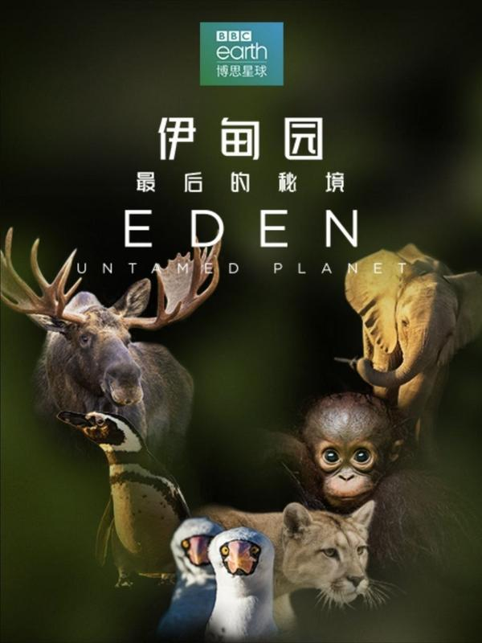

---

## 阿波罗11号

[2026-10-19 21:54] 来自：电影资源频道(4K、REMUXE/原盘)

名称：【原盘】阿波罗11号 (2019) 4K REMUX 外挂简中字幕

描述：阿波罗11号是“阿波罗计划”第五次载人任务，尼尔·阿姆斯特朗与巴兹·奥尔德林成为了首次踏上月球的人类。阿波罗11号小飞船降落在月表静海附近，阿姆斯特朗向指挥中心报告。两人在月球表面活动了两个半小时，使用钻探取得了月芯标本，拍摄了一些照片，采集了22千克的阿波罗11号的成功，标志着美国在太空竞赛中的胜利，也完成了此前肯尼迪总统做出的承诺——美国会在1970年之前将宇航员送上月球并成功返回。

夸克网盘：https://pan.quark.cn/s/4c822e0baff5

📁 大小：53.2GB

🏷 标签：#纪录片 #历史 #阿波罗11号

---

## 阿波罗11号

[2026-10-19 20:15] 来自：综合网盘资源频道

名称：【原盘】阿波罗11号 (2019) 4K REMUX 外挂简中字幕

描述：阿波罗11号是“阿波罗计划”第五次载人任务，尼尔·阿姆斯特朗与巴兹·奥尔德林成为了首次踏上月球的人类。阿波罗11号小飞船降落在月表静海附近，阿姆斯特朗向指挥中心报告。两人在月球表面活动了两个半小时，使用钻探取得了月芯标本，拍摄了一些照片，采集了22千克的阿波罗11号的成功，标志着美国在太空竞赛中的胜利，也完成了此前肯尼迪总统做出的承诺——美国会在1970年之前将宇航员送上月球并成功返回。

阿里云盘：https://www.alipan.com/s/sk1jKmD2Xe1

夸克网盘：https://pan.quark.cn/s/4c822e0baff5

百度网盘：https://pan.baidu.com/s/1y6zwW6gypIvCxIcaYnPECA?pwd=o897

📁 大小：53.2GB

🏷 标签：#纪录片 #历史 #阿波罗11号 #原盘 #4K #REMUX #外挂简中字幕 #ali #quark #baidu

---

## 入室弟子

[2026-10-19 15:37] 来自：综合网盘资源频道

名称：入室弟子 The Disciple：A Wu-Tang Fable (2026)

描述：这部纪录片讲述了 Cilvaringz 如何从歌迷出人意料地成为武当帮一员而声名鹊起，同时揭秘了那张名声不佳的专辑《少林往事》的诞生始末。

夸克网盘：https://pan.quark.cn/s/27f3903f2326

阿里云盘：https://www.alipan.com/s/pLm48o7FLjG

📁 大小：NG

🏷 标签：#纪录片 #音乐 #入室弟子 #quark #ali

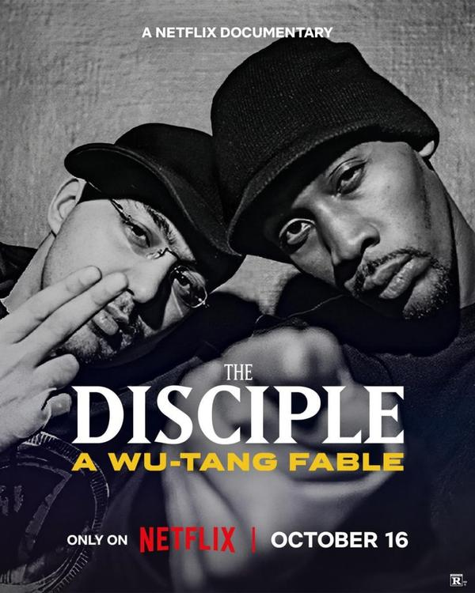

---

## 大象

[2026-10-19 15:18] 来自：纪录片资源频道

名称：大象 (2020) 4K HDR & Dv 国粤英多音轨 内封简繁英字幕

描述：大象（又名《非洲大象》《大象的世界》、《万象之家》）是一部由马克·林菲尔德和凡妮莎·贝洛维兹共同执导的美国自然纪录片，讲述了非洲大象Shani和她充满活力的儿子Jomo（亦作Joao）跟随大象家族穿越卡拉哈里沙漠寻找绿洲的史诗旅程。

夸克网盘：https://pan.quark.cn/s/48d53c99a348

百度网盘：https://pan.baidu.com/s/1jnk2dIjFGIiaJRMqsJksyA?pwd=9jlv 来自：百度网盘综合频道 [2026-10-19 15:17] 名称：大象 (2020) 4K HDR & Dv 国粤英多音轨 内封简繁英字幕

📁 大小：10.3GB

🏷 标签：#大象 #纪录片 #迪士尼

---

## 菲托帕兹歌中的世界

[2026-10-19 12:10] 来自：影视动漫分享|SeedHub|夸克|网盘|🧲

名称：菲托·帕兹：歌中的世界 (2026)

#电影 #纪录片 #夸克

主演: 

豆瓣: [0](https://movie.douban.com/subject/38412897/)

2024年的一场意外，让驰骋乐坛四十余年的阿根廷摇滚巨匠菲托・派斯被迫中止环球巡演，命运按下暂停键，也促成这场向内的回望之旅。导演作为他多年挚友，得以获得前所未有的..

夸克网盘：https://pan.quark.cn/s/6fbc388ae77c

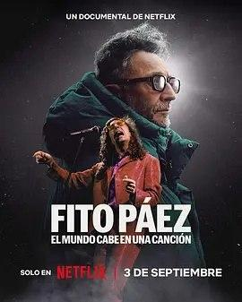

---

## 入室弟子

[2026-10-19 10:43] 来自：肯德基の4K影视综合电影云盘站

名称：入室弟子（2026）NF DV&HDR 内封官中

描述：这部纪录片讲述了 Cilvaringz 如何从歌迷出人意料地成为武当帮一员而声名鹊起，同时揭秘了那张名声不佳的专辑《少林往事》的诞生始末。

百度网盘：https://pan.baidu.com/s/1lCLQVW-bEoSDTOVdmYPpyg?pwd=437x

夸克网盘：https://pan.quark.cn/s/fd44ac58df6f 来自：综合网盘资源频道 [2026-10-19 10:41] 名称：入室弟子(2026)NF DV&HDR 内封官中

📁 大小：14.8G

🏷 标签：#入室弟子 #武当帮门徒 #纪录片 #音乐

---

## 年画画年

[2026-10-18 22:35] 来自：综合网盘资源频道

名称：年画·画年 (2021) 1080P 全7集

描述：该片聚焦中国人春节最强烈的图像元素——年画，在中国人千年文脉的传承中，以烟火气的表达讲述民间优秀传统文化故事，展现年画独特的魅力和跨时代的意义。

阿里云盘：https://www.alipan.com/s/s979pRZ625P

夸克网盘：https://pan.quark.cn/s/af31f646a016

百度网盘：https://pan.baidu.com/s/1sahX8IbM9mNYnD1_QDBmXg?pwd=0p1q

📁 大小：9GB

🏷 标签：#年画 #画年 #纪录片 #年画·画年 #1080P #ali #quark #baidu

---

## 追逐珊瑚

[2026-10-18 13:59] 来自：电影资源频道(4K、REMUXE/原盘)

名称：追逐珊瑚 (2017) 4K HDR & Dv 内封简繁字幕

描述：珊瑚礁是海洋生命的孕育场，这一维系人类生存的非凡生态系统正面临危机。然而随着碳排放导致海水变暖，一种被称为“珊瑚白化”的现象——即珊瑚大规模死亡的征兆——正在全球加速蔓延，公众却对这场在水下悄然肆虐的灾难之规模与影响一无所知。

夸克网盘：https://pan.quark.cn/s/dc6f694d2e02

百度网盘：https://pan.baidu.com/s/148Mf83bG3m8KU1rcMaAYAQ?pwd=eieo 来自：综合网盘资源频道 [2026-10-18 12:44] 名称：追逐珊瑚 (2017) 4K HDR & Dv 内封简繁字幕

阿里云盘：https://www.alipan.com/s/qfwsbBRYBGz 来自：综合网盘资源频道 [2026-10-18 12:44] 名称：追逐珊瑚 (2017) 4K HDR & Dv 内封简繁字幕

📁 大小：11.8GB

🏷 标签：#追逐珊瑚 #纪录片 #NF

---

## 河西走廊纪录片

[2026-10-17 20:46] 来自：综合网盘资源频道

名称：《河西走廊》纪录片 原声音乐大碟 flac

描述：《河西走廊》纪录片原声音乐大碟，由雅尼、徐鲤联手打造。新世纪曲风，《河西走廊之梦》苍凉辽阔，东西乐韵交融，以旋律勾勒丝路千年风云，史诗氛围感十足。

夸克网盘：https://pan.quark.cn/s/89b5458fe03f

📁 大小：N

🏷 标签：#无损音乐 #音乐 #纯音乐 #河西走廊 #纪录片 #原声音乐大碟 #flac #quark

---

## 国际空间站

[2026-10-17 15:11] 来自：综合网盘资源频道

名称：【原盘】国际空间站 (2002) 4K REMUX 外挂简中字幕

描述：影片是由美国IMAX公司拍摄3D纪录片，它再现各国宇航员在外太空航行的宇宙空间站上的日常生活。影片展示的完全不同与地球上的生活状态，令观众闻所未闻，充满着有趣的细节。影片由IMAX巨幅银幕还原的影像，逼真的视觉效果可以令观众忘记现实，仿佛也身处美妙的失重世界之中。

阿里云盘：https://www.alipan.com/s/zqUoGbobYEY

夸克网盘：https://pan.quark.cn/s/9fe0d59c6097

百度网盘：https://pan.baidu.com/s/1gc9qtybnosCm_y3CayVODw?pwd=5596

📁 大小：20.6GB

🏷 标签：#国际空间站 #纪录片 #原盘 #4K #REMUX #外挂简中字幕 #ali #quark #baidu

---

## 迈克尔杰克逊就是这样

[2026-10-17 09:30] 来自：纪录片资源频道

名称：迈克尔·杰克逊：就是这样 (2009) 1080P 内封简繁字幕

描述：2009年6月25日，这可以说是全球音乐界的巨大损失。迈克尔·杰克逊（迈克尔·杰克逊 Michael Jackson 饰），全球瞩目的流行音乐巨星在这一天就此陨落。原本，计划在2009年夏天举行的名为“This is it”告别演唱会，也无法如期与歌迷们见面。不过，在此之前迈克尔•杰克逊为了此次的演唱会，进行了大量的彩排工作，并亲力亲为的为选曲、编排、舞蹈、灯光等多个环节把关。整个过程，都被详实的记录了下来。没有了现场的演唱会，导演肯尼•奥特加就利用这些排练片段搭配上天王的传世名曲，为全球的乐迷们在大银幕上呈现出了一场完全不一样的演唱会。这不单单是一部纪录片，这是对这位天皇巨星献上的最后的缅怀……用平凡的片段，展现着巨星真实、超越常人的一面。

夸克网盘：https://pan.quark.cn/s/41c456ea0c6b

📁 大小：11.1GB

🏷 标签：迈克尔·杰克逊：就是这样 #纪录片 #音乐

---

## 缅北电诈覆灭纪实

[2026-10-16 23:10] 来自：肯德基の4K影视综合电影云盘站

名称：缅北电诈覆灭纪实 (2026) 哔哩哔哩 1080p 高码率 3集全

描述：纪录片全面展现了中国公安机关会同有关部门开展打击缅北电诈集团犯罪专项工作、彻底铲除缅北“四大家族”及明家等犯罪集团的历程。全片共分三集。

夸克网盘：https://pan.quark.cn/s/41241e1e1b48

百度网盘：https://pan.baidu.com/s/18MuhmWU858xV7IUiqZCdVw?pwd=84z4

📁 大小：NG

🏷 标签：#纪录片 #缅北电诈覆灭纪实

---

## 卡洛斯阿尔卡拉斯我的网球之道

[2026-10-16 12:20] 来自：综合网盘资源频道

名称：卡洛斯·阿尔卡拉斯：我的网球之道 (2025)

描述：这部纪录片剧集跟拍卡洛斯·阿尔卡拉斯，了解他如何平衡辉煌网球事业带来的压力与 20 岁的年轻人所渴望的放松与自由。

夸克网盘：https://pan.quark.cn/s/c166004313e9

阿里云盘：https://www.alipan.com/s/72D8WByP27V

📁 大小：NG

🏷 标签：#纪录片 #卡洛斯·阿尔卡拉斯 #我的网球之道 #quark #ali

---

## 海豚礁

[2026-10-16 12:11] 来自：纪录片资源频道

名称：海豚礁 (2020) 4K HDR 外挂繁英双语字幕

描述：影片讲述太平洋宽吻海豚Echo与它的家庭成员一同住在珊瑚礁之间，随着年岁增长，它面对来自大海的考验和海豚世界的种种关系问题，无法决定自己是否应该成长并承担更多责任。影片通过海洋生物视角展现海豚家庭关系与海洋生态多样性，结合水下摄影技术记录海豚、鲸鱼等海洋生物的真实生存状态，选择前往一些壮美而又与世隔绝的地方进行拍摄。该片延续了迪士尼自然系列以野生动物为核心的表现手法。

夸克网盘：https://pan.quark.cn/s/f2e01d83d44e

📁 大小：8.9GB

🏷 标签：#纪录片 #海豚礁 #迪士尼

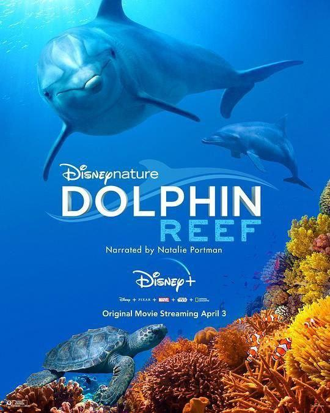

---

## 最后的猎人

[2026-10-15 22:52] 来自：纪录片资源频道

名称：最后的猎人 (2004) 1080P 国法多音轨 内封简中字幕

描述：Norman Winther是这世上最后仅存、对庄严的洛磯山脉拥有深刻理解并尊敬自然的猎人之一。他与印地安人那哈尼族的妻子涅芭斯卡，以及一群忠实的哈士奇猎犬，生活在一个以季节变化为节奏的世界：在冬天的雪地里驰骋、跨越汹涌的河水、遭受大灰熊与狼群的攻击，都是猎人寻常生活的一部份。诺曼在这个有时大风雪盖过说话声的冰雪世界，培养出他独特的生活态度。这部电影是对这个景观壮丽、辽阔原始的高海拔国度的礼讚。

夸克网盘：https://pan.quark.cn/s/041f06514e5e

📁 大小：6.8GB

🏷 标签：#最后的猎人 #纪录片

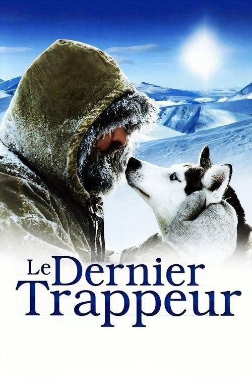

---

## 求偶游戏

[2026-10-15 18:11] 来自：综合网盘资源频道

名称：求偶游戏 The Mating Game (2021)

描述：这是动物为寻找配偶繁衍后代而引发的故事，故事引人入胜、令人捧腹又充满戏剧性。从新手到老手，从忠诚的伴侣到彻头彻尾的骗子，从浮夸炫耀到明目张胆的行为。我们将揭示动物寻找配偶的非凡策略。《求偶游戏 》 将深入分析如何才能成功地收获爱情。

夸克网盘：https://pan.quark.cn/s/9ece3a6e11af

阿里云盘：https://www.alipan.com/s/81SyPpnw88h

📁 大小：NG

🏷 标签：#纪录片 #求偶游戏 #quark #ali

---

## 泰森

[2026-10-15 10:15] 来自：综合网盘资源频道

名称：泰森 Tyson (2026)

描述：这部扣人心弦的四集纪录片剧集聚焦迈克·泰森这位体育史上最令人敬畏和迷人的人物之一，探寻了他的劲爆人生。

夸克网盘：https://pan.quark.cn/s/b4c721618133

阿里云盘：https://www.alipan.com/s/6daZEfWaBNN

📁 大小：NG

🏷 标签：#纪录片 #泰森 #quark #ali

---

## 冰河时代的巨人

[2026-10-15 09:13] 来自：综合网盘资源频道

名称：【原盘】冰河时代的巨人 (2013) 4K REMUX 外挂简中字幕

描述：回到现代文明诞生前的一万年前，在那个历史时期，人类与巨型动物共同生存在奇异壮观的冰封大陆上。本片尽可能真实的还原了北美、欧洲、亚洲大陆的壮丽地貌，利用炫目的CGI技术重塑了长毛象、剑齿虎、冰原狼等冰河时代生物，对冰河时代感兴趣的观众们来说，本片绝对是不应错过的一次饕餮盛宴。与此同时，影片还探索了可持续环境发展，在极端环境中存活等重要课题。

阿里云盘：https://www.alipan.com/s/Qes92vsrrKZ

夸克网盘：https://pan.quark.cn/s/94a8f737d8bb

百度网盘：https://pan.baidu.com/s/1Z9Su0Yy4OxJRIY6AzZW79A?pwd=xl51

📁 大小：18.1GB

🏷 标签：#冰河时代的巨人 #纪录片 #原盘 #4K #REMUX #外挂简中字幕 #ali #quark #baidu

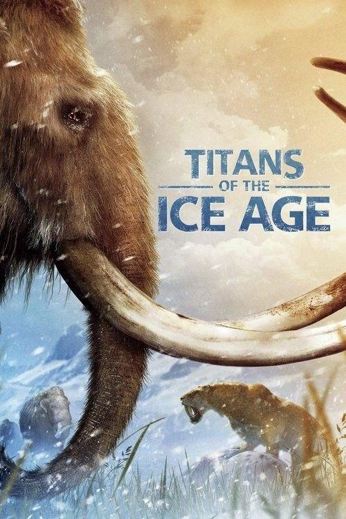

---

## 缅北电诈覆灭纪实

[2026-10-14 22:53] 来自：肯德基の4K影视综合电影云盘站

名称：缅北电诈覆灭纪实 (2026) 哔哩哔哩 1080p 高码率 3集全

描述：纪录片全面展现了中国公安机关会同有关部门开展打击缅北电诈集团犯罪专项工作、彻底铲除缅北“四大家族”及明家等犯罪集团的历程。全片共分三集。

夸克网盘：https://pan.quark.cn/s/41241e1e1b48

百度网盘：https://pan.baidu.com/s/18MuhmWU858xV7IUiqZCdVw?pwd=84z4

📁 大小：NG

🏷 标签：#纪录片 #缅北电诈覆灭纪实

---

## 心火写给火山夫妇的安魂曲

[2026-10-14 12:25] 来自：纪录片资源频道

名称：心火：写给火山夫妇的安魂曲 (2022) 1080P 简中硬字幕

描述：讲述了法国著名“火山夫妇”卡蒂亚和莫里斯的故事。卡蒂亚和莫里斯是火山学家，两人自幼爱上了火山，相同的志向与爱好让他们走到了一起。他们的一生致力于活火山研究，足迹遍及世界上所有的火山。1991年，两人登上了日本的云仙岳火山，葬身于突然爆发的火山之中。卡蒂亚和莫里斯留下了大量的录像档案，在抢救下来的影像资料中，可以看到即使在生命的最后一刻，他们还在做记录，播报着火山的喷发。

夸克网盘：https://pan.quark.cn/s/9f94657a8382

📁 大小：3.5GB

🏷 标签：#心火：写给火山夫妇的安魂曲 #纪录片

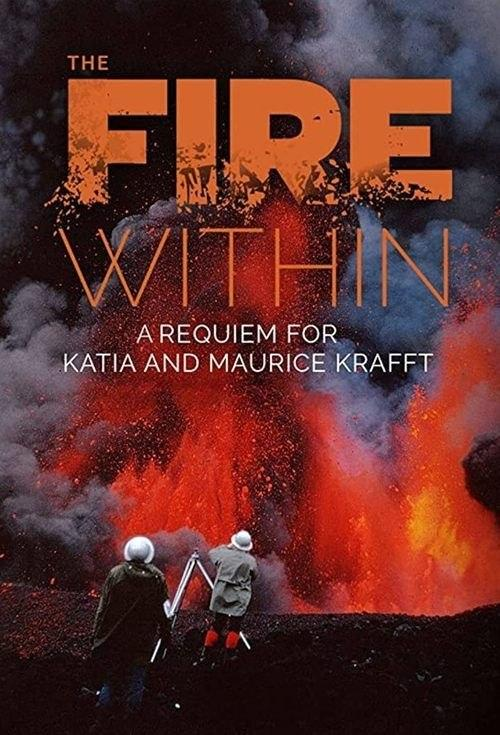

---

## 九一八事变后纪

[2026-10-14 12:11] 来自：影视动漫分享|SeedHub|夸克|网盘|🧲

名称：九一八事变后纪 (2025)

#电影 #战争 #历史 #纪录片 #夸克 #百度

主演: 

豆瓣: [0](https://movie.douban.com/subject/37526334/)

九一八事件，即南满铁路爆炸，标志着中国长达14年的抗日战争的开始，也拉开了世界反法西斯战争的序幕。中国人民用血肉筑起一道坚不可摧的防线，抵抗日本侵略者，为世界反法西..

夸克网盘：https://pan.quark.cn/s/f4d44853bb09

百度网盘：https://pan.baidu.com/s/1PvGO8rsr8YgDYplV5MmzHQ?pwd=g8nL

---

## 奔向月球

[2026-10-13 23:16] 来自：综合网盘资源频道

名称：【原盘】奔向月球 (2015) 4K REMUX 外挂简中字幕

描述：时至今日，登陆月球仍然是人类最伟大的科技成就。本片讲述的是无畏的登月先锋们的故事，从阿波罗1号到17号......

阿里云盘：https://www.alipan.com/s/drEKS8tw6b5

夸克网盘：https://pan.quark.cn/s/cef1534cd48c

百度网盘：https://pan.baidu.com/s/1JF8XxGub9tGqKfJYMaDYng?pwd=p97o

📁 大小：20.8GB

🏷 标签：#奔向月球 #纪录片 #原盘 #4K #REMUX #外挂简中字幕 #ali #quark #baidu

---

## 绿洲乐队别为往事懊恼

[2026-10-13 10:58] 来自：百度网盘综合频道

名称：绿洲乐队：别为往事懊恼（2026）Disney+ 4K DV&HDR 内封官中

描述：纪录绿洲乐队重聚后的 Oasis Live ’25 世界巡演，记录乐队及全球歌迷的经历与情感，并通过排练、后台、演出及连姆和诺埃尔·加拉格尔二十多年来首次共同采访，展现这一全球音乐事件。

百度网盘：https://pan.baidu.com/s/1OapOrDiQYJMIJqUm38Ve5A?pwd=z4cy

夸克网盘：https://pan.quark.cn/s/cb909abfe8ba 来自：肯德基の4K影视综合电影云盘站 [2026-10-13 10:58] 名称：绿洲乐队：别为往事懊恼（2026）Disney+ 4K DV&HDR 内封官中

📁 大小：14.2G

🏷 标签：#绿洲乐队 #别为往事懊恼 #纪录片 #音乐 #迪士尼

---

## 大太平洋

[2026-10-12 21:11] 来自：综合网盘资源频道

名称：【原盘】大太平洋 (2017) 4K REMUX SDR 全5集 外挂简中字幕

描述：纪录片《大太平洋》运用4K高分辨率摄像机进行拍摄，打破陆地与海洋的界限，以前所未见的方式呈现太平洋的故事。本片拍摄的物种和故事多达近30个，分布在全球14个国家和地区。颠覆传统以地区、习性、物种串联故事的方式，一集一个情感主线，一个动物主角，通过它的迁徙，将不同动物的故事串联在一起，并且每集聚焦于太平洋的某个标志性特色：激情、贪婪、狂暴和神秘，将太平洋上的各色故事交织在一起，刻画出这片海洋丰富多彩的每一面。为观众了解太平洋提供新鲜的视角，引发观众共鸣。

阿里云盘：https://www.alipan.com/s/kvzisXWoQdq

夸克网盘：https://pan.quark.cn/s/9cbc3a236257

百度网盘：https://pan.baidu.com/s/1GnCbF-iS64wo4i0Lzo0k9w?pwd=7nd6

📁 大小：83.5GB

🏷 标签：#大太平洋 #纪录片 #原盘 #4K #REMUX #SDR #外挂简中字幕 #ali #quark #baidu

---

## 中国救护2

[2026-10-12 12:10] 来自：影视动漫分享|SeedHub|夸克|网盘|🧲

名称：中国救护2 (2026)

#电影 #纪录片 #夸克 #百度

主演: 

豆瓣: [0](https://movie.douban.com/subject/38445105/)

用24小时跟拍，带你直击深圳最真实的急救现场，聚焦心跳加速的生死时刻与救护车背后的人生百态。这一季更年轻——聚焦都市青年的突发险情；更完整——追踪入院后的揪心与温暖..

夸克网盘：https://pan.quark.cn/s/23facc1c5c52

百度网盘：https://pan.baidu.com/s/1ZbnXuDeACApsZ6Xm4o8niA?pwd=yptv

百度网盘：https://pan.baidu.com/s/1E-S2qbDFqFbx4lh2HD9MEA?pwd=6666 来自：肯德基の4K影视综合电影云盘站 [2026-10-10 12:40] 名称：中国救护2  更03 [2026][纪录片]

夸克网盘：https://pan.quark.cn/s/b47ca675eba6 来自：肯德基の4K影视综合电影云盘站 [2026-10-10 12:40] 名称：中国救护2  更03 [2026][纪录片]

---

## 别为往事懊恼

[2026-10-12 11:58] 来自：综合网盘资源频道

名称：别为往事懊恼(2026) 英国 1080P [纪录片/音乐]

描述：聚焦Oasis Live '25全球巡演的现场表演和幕后故事，包括2026年Noel和Liam25年来首次共同采访。直击乐队事隔16年的加拉格兄弟世纪大和解，巡回狂热与幕后磨合并进，见证摇滚传说再起。

链接：

夸克网盘：https://pan.quark.cn/s/5205935f34d9

迅雷网盘：https://pan.xunlei.com/s/VP3hqJ3vQo4WJvmqWu50EscIA1?pwd=fyaj

百度网盘：https://pan.baidu.com/s/15HGIAkRcbgUxFuypeXLyOA?pwd=6666

📁 大小：N

🏷 标签：#纪录片 #音乐 #别为往事懊恼 #英国 #1080P #quark #xunlei #baidu

---

## 穿越落基山脉

[2026-10-11 21:46] 来自：综合网盘资源频道

名称：【原盘】穿越落基山脉 (2011) 4K REMUX HDR 外挂简中字幕

描述：影片将带领观众沿着加拿大太平洋铁路，穿越落基山脉  体验穿越加拿大落基山脉的蒸汽火车之旅。影片不仅展现了落基山的壮丽远景，并且介绍了加拿大太平洋铁路工程的建设，这是加拿大的第一条横贯大陆的铁路建设，世界上最伟大的铁路工程之一。在45分钟的电影中，观众将登上雄伟的蒸汽机2816号，感受地球上最美丽、最崎岖的地貌与人类史诗铁路工程的完美结合。

阿里云盘：https://www.alipan.com/s/heRbcGw2mAs

夸克网盘：https://pan.quark.cn/s/a50c8e2168f8

百度网盘：https://pan.baidu.com/s/1o2GjU69RHGNhoaGqXakuIA?pwd=60r5

📁 大小：18.9GB

🏷 标签：#穿越落基山脉 #纪录片 #原盘 #4K #REMUX #HDR #外挂简中字幕 #ali #quark #baidu

---

## 摄氏零度春光再现

[2026-10-11 16:59] 来自：纪录片资源频道

名称：摄氏零度春光再现 (1999) 1080P 外挂简中字幕

描述：黎耀辉（梁朝伟）和何保荣（张国荣）互换过名字和身份；黎耀辉曾为何保荣自杀过；他们之间曾经出现过一个女人（关淑怡）……作为《春光乍泄》的工作人员重返阿根廷拍摄现场拍摄的该片，混合剪辑了许多如上的电影上映版中没有的片段，并有王家卫、梁朝伟等人拍摄《春光乍泄》过程中的诸多真实心情记录。 《春光乍泄》原来的故事大纲是“布宜诺斯艾利斯情事”，是说何保荣（梁朝伟）来到阿根廷替他父亲处理善后，却意外发觉他父亲在当地有个同性情人，好奇心使其萌生与同性交往的念想。而原来故事的主场景，也不是上映版中最常出现的探戈小酒馆，而是从一家当地的中国餐馆开始的。

夸克网盘：https://pan.quark.cn/s/e2424913e09a

📁 大小：2.3GB

🏷 标签：#摄氏零度春光再现 #纪录片

---

## 粒子狂热

[2026-10-11 16:50] 来自：纪录片资源频道

名称：粒子狂热 (2013) 1080P 外挂简英双语字幕

描述：讲述科学家们寻找希格斯玻色子的故事,希格斯玻色子由 英国物理学家彼得 希格斯所预言存 在的粒子,它还被成为“上帝粒子”。

夸克网盘：https://pan.quark.cn/s/61c1cf64b1f1

📁 大小：7.6GB

🏷 标签：#纪录片 #粒子狂热

---

## 中国救护

[2026-10-11 16:29] 来自：综合网盘资源频道

名称：中国救护 第二季 中国救护2(2026)【4K.HDR.50fps】【更04集】

描述：用24小时跟拍，带你直击深圳最真实的急救现场，聚焦心跳加速的生死时刻与救护车背后的人生百态。这一季更年轻——聚焦都市青年的突发险情；更完整——追踪入院后的揪心与温暖；更有用——助你学会心肺复苏等救命技能。看真实故事，也读懂“人人敢救、人人能救”的深圳温度，下一个挺身而出的英雄就是你！

夸克网盘：https://pan.quark.cn/s/23facc1c5c52

百度网盘：https://pan.baidu.com/s/1ZbnXuDeACApsZ6Xm4o8niA?pwd=yptv

📁 大小：NG

🏷 标签：#纪录片 #中国救护 #4K #HDR #50fps #中国救护2 #quark #baidu

---

## 人生果实

[2026-10-10 22:18] 来自：纪录片资源频道

名称：人生果实 (2017) 1080P 简中硬字幕

描述：日本建筑师津端修一与津端英子夫妇的小木屋位于日本高藏寺新城，周围是一片杂木林，室内布置朴实而温馨，院子里栽了各种果树，多达一百八十棵，房屋面积不过五十平米而已，给人一种小而美好的感觉。津端先生已经九十岁高龄，夫人英子也有八十七岁了，但还在院子里挖土豆、刨芦笋、种柠檬、摘草莓、打胡桃。两人的生活处处用心，为了在客厅里看到院子里的花，两人还细心地调整餐桌的位置。先生觉得夫人做的标牌不够清晰，于是把它们刷成了明亮的黄色，上面写着“不要践踏”、“请注意、会疼哦”等等。夫人英子无所不能，种蔬菜、种水果、做甜品，样样拿手。津端每天写十张明信片，寄给不见面的朋友，联络远方的友情。

夸克网盘：https://pan.quark.cn/s/2ef6096513cd

📁 大小：2.3GB

🏷 标签：#人生果实 #纪录片

---

## 王朝

[2026-10-10 15:08] 来自：综合网盘资源频道

名称：【原盘】王朝 第一季 (2018) 4K REMUX 外挂简英双语字幕

描述：西非撒哈拉沙漠边境，统治族群长达三年之久的黑猩猩戴维面临其他雄性的挑战，为了守住王权，他开始选择结盟。而当遭到围攻后，这位不死的王者又毅然决然踏上夺回王位的复仇之路。南极大陆，数千只帝企鹅爸爸团聚一起，与极其寒冷的永夜作抗争。他们等待新生命的出生，等待 爱人的归来。肯尼亚草原，雌狮查姆竭尽全力守护族群，在巨大的灾难面前，他必须面临生死存亡的考验。津巴布韦国家公园，垂老的三色狼泰特渐感力不从心，她对家族的控制力逐渐减弱，而她的女儿正在崛起，觊觎着母亲的皇位。印度，雌虎拉杰贝拉靠一己之力捕捉猎物，养育四个孩子，但是大自然从不因此对她慈悲半分。

阿里云盘：https://www.alipan.com/s/76bewhUgFo9

夸克网盘：https://pan.quark.cn/s/21079969e8b6

百度网盘：https://pan.baidu.com/s/1Y_jhuhY51ZcauBrdDxbfuw?pwd=0aq2

📁 大小：87GB

🏷 标签：#王朝 #纪录片 #原盘 #4K #REMUX #外挂简英双语字幕 #ali #quark #baidu

---

## 寻迹庞贝古城与汤姆希德勒斯顿同行

[2026-10-10 14:08] 来自：百度网盘综合频道

名称：寻迹庞贝古城：与汤姆·希德勒斯顿同行（2026）Disney+ 4K DV&HDR 内封官中 全03集

描述：火山吞噬庞贝的那天，是否有人躲过死神降临？跟着汤姆·希德勒斯顿重返灾难前的最后一天。结合尖端考古学与历史推演，层层揭开尘封千年的真相。见证人们在分秒必争之际，如何做出攸关生死的关键抉择。

百度网盘：https://pan.baidu.com/s/1oCcVGcm7NaPmhpBwEJ2tCg?pwd=hvti

夸克网盘：https://pan.quark.cn/s/dcc5066f3aaf 来自：肯德基の4K影视综合电影云盘站 [2026-10-10 14:08] 名称：寻迹庞贝古城：与汤姆·希德勒斯顿同行（2026）Disney+ 4K DV&HDR 内封官中 全03集

📁 大小：12.8G

🏷 标签：#寻迹庞贝古城 #与汤姆·希德勒斯顿同行 #纪录片 #剧情 #迪士尼

