## 童安格挚爱珍藏版

[2026-10-29 00:01] 来自：夸克云盘影视资源频道

名称：童安格《挚爱珍藏版》 1：1母盘直刻版WAV+分轨

描述：极致试听发烧靓声

顶级发烧器材专业监听精品CD

忆起当年无尽往事重拾经典历程金曲

专辑曲目:

01忘不了

02把根留住

03.梦开始的地方

04耶利亚女郎

05花瓣雨

06爱与哀愁

07其实你不懂我的心

08借我一点爱

09一世情缘

10让生命等候

11明天你是否依然爱我

12最后一首歌

夸克网盘：https://pan.quark.cn/s/e2c9aa5279de

📁 大小：441MB

🏷 标签：#无损音乐 #音乐 #华语

---

## James

[2026-10-28 23:42] 来自：无损音乐分享频道

名称：James Horner.2017 – 《Titanic》  [20th Anniversary Edition]4CD FLAC十CUE

描述：詹姆斯·霍纳（《泰坦尼克号》配乐作曲）二十周年纪念版

- 4CD：4碟版本

夸克网盘：https://pan.quark.cn/s/83369f51478c

📁 大小：N

🏷 标签：#无损音乐 #音乐 #欧美

---

## Samara

[2026-10-28 22:02] 来自：无损音乐分享频道

名称：Samara Joy - Live At The Blue Note L.A. (2026) 24Bit 96kHz flac

描述：格莱美爵士女声Samara Joy首张现场EP，录制于洛杉矶Blue Note售罄专场。演绎经典爵士标准曲，人声丝滑细腻，完整留存俱乐部现场鲜活的即兴氛围感。

夸克网盘：https://pan.quark.cn/s/04ecbb0f8928

📁 大小：581MB

🏷 标签：#无损音乐 #音乐 #爵士

---

## Italian

[2026-10-28 21:29] 来自：综合网盘资源频道

名称：Italian Autumn Jazz 爵士 2026 FLAC

描述：意大利爵士音乐选集，融合现场钢琴爵士、现代爵士、萨克斯、手风琴与地中海风情。

百度网盘：https://pan.baidu.com/s/1vZJVmMwRcHeV7lGCrkJWlA?pwd=vnkr

夸克网盘：https://pan.quark.cn/s/49a7a0dd8463

迅雷网盘：https://pan.xunlei.com/s/VP51gjZZKEQwlY8Qd6gHWfH7A1?pwd=3ivc

📁 大小：700MB

🏷 标签：#音乐 #爵士 #FLAC #baidu #quark #xunlei

---

## 群星

[2026-10-28 20:43] 来自：夸克云盘影视资源频道

名称：群星 - 1999年国语流行畅销金曲 FLAC

描述：世纪之交的1999年，华语乐坛迎来神仙打架的高光时刻。这张《国语流行畅销金曲1999》精选集，汇聚一众经典。王菲、张惠妹、张宇、张学友等老牌歌手佳作纷呈，萧亚轩、蔡依林、谢霆锋新生代崭露头角。朴树、羽泉、伍佰、五月天带来动人的原创力量，《阴天》《单身情歌》《那些花儿》等曲目耐听传世，定格世纪末华语乐坛璀璨的黄金尾声。

夸克网盘：https://pan.quark.cn/s/ae317cac76ff

📁 大小：NG

🏷 标签：#无损音乐 #音乐 #华语

---

## XLOV

[2026-10-28 18:02] 来自：综合网盘资源频道

名称：XLOV - i=! (2026) FLAC

描述：韩男团新专辑。

百度网盘：https://pan.baidu.com/s/1vX7-yUzwOJjZ8-YoYgSCww?pwd=bdes

夸克网盘：https://pan.quark.cn/s/d444ba1eb165

迅雷网盘：https://pan.xunlei.com/s/VP50wepxGCxDJofzAK-IRTo5A1?pwd=wpng

📁 大小：170MB

🏷 标签：#音乐 #FLAC #baidu #quark #xunlei

---

## 云朵

[2026-10-28 17:50] 来自：综合网盘资源频道

名称：云朵 云絮低语 (2026) 36首 (FLAC 24bit 48khz)

描述：新增 dj版歌曲 以及一些.伴奏版

1. 月亮新娘

2. 格桑花开的季节

3. 唱情郎

4. 山河为证

5. 穿过人海去见你

6. 十八岁的姑娘

7. 大山的女儿

8. 且借人间二两墨

9. 钗头凤

10. 云絮低语

....

夸克网盘：https://pan.quark.cn/s/8ba8bee41fed

百度网盘：https://pan.baidu.com/s/1ImeO-MPRIEa1-BAq5N3QMg?pwd=kick 来自：百度网盘综合频道 [2026-10-28 17:18] 名称：云朵 云絮低语 (2026) 36首 (FLAC 24bit 48khz)

📁 大小：2GB

🏷 标签：#无损音乐 #音乐 #华语 #云朵 #云絮低语 #36首 #FLAC #24bit #quark

---

## Birth

[2026-10-28 17:17] 来自：百度网盘综合频道

名称：Birth 诞生-江语(2026) FLAC 24bit 48khz

描述：江语首张个人原创全长专辑《BIRTH诞生》现已正式发行。本张专辑由江语与制作人肖骏共同打造，大部分作品孕育并创作于江语的英国留学时期。音乐风格以另类流行(Alt-Pop)为基底，巧妙融合了独立摇滚(Indie Rock)、Trip-hop、合成器音乐以及实验电子等多元元素。

百度网盘：https://pan.baidu.com/s/1MkPKOBcwIjuNJAENyVkrbg?pwd=kick

📁 大小：N

🏷 标签：#无损音乐 #音乐 #华语

---

## 许飞

[2026-10-28 17:15] 来自：夸克云盘影视资源频道

名称：许飞 - 每个春天我都会唱歌 (2026) FLAC

描述：许飞&余秀华

两个不被定义的女性，一场诗与歌的灵魂相遇

曲目

01.不知天高地厚的人

02.穿过大半个中国去说你

03.人间

04.或许不关于爱情的

05.给你

06.每个春天我都会唱歌

07.我是这世界的情人

08.我想这样和你一起生活

09.来世，让我做你的邻居吧

夸克网盘：https://pan.quark.cn/s/2ca4d2e011e3

📁 大小：N

🏷 标签：#无损音乐 #音乐 #华语

---

## 云朵

[2026-10-28 12:11] 来自：夸克云盘影视资源频道

名称：云朵 云絮低语 (2026) 36首 (FLAC 24bit 48khz)

描述：新增 dj版歌曲 以及一些.伴奏版

夸克网盘：https://pan.quark.cn/s/8ba8bee41fed

夸克网盘：https://pan.quark.cn/s/88b8f238eaa9 来自：无损音乐分享频道 [2026-10-28 12:01] 名称：云朵 云絮低语2026 FLAC 24bit 192khz

📁 大小：2GB

🏷 标签：#无损音乐 #音乐 #华语

---

## 甜蜜的人生

[2026-10-28 12:10] 来自：影视动漫分享|SeedHub|夸克|网盘|🧲

名称：甜蜜的人生 (2005)

#电影 #动作 #音乐 #犯罪 #剧情 #惊悚 #夸克 #百度

主演: 李炳宪 申敏儿 金永哲 

豆瓣: [7.3](https://movie.douban.com/subject/1401383/)

善宇（李秉宪饰）对黑帮老大姜老板忠心耿耿，做事认真妥当的他也深得姜老板的信任与厚爱。姜老板更将自己的餐厅交给了善宇打理。

姜老板出名无情冷酷，谁都不能破坏他定..

夸克网盘：https://pan.quark.cn/s/059352bd930f

百度网盘：https://pan.baidu.com/s/1DKEUwjrfErBown7cwrcS5w?pwd=c8hu

---

## 王菲

[2026-10-27 20:52] 来自：夸克云盘影视资源频道

名称：王菲 1993 - 執迷不悔 (Remastered 2019)

描述：王菲1993年经典大碟，2019重新母带修复，同名曲国语版由王菲亲笔填词，收录《季候风》等佳作，人声细腻，是港乐黄金时代代表性唱片。

夸克网盘：https://pan.quark.cn/s/15e97464b734

📁 大小：N

🏷 标签：#无损音乐 #音乐 #华语

---

## 羽泉

[2026-10-27 20:47] 来自：夸克云盘影视资源频道

名称：羽泉 热爱 wav 分轨

描述：1. 选择牺牲

2. 深呼吸

3. 心似狂潮

4. 隔世情人

5. 狂想曲

6. 烫心

7. 问

8. 我愿意

9. Good-bye

10. 忘·记

夸克网盘：https://pan.quark.cn/s/4b02ea274b26

📁 大小：N

🏷 标签：#无损音乐 #音乐 #华语

---

## Rudy

[2026-10-27 20:42] 来自：无损音乐分享频道

名称：Rudy Adrian - Southern Isles Sketchbook (2026) FLAC 24bit 96khz qobuz

描述：新世纪纯音乐

夸克网盘：https://pan.quark.cn/s/93083e70c80a

📁 大小：N

🏷 标签：#无损音乐 #音乐 #纯音乐

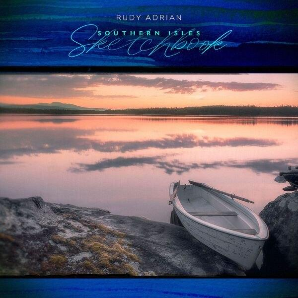

---

## ILLIT

[2026-10-27 12:37] 来自：综合网盘资源频道

名称：ILLIT - BREAK EVEN (2026) FLAC

描述：韩女团新专辑。

百度网盘：https://pan.baidu.com/s/1i6glhl2-csUUkaZZhf0HWw?pwd=43wf

夸克网盘：https://pan.quark.cn/s/e12082ebc276

迅雷网盘：https://pan.xunlei.com/s/VP4vbmLfSOApjCTFiSu8POPZA1?pwd=xsyz

📁 大小：130MB

🏷 标签：#音乐 #FLAC #baidu #quark #xunlei

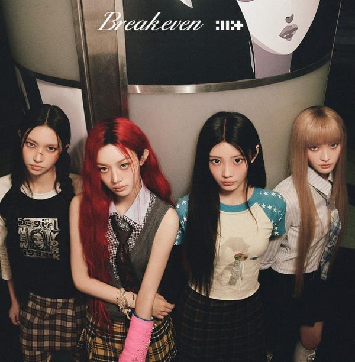

---

## 李幸倪2026

[2026-10-27 08:38] 来自：综合网盘资源频道

名称：李幸倪2026  - 一念通天 SACD Collection 1【环球】3SACD编号版 3CD

描述：一念通天，蜕变成香港乐坛天后完全体。

作为香港乐坛最具魅力的女声之一，Gin Lee李幸倪在BMA时期的三张代表作《Here I Come》、《Gin Lee》与《Ginetic》，多年来一直是不少乐迷心中的经典。这次由官方监修，以日本专业厂房压制SACD(Super Audio CD)重新制作，是首度以高规格格式推出的珍藏版本。音质大幅提升，层次更立体、动态更细致，适合欣赏Gin Lee鲜明声线与细致情感。

夸克网盘：https://pan.quark.cn/s/2b525eff4ce6

📁 大小：3.4GB

🏷 标签：#无损音乐 #音乐 #华语 #一念通天 #环球 #3SACD编号版 #quark

---

## 아일릿

[2026-10-27 08:37] 来自：综合网盘资源频道

名称：아일릿(ILLIT) - BREAK EVEN (2026)[GENIE] FLAC 24bit 44khz

描述：ILLIT《BREAK EVEN》2026新专，延续清新灵动的少年感曲风，轻快节奏搭配干净 vocal，诉说关于得失与自洽，充满青春独有的松弛元气。

夸克网盘：https://pan.quark.cn/s/400b44e0cfe7

百度网盘：https://pan.baidu.com/s/1BaG0rDi5eWHYt0hiG1V9vQ?pwd=kick 来自：综合网盘资源频道 [2026-10-27 08:34] 名称：아일릿(ILLIT) - BREAK EVEN (2026)[GENIE] FLAC 24bit 44khz

📁 大小：138MB

🏷 标签：#无损音乐 #音乐 #kpop #FLAC #24bit #quark

---

## IVE

[2026-10-27 08:37] 来自：综合网盘资源频道

名称：IVE (아이브) - Looks Can Kill (2026)[GENIE] FLAC 24bit 96khz

描述：IVE《Looks Can Kill》2026新作，延续女团华丽酷飒风格，抓耳旋律搭配利落舞台质感，以魅惑强势的曲风，演绎兼具美感与力量的音乐叙事。

夸克网盘：https://pan.quark.cn/s/5c6591e169f1

百度网盘：https://pan.baidu.com/s/1hH36APRN6AZhAyZxTc91-A?pwd=kick 来自：综合网盘资源频道 [2026-10-27 08:34] 名称：IVE (아이브) - Looks Can Kill (2026)[GENIE] FLAC 24bit 96khz

📁 大小：N

🏷 标签：#无损音乐 #音乐 #kpop #FLAC #24bit #quark

---

## IVE

[2026-10-27 02:26] 来自：无损音乐分享频道

名称：IVE (아이브) - Looks Can Kill (2026)[GENIE] FLAC 24bit 96khz

描述：IVE《Looks Can Kill》2026新作，延续女团华丽酷飒风格，抓耳旋律搭配利落舞台质感，以魅惑强势的曲风，演绎兼具美感与力量的音乐叙事。

夸克网盘：https://pan.quark.cn/s/5c6591e169f1

📁 大小：N

🏷 标签：#无损音乐 #音乐 #kpop

---

## 电子音乐

[2026-10-26 22:39] 来自：综合网盘资源频道

名称：电子音乐 - Kompilation I 2026 FLAC

描述：Big Room、Techno电子音乐专辑 。

百度网盘：https://pan.baidu.com/s/1AhjbR5DNIEms6LbZyGPahg?pwd=jfj7

夸克网盘：https://pan.quark.cn/s/48393ae2c202

迅雷网盘：https://pan.xunlei.com/s/VP4sce77l3xAgW-2r5zsYritA1?pwd=px67

📁 大小：700MB

🏷 标签：#音乐 #电子音乐 #FLAC #baidu #quark #xunlei

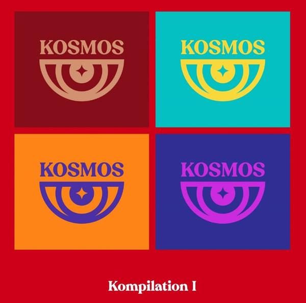

---

## 破碎之家

[2026-10-26 21:50] 来自：综合网盘资源频道

名称：破碎之家 The Broken Circle Breakdown (2012)

描述：故事背景是比利时的根特市。爱丽丝(薇儿拉·贝坦丝)经营一家纹身店，浑身布满纹身。迪迪尔(约翰·海尔登贝格)则是一支小型蓝草音乐(Bluegrass Music)乐队里的班卓琴手。内心向往着大美利坚，迪迪尔整日同朋友们一起伴着篝火吟唱着美国乡村民谣，生活得无忧无虑。如果不是比利时灰色的天空，你或许会把这里误认为是阿拉巴马。迪迪尔与爱丽丝就像是白天与黑夜，两个个性迥异的人却一见钟情，生活在了一起。

夸克网盘：https://pan.quark.cn/s/474fb3473fbb

阿里云盘：https://www.alipan.com/s/69AQ2Qwpgmh

📁 大小：NG

🏷 标签：#剧情 #爱情 #音乐 #破碎之家 #quark #ali

---

## IVE

[2026-10-26 20:11] 来自：综合网盘资源频道

名称：IVE - Looks Can Kill (2026) FLAC

描述： 韩女团新专辑。

百度网盘：https://pan.baidu.com/s/18yP0RhoPuLSFnWY8BDO3fg?pwd=vpgt

夸克网盘：https://pan.quark.cn/s/67bec2537721

迅雷网盘：https://pan.xunlei.com/s/VP4s6GM5l3xAgW-2r5zrzjTGA1?pwd=27de

📁 大小：130MB

🏷 标签：#音乐 #FLAC #baidu #quark #xunlei

---

## 泰勒斯威夫特时代巡回演唱会一个时代的结束

[2026-10-26 12:46] 来自：肯德基の4K影视综合电影云盘站

名称：泰勒·斯威夫特：时代巡回演唱会，一个时代的结束  Taylor Swift | The Eras Tour | The End of an Era (2025) 01-06 内嵌中英字幕

描述：泰勒·斯威夫特：时代巡回演唱会终场秀

Taylor Swift | The Eras Tour | The Final Show (2025)

夸克网盘：https://pan.quark.cn/s/6aa7d464114b

📁 大小：NA

🏷 标签：#音乐 #泰勒·斯威夫特 #时代巡回演唱会 #一个时代的结束 #quark

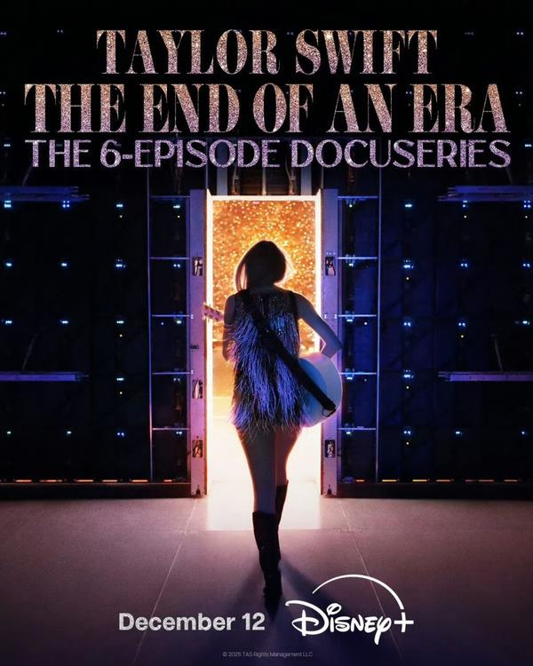

---

## 李幸倪

[2026-10-26 10:27] 来自：夸克云盘影视资源频道

名称：李幸倪 后青春舞曲(2026) (FLAC 24bit 48khz)

描述：新单曲

电影  妈样年华 主题曲

夸克网盘：https://pan.quark.cn/s/f396acd9634c

📁 大小：N

🏷 标签：#无损音乐 #音乐 #华语

---

## ABC唱片

[2026-10-26 10:27] 来自：夸克云盘影视资源频道

名称：ABC唱片 -《德德玛 美丽的草原我的家》 wav 整轨+分轨

描述：1. 草原夜色美

2. 美丽的草原我的家

3. 达古拉

4. 远去的母亲

5. 草原上有一个美丽的传说

6. 天上的风

7. 达那巴拉

8. 雕花的马鞍

9. 蓝色的蒙古高原

10. 牧村的黄昏

11. 赞歌

12. 牧歌

13. 草原无名河

夸克网盘：https://pan.quark.cn/s/a6538d537da9

📁 大小：NG

🏷 标签：#无损音乐 #音乐 #华语

---

## VA

[2026-10-26 10:25] 来自：无损音乐分享频道

名称：VA - 音乐史 弗拉门戈 FLAC

描述：VA - 音乐史 弗拉门戈 Music History - Flamenco (2026) FLAC+CUE

夸克网盘：https://pan.quark.cn/s/e9d118e51854

📁 大小：N

🏷 标签：#无损音乐 #音乐 #纯音乐

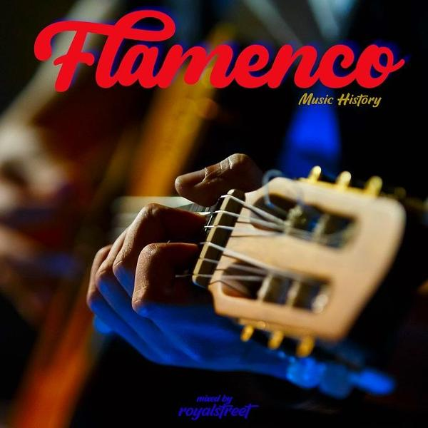

---

## Dan

[2026-10-26 10:22] 来自：无损音乐分享频道

名称：Dan Gibson's Solitudes - Celtic Meditations (16.8.2024)  FLAC

描述：丹·吉布森｜幽静系列 — 凯尔特冥想

新世纪 纯音乐

夸克网盘：https://pan.quark.cn/s/1fc7d1045a16

📁 大小：468MB

🏷 标签：#无损音乐 #音乐 #纯音乐

---

## John

[2026-10-26 07:15] 来自：综合网盘资源频道

名称：John Legend - Muse(2026) FLAC 24bit 44khz qobuz

描述：约翰传奇 新专

由Pharrell Williams操刀制作，融合灵魂乐、福音、嘻哈与非洲节拍，编曲充满电影质感，醇厚人声演绎，兼具复古优雅与现代律动。

百度网盘：https://pan.baidu.com/s/1CzD19ONfuMr6K4_UJElAIw?pwd=kick

夸克网盘：https://pan.quark.cn/s/ff1546fea717 来自：综合网盘资源频道 [2026-10-26 07:08] 名称：John Legend - Muse(2026) FLAC 24bit 44khz qobuz

📁 大小：503MB

🏷 标签：#无损音乐 #音乐 #欧美流行 #FLAC #24bit #baidu

---

## 群星一人一首成名曲2发烧至尊版HQCDwav

[2026-10-26 07:09] 来自：综合网盘资源频道

名称：群星《一人一首成名曲2·发烧至尊版HQCD》wav

描述：

1 陈影 – 遇见

2 陈宁 – 原来你也在这里

3 白晓 – 天使的翅膀

4 江智民 – 为爱痴狂

5 雷婷 – 爱的箴言

6 蓝海 – 一剪梅

7 王欢 – 牵手

8 张琼 – 青花瓷

9 吕晋 – 寂寞公路

10 苏曼 – 当你孤单你会想起谁

11 龚玥 – 我的中国心

12 彭柯 – 不想看见你哭

13 周虹 – 明月千里寄相思

14 晓花 – 一千年以后

15 童丽 – 是否

....

夸克网盘：https://pan.quark.cn/s/72ef204db1ec

📁 大小：1.3G

🏷 标签：#无损音乐 #音乐 #华语 #群星 #一人一首成名曲2·发烧至尊版HQCD #wav #quark

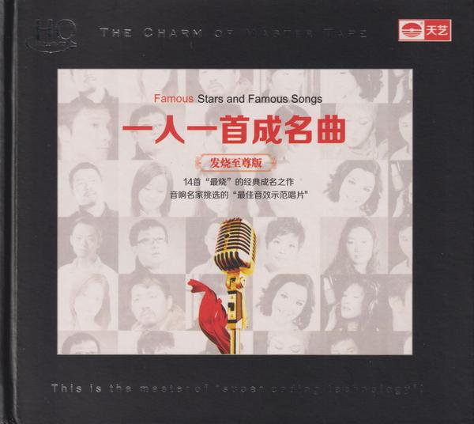

---

## Birth

[2026-10-26 00:01] 来自：无损音乐分享频道

名称：Birth 诞生-江语(2026) FLAC 24bit 48khz

描述：江语首张个人原创全长专辑《BIRTH诞生》现已正式发行。本张专辑由江语与制作人肖骏共同打造，大部分作品孕育并创作于江语的英国留学时期。音乐风格以另类流行(Alt-Pop)为基底，巧妙融合了独立摇滚(Indie Rock)、Trip-hop、合成器音乐以及实验电子等多元元素。

夸克网盘：https://pan.quark.cn/s/15d4778046dc

📁 大小：N

🏷 标签：#无损音乐 #音乐 #华语

---

## 此处通往繁星

[2026-10-25 23:15] 来自：综合网盘资源频道

名称：此处通往繁星 影视原声带 FLAC 24bit 48khz

描述：1 郁可唯 – 以我为名的宇宙 (《此处通往繁星》电视剧主题曲)

2 郭麒麟 – 后生仔 (《此处通往繁星》电视剧片头曲)

3 方柚希 – 后生仔 (《此处通往繁星》电视剧推广曲)

4 杨雨青 – 此刻灿烂 (《此处通往繁星》电视剧插曲)

5 郁可唯 – 以我为名的宇宙 (伴奏)

6 郭麒麟 – 后生仔 (伴奏)

7 方柚希 – 后生仔 (伴奏)

8 杨雨青 – 此刻灿烂 (伴奏)

9 郁可唯 – 以我为名的宇宙 (和声伴奏)

10 郭麒麟 – 后生仔 (和声伴奏)

11 方柚希 – 后生仔 (和声伴奏)

12 杨雨青 – 此刻灿烂 (和声伴奏)

夸克网盘：https://pan.quark.cn/s/3ec1ed2a9027

📁 大小：N

🏷 标签：#无损音乐 #音乐 #华语 #此处通往繁星 #影视原声带 #FLAC #24bit #quark

---

## The

[2026-10-25 17:10] 来自：综合网盘资源频道

名称：The Weeknd - AFTER HOURS TIL DAWN COLLECTION

描述：The Weeknd《AFTER HOURS TIL DAWN COLLECTION》，日本限定套装，集结《After Hours》《Dawn FM》等核心专辑，天野喜孝绘制封面，暗调复古合成器R&B，沉溺迷离的夜色叙事。

夸克网盘：https://pan.quark.cn/s/332cac37fd80

📁 大小：1.9GB

🏷 标签：#无损音乐 #音乐 #欧美流行 #quark

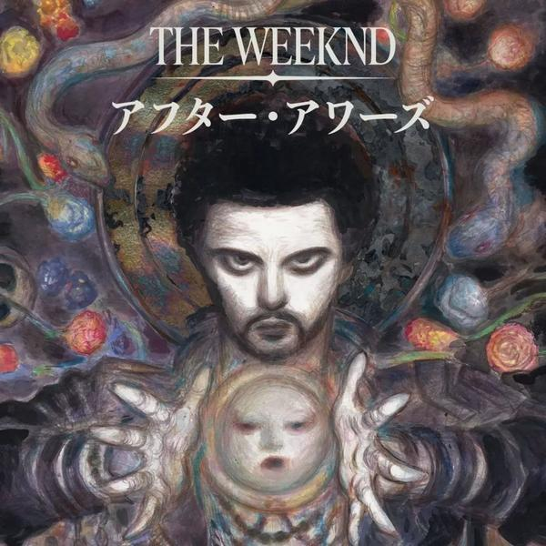

---

## HIFI丝竹

[2026-10-25 14:56] 来自：综合网盘资源频道

名称：HIFI丝竹 wav+cue

描述：【HiFi丝竹】梦中国

由日本作曲家改编的江南丝竹版本，展现精致、细腻的音乐美感，以及原音重现的最高品质，效果之佳睥睨一切大师国乐录音。典范的演奏、典范的录音、典范的制作，具有永恒的价值，国乐乐迷，都应拥有一张。

夸克网盘：https://pan.quark.cn/s/76d2bd5417ff

📁 大小：N

🏷 标签：#无损音乐 #音乐 #纯音乐 #HIFI丝竹 #wav #quark

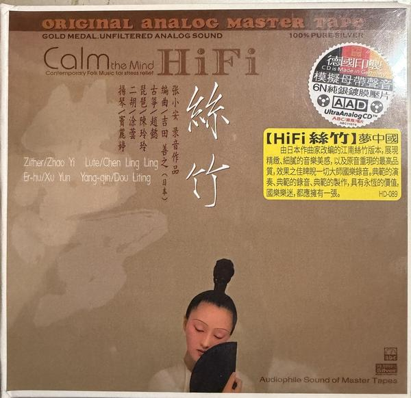

---

## 柏林之声专属车载音乐

[2026-10-25 13:37] 来自：综合网盘资源频道

名称：柏林之声专属车载音乐 U 盘，无损高音质，让音乐与行驶节奏同频。

描述：汇聚全网经典曲目，满足不同行车心情的听歌需求，适配柏林之声的调音特质与车载场景需求，以纯粹的音质、丰富的曲库，让你在驰骋途中，邂逅音乐本真的美好。还有经典老歌专区，那些刻在青春里的旋律

夸克网盘：https://pan.quark.cn/s/1ae1e97098ac

📁 大小：41.1G

🏷 标签：#音乐 #柏林之声 #车载音乐 #无损高音质 #歌曲下载 #quark #柏林之声专属车载音乐 #让音乐与行驶节奏同频

---

## 寇雅婷繁花似锦HQ

[2026-10-25 12:12] 来自：肯德基の4K影视综合电影云盘站

名称：寇雅婷《繁花似锦HQⅡ》(2026) 头版限量编号 低速原抓WAV + CUE

描述：

hifi女声新专

01.康定情歌

02.牧歌

03.狼

04.偏偏喜欢你（国语版）

05.借我一点爱

06.恋曲1990

07.大约在冬季

08.彩云追月

09.往日时光

10.滚滚红尘

11.多年以后

12.再见我的爱人

夸克网盘：https://pan.quark.cn/s/aeea26859bcf

百度网盘：https://pan.baidu.com/s/17GPC8z0iuYKhGLPTYC3yng?pwd=kick

📁 大小：N

🏷 标签：#无损音乐 #音乐 #华语

---

## Anderson

[2026-10-25 11:21] 来自：综合网盘资源频道

名称：Anderson .Paak & Cordae - Heavy Is The Crown (2026) FLAC

描述：流行说唱专辑。

百度网盘：https://pan.baidu.com/s/1nHeMi2ssNOEj7b-69FK7fw?pwd=ksti

夸克网盘：https://pan.quark.cn/s/c4e1468d060f

迅雷网盘：https://pan.xunlei.com/s/VP4l3laltgy4LDmC8RDE2zrTA1?pwd=9iue

📁 大小：200MB

🏷 标签：#音乐 #FLAC #baidu #quark #xunlei

---

## 郁可唯

[2026-10-25 09:54] 来自：综合网盘资源频道

名称：郁可唯 平原 (2026) FLAC 24bit 48khz

描述：郁可唯 / Yisa Yu 专辑『平原 / Plain』上半张(五首歌) 10月25日已正式发行

曲目列表：

1. 银耳

2. 而后

3. 层层

4. 风轻

5. 过了

夸克网盘：https://pan.quark.cn/s/f548b5fe8b8f

百度网盘：https://pan.baidu.com/s/1_Xx10cgpD85SDFIV5EPGPw?pwd=kick

📁 大小：245MB

🏷 标签：#无损音乐 #音乐 #华语 #郁可唯 #平原 #FLAC #24bit #quark #baidu

---

## Ai歌手

[2026-10-25 09:31] 来自：综合网盘资源频道

名称：Ai歌手 6667首 合集 WAV分轨

描述：集结众多热门AI声线：阿丽塔、阿野、白兰、白慕寒、蔡沐妍、大头针、归来小易、光启、嘉欣、柯唯、李伯然等，收录上万首翻唱曲目，曲风丰富，涵盖流行、粤语金曲、怀旧老歌、抒情热歌等多种类型。

夸克网盘：https://pan.quark.cn/s/a44de03c6ee4

📁 大小：212GB

🏷 标签：#无损音乐 #音乐 #华语 #Ai歌手 #6667首 #合集 #WAV分轨 #quark

---

## 卡拉扬DG合集

[2026-10-25 09:29] 来自：综合网盘资源频道

名称：卡拉扬DG合集 330CD

描述：卡拉扬DG330CD合集完整收录了1938年至1989年间DG厂牌的全部正式录音；这套合集完整保留了从早期模拟单声道、立体声到初期数字录音的音频，堪称技术迭代的活档案

夸克网盘：https://pan.quark.cn/s/f4267c1d6e2e

📁 大小：124GB

🏷 标签：#无损音乐 #音乐 #古典 #卡拉扬DG合集 #quark

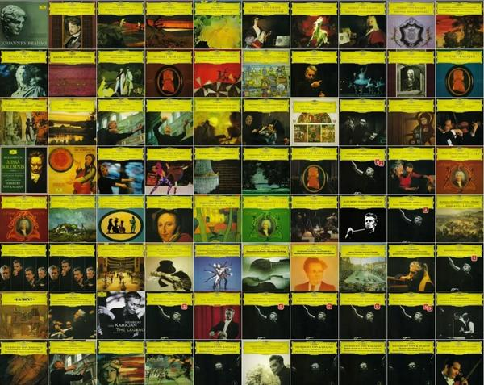

---

## 1100多首6090年代粤语怀旧歌曲大合集

[2026-10-25 08:34] 来自：综合网盘资源频道

名称：1100多首60-90年代粤语怀旧歌曲大合集

描述：60-90年代唱遍大街小巷，陪伴一代人成長的香港粵語金曲，汇集了 60 年代至 90 年代港乐的黄金之作。这些金曲涵盖了各大巨星如张学友、张国荣、Beyond、陈百强、梅艳芳的代表作。无论是影视金曲还是街头巷尾传唱的浪漫情歌，均是不可多得的珍藏。

夸克网盘：https://pan.quark.cn/s/6279e2ae132f

📁 大小：33.8G

🏷 标签：#音乐 #歌曲下载 #粤语 #怀旧 #歌曲 #合集 #quark

---

## Amy

[2026-10-25 02:40] 来自：无损音乐分享频道

名称：Amy Winehouse - Back To Black (20th Anniversary Edition) (2026) FLAC qobuz

描述：Amy Winehouse《Back To Black》二十周年纪念版。英国灵魂爵士女声Amy Winehouse，嗓音粗粝充满故事感；这版收录原版曲目、未曝光Demo与现场录音，复古骚灵旋律，诉说心碎与沉沦。

夸克网盘：https://pan.quark.cn/s/02de3385418d

📁 大小：1.1GB

🏷 标签：#无损音乐 #音乐 #欧美流行

---

## 寇雅婷繁花似锦HQ

[2026-10-25 02:39] 来自：百度网盘综合频道

名称：寇雅婷《繁花似锦HQⅡ》(2026) 头版限量编号 低速原抓WAV + CUE

描述：

hifi女声新专

01.康定情歌

02.牧歌

03.狼

04.偏偏喜欢你（国语版）

05.借我一点爱

06.恋曲1990

07.大约在冬季

08.彩云追月

09.往日时光

10.滚滚红尘

11.多年以后

12.再见我的爱人

百度网盘：https://pan.baidu.com/s/17GPC8z0iuYKhGLPTYC3yng?pwd=kick

夸克网盘：https://pan.quark.cn/s/aeea26859bcf 来自：夸克云盘影视资源频道 [2026-10-25 02:35] 名称：寇雅婷《繁花似锦HQⅡ》(2026) 头版限量编号 低速原抓WAV + CUE

📁 大小：N

🏷 标签：#无损音乐 #音乐 #华语

---

## Ai歌手

[2026-10-25 02:35] 来自：夸克云盘影视资源频道

名称：Ai歌手 6667首 合集 WAV分轨

描述：集结众多热门AI声线：阿丽塔、阿野、白兰、白慕寒、蔡沐妍、大头针、归来小易、光启、嘉欣、柯唯、李伯然等，收录上万首翻唱曲目，曲风丰富，涵盖流行、粤语金曲、怀旧老歌、抒情热歌等多种类型。

夸克网盘：https://pan.quark.cn/s/a44de03c6ee4

📁 大小：212GB

🏷 标签：#无损音乐 #音乐 #华语

---

## 嫁金钗

[2026-10-25 00:35] 来自：综合网盘资源频道

名称：嫁金钗 影视原声带专辑 (2026) FLAC 24bit 48khz

描述：《嫁金钗》原声专辑，共39首。集结刘宇宁、袁娅维、黄诗扶等歌手演绎主题曲与插曲，许昊珂操刀全片配乐。曲风古典婉转，兼具权谋张力与缱绻情思，人声与器乐交织，勾勒剧中女子博弈与深情的故事。

夸克网盘：https://pan.quark.cn/s/9b692853a272

百度网盘：https://pan.baidu.com/s/1xKu4uptnNY0hQABuFbT8sw?pwd=kick

📁 大小：1.1G

🏷 标签：#无损音乐 #音乐 #华语 #嫁金钗 #影视原声带专辑 #FLAC #24bit #quark #baidu

---

## 群星

[2026-10-24 13:23] 来自：综合网盘资源频道

名称：群星 2026 -《早春晴朗 影视原声带》WAV

描述：群星 - 早春晴朗 OST

01.汪苏泷 - 路过晴朗

02.刘宇宁 - 她

03.袁娅维TIA RAY - 此刻

04.段奥娟 - 这一刻

05.陈婧霏 - Lady Snow

06.杨雨青 - You Are My Light

07.李长庚 - You Should Know

08.衣诺 - 我将于人世外

夸克网盘：https://pan.quark.cn/s/b280c805bb16

百度网盘：https://pan.baidu.com/s/1fyqV6nPAuKZumFi8Xgm0cA?pwd=kick

百度网盘：https://pan.baidu.com/s/17ATLMmuAxE2L5U8ca7UOpQ?pwd=kick 来自：肯德基の4K影视综合电影云盘站 [2026-10-24 11:49] 名称：群星 - 1998 年国语流行畅销金曲 FLAC

夸克网盘：https://pan.quark.cn/s/ea41aa5665b8 来自：肯德基の4K影视综合电影云盘站 [2026-10-24 11:49] 名称：群星 - 1998 年国语流行畅销金曲 FLAC

📁 大小：474MB

🏷 标签：#无损音乐 #音乐 #华语 #群星 #早春晴朗 #影视原声带 #WAV #quark #baidu

---

## 保罗莫里哀

[2026-10-24 13:18] 来自：无损音乐分享频道

名称：保罗莫里哀 Paul Mauriat - The Seven Seas (1983) FLAC 24bit 192khz qobuz

描述：

 1.The Seven Seas

 2.So Bad Pipes Of Peace

 3.Thriller

 4.An Innocent Man

 5.Making Love Out Of Nothing At All

 6.Baroque Cantabile

 7.Say Say Say

 8.Total Eclipse Of The Heart

 9.I Like Chopin

 10.Think Of Laura

 11.You Flew Into My Life

 保罗·莫里亚轻音乐专辑，以标志性优雅弦乐重新改编欧美流行经典，旋律流畅浪漫，音色温润通透，是熟悉的法式轻音乐温柔演绎版本。

夸克网盘：https://pan.quark.cn/s/5361034fff0e

📁 大小：1.6GB

🏷 标签：#无损音乐 #音乐 #欧美

---

## FFOREVER今夜让我带你高飞远走

[2026-10-24 11:50] 来自：肯德基の4K影视综合电影云盘站

名称：F✦FOREVER《今夜让我带你高飞远走》(2026) FLAC 24bit 48khz

描述：

F✦FOREVER限定组合，由阿信、言承旭、吴建豪、周渝民组成。专辑收录新歌与F4经典重制，主打曲《今夜让我带你高飞远走》特邀刘宇宁合唱，其余曲目由四人演绎，

01.今夜让我带你高飞远走（含刘宇宁）

02.流星雨

03.恒星不忘 Forever Forever

04.爱人啊

05.烟火的季节

06.我只想

07.伤心的人别听慢歌 (贯彻快乐)

08.你要的爱

09.第一时间

10.放手一搏 Always be My Bro

夸克网盘：https://pan.quark.cn/s/3e291616de0d

百度网盘：https://pan.baidu.com/s/16ajNsKocywPVnd6OjBYBvA?pwd=kick

📁 大小：N

🏷 标签：#无损音乐 #音乐 #华语

---

## 张靓颖

[2026-10-24 11:49] 来自：肯德基の4K影视综合电影云盘站

名称：张靓颖 不知道说什么 (2026) (FLAC 24bit 48khz

描述：张靓颖 最新单曲

夸克网盘：https://pan.quark.cn/s/59d49ca7e029

百度网盘：https://pan.baidu.com/s/1kUj8Huy5-xTEDyC1ho26mQ?pwd=kick

📁 大小：N

🏷 标签：#无损音乐 #音乐 #华语

---

## 曾沛慈

[2026-10-24 11:49] 来自：肯德基の4K影视综合电影云盘站

名称：曾沛慈 牵挂(2026) FLAC 24bit 48khz

描述：新单曲

夸克网盘：https://pan.quark.cn/s/39d6225bfc03

百度网盘：https://pan.baidu.com/s/1HtqrAOkcCZyjJuTsdZmN-g?pwd=kick

📁 大小：N

🏷 标签：#无损音乐 #音乐 #华语

---

## 莫西子诗

[2026-10-24 11:48] 来自：肯德基の4K影视综合电影云盘站

名称：莫西子诗 合集 FLAC

描述：彝族音乐人莫西子诗全集，收录三张录音室专辑与多场珍贵现场录音。扎根大凉山故土，融合彝语吟唱、民谣与实验氛围，质朴又充满诗意。从《原野》到新作《星星、荆棘和鸟群》，以大地、月光、山野为意象，吟唱故乡、生命与孤独，是极具灵性的民族民谣典藏。

夸克网盘：https://pan.quark.cn/s/3afeb7bcf674

📁 大小：NG

🏷 标签：#无损音乐 #音乐 #华语

---

## 古典HiFi再现

[2026-10-24 11:45] 来自：无损音乐分享频道

名称：古典HiFi再现 WAV

描述：绝版唱片，囊括最经典的古典名曲

夸克网盘：https://pan.quark.cn/s/33ea5a0fdcff

📁 大小：NG

🏷 标签：#无损音乐 #音乐 #古典

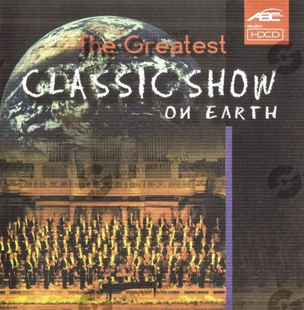

---

## 曾沛慈

[2026-10-24 01:12] 来自：夸克云盘影视资源频道

名称：曾沛慈 牵挂(2026) FLAC 24bit 48khz

描述：新单曲

夸克网盘：https://pan.quark.cn/s/39d6225bfc03

📁 大小：N

🏷 标签：#无损音乐 #音乐 #华语

---

## 张靓颖

[2026-10-24 01:12] 来自：夸克云盘影视资源频道

名称：张靓颖 不知道说什么 (2026) (FLAC 24bit 48khz

描述：张靓颖 最新单曲

夸克网盘：https://pan.quark.cn/s/59d49ca7e029

📁 大小：N

🏷 标签：#无损音乐 #音乐 #华语

---

## 群星

[2026-10-24 01:11] 来自：夸克云盘影视资源频道

名称：群星 - 1998 年国语流行畅销金曲 FLAC

描述：1998年是华语乐坛群星璀璨的黄金年份。本张年度金曲精选，集结王菲、那英、任贤齐、张学友、李玟、刘若英、动力火车等一众实力歌手。收录《红豆》《征服》《伤心太平洋》《雨蝶》《笨小孩》等国民金曲，涵盖抒情、流行、动感多元曲风。首首脍炙人口、传唱度极高，镌刻着千禧年前的乐坛盛世，承载一代人难忘的青春记忆，是极具珍藏价值的90年代华语经典合集。

夸克网盘：https://pan.quark.cn/s/ea41aa5665b8

📁 大小：NG

🏷 标签：#无损音乐 #音乐 #华语

---

## FFOREVER今夜让我带你高飞远走

[2026-10-24 00:05] 来自：百度网盘综合频道

名称：F✦FOREVER《今夜让我带你高飞远走》(2026) FLAC 24bit 48khz

描述：

F✦FOREVER限定组合，由阿信、言承旭、吴建豪、周渝民组成。专辑收录新歌与F4经典重制，主打曲《今夜让我带你高飞远走》特邀刘宇宁合唱，其余曲目由四人演绎，

01.今夜让我带你高飞远走（含刘宇宁）

02.流星雨

03.恒星不忘 Forever Forever

04.爱人啊

05.烟火的季节

06.我只想

07.伤心的人别听慢歌 (贯彻快乐)

08.你要的爱

09.第一时间

10.放手一搏 Always be My Bro

链接：

百度网盘：https://pan.baidu.com/s/16ajNsKocywPVnd6OjBYBvA?pwd=kick

夸克网盘：https://pan.quark.cn/s/3e291616de0d 来自：夸克云盘影视资源频道 [2026-10-24 00:05] 名称：F✦FOREVER《今夜让我带你高飞远走》(2026) FLAC 24bit 48khz

📁 大小：N

🏷 标签：#无损音乐 #音乐 #华语

---

## 曾沛慈

[2026-10-24 00:03] 来自：百度网盘综合频道

名称：曾沛慈 牵挂(2026) FLAC 24bit 48khz

描述：新单曲

链接：

百度网盘：https://pan.baidu.com/s/1HtqrAOkcCZyjJuTsdZmN-g?pwd=kick

夸克网盘：https://pan.quark.cn/s/39d6225bfc03 来自：无损音乐分享频道 [2026-10-24 00:03] 名称：曾沛慈 牵挂(2026) FLAC 24bit 48khz

📁 大小：N

🏷 标签：#无损音乐 #音乐 #华语

---

## 张靓颖

[2026-10-24 00:02] 来自：百度网盘综合频道

名称：张靓颖 不知道说什么 (2026) (FLAC 24bit 48khz

描述：张靓颖 最新单曲

链接：

百度网盘：https://pan.baidu.com/s/1kUj8Huy5-xTEDyC1ho26mQ?pwd=kick

夸克网盘：https://pan.quark.cn/s/59d49ca7e029 来自：无损音乐分享频道 [2026-10-24 00:02] 名称：张靓颖 不知道说什么 (2026) (FLAC 24bit 48khz

📁 大小：N

🏷 标签：#无损音乐 #音乐 #华语

---

## 群星

[2026-10-24 00:01] 来自：百度网盘综合频道

名称：群星 - 1998 年国语流行畅销金曲 FLAC

描述：1998年是华语乐坛群星璀璨的黄金年份。本张年度金曲精选，集结王菲、那英、任贤齐、张学友、李玟、刘若英、动力火车等一众实力歌手。收录《红豆》《征服》《伤心太平洋》《雨蝶》《笨小孩》等国民金曲，涵盖抒情、流行、动感多元曲风。首首脍炙人口、传唱度极高，镌刻着千禧年前的乐坛盛世，承载一代人难忘的青春记忆，是极具珍藏价值的90年代华语经典合集。

链接：

百度网盘：https://pan.baidu.com/s/17ATLMmuAxE2L5U8ca7UOpQ?pwd=kick

夸克网盘：https://pan.quark.cn/s/ea41aa5665b8 来自：无损音乐分享频道 [2026-10-24 00:01] 名称：群星 - 1998 年国语流行畅销金曲 FLAC

百度网盘：https://pan.baidu.com/s/1a8lPx2NBqRQr-VTyuQm0Zg?pwd=kick 来自：综合网盘资源频道 [2026-10-23 20:00] 名称：群星 - 1997 年国语流行畅销金曲 FLAC

夸克网盘：https://pan.quark.cn/s/7fde32111f9d 来自：综合网盘资源频道 [2026-10-23 19:56] 名称：群星 - 1997 年国语流行畅销金曲 FLAC

📁 大小：NG

🏷 标签：#无损音乐 #音乐 #华语

---

## Minnie

[2026-10-23 22:31] 来自：综合网盘资源频道

名称：Minnie - i love you to the moon and back (2026) FLAC

描述：新EP专辑。

百度网盘：https://pan.baidu.com/s/1ZY7oSP-9eV_nioOyksCleg?pwd=y78r

夸克网盘：https://pan.quark.cn/s/8d7b9a36224f

迅雷网盘：https://pan.xunlei.com/s/VP4d8diFvgHdchYry1upD2-hA1?pwd=9jj9

📁 大小：70MB

🏷 标签：#音乐 #FLAC #baidu #quark #xunlei

---

## 保罗莫里哀

[2026-10-23 12:36] 来自：无损音乐分享频道

名称：保罗莫里哀 Paul Mauriat - Nagekidori (1987) FLAC 24bit 192khzqobuz

描述：轻音乐

夸克网盘：https://pan.quark.cn/s/e5e77b57fcda

📁 大小：NG

🏷 标签：#无损音乐 #音乐 #纯音乐

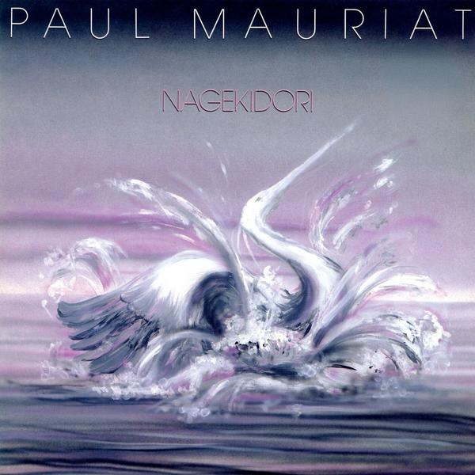

---

## Hilary

[2026-10-23 09:34] 来自：综合网盘资源频道

名称：Hilary Duff - Holiday Things 2026 FLAC

描述：新EP专辑。

百度网盘：https://pan.baidu.com/s/1p0HUFsfrYq1rUcnX4GM5sQ?pwd=bv6y

夸克网盘：https://pan.quark.cn/s/a047bca09705

迅雷网盘：https://pan.xunlei.com/s/VP4aO3GLNbMb3ve94pBJa534A1?pwd=7erc

📁 大小：190MB

🏷 标签：#音乐 #FLAC #baidu #quark #xunlei

---

## LisaPRESS

[2026-10-23 08:04] 来自：肯德基の4K影视综合电影云盘站

名称：Lisa-PRESS PLAY - 2026 (FLAC 24bit-44.1kHz) qobuz

描述：新专

夸克网盘：https://pan.quark.cn/s/653852509220

📁 大小：200MB

🏷 标签：#无损音乐 #音乐 #欧美

---

## 须弥乐团

[2026-10-23 08:04] 来自：肯德基の4K影视综合电影云盘站

名称：须弥乐团 2026《鼓宴·须弥三国HQⅡ》头版限量编号WAV+分轨

描述：

01.三国·须弥

02.单骑

03.迅雷疾风

04.破竹

05.杯中惊涛

06.卧龙吟

07.朔漠南望

08.旌旗乱

09.焚天鼓

10.渡江

11.归沧浪

夸克网盘：https://pan.quark.cn/s/4648ea4bdc9c

📁 大小：N

🏷 标签：#无损音乐 #音乐 #纯音乐

---

## John

[2026-10-23 08:04] 来自：肯德基の4K影视综合电影云盘站

名称：John Legend - Muse(2026) FLAC qobuz

描述：约翰传奇 新专

由Pharrell Williams操刀制作，融合灵魂乐、福音、嘻哈与非洲节拍，编曲充满电影质感，醇厚人声演绎，兼具复古优雅与现代律动。

夸克网盘：https://pan.quark.cn/s/ebb123d757d9

📁 大小：326MB

🏷 标签：#无损音乐 #音乐 #欧美流行

---

## 谭咏麟2026刻骨铭心感激篇5CD

[2026-10-23 08:03] 来自：肯德基の4K影视综合电影云盘站

名称：谭咏麟.2026《刻骨铭心·感激篇》5CD 流行传世自选集CD抓轨 [WAV+CUE]

描述：谭咏麟《刻骨铭心 流行传世自选集·感激篇》，5CD DSD数码重制，收录《爱在深秋》《朋友》等影视金曲，醇厚声线诉说感恩，回味粤语黄金时代。

夸克网盘：https://pan.quark.cn/s/e8f40847d0d2

📁 大小：2.8GB

🏷 标签：#音乐 #无损音乐 #华语

---

## 群星

[2026-10-23 07:24] 来自：综合网盘资源频道

名称：群星 - 青梅竹马101 WAV 分轨

描述：《青梅竹馬101》是环球推出的怀旧金曲合集，全套6CD，甄选101首华语经典情歌。汇聚周治平、齐秦、王菲、张学友、童安格等老牌歌手，旋律温柔怀旧，记录青涩爱恋，是属于八九十年代的青春声音备忘录。

夸克网盘：https://pan.quark.cn/s/e2446a14476d

📁 大小：4.3GB

🏷 标签：#无损音乐 #音乐 #huay #群星 #青梅竹马101 #WAV #分轨 #quark

---

## LisaPRESS

[2026-10-23 00:09] 来自：百度网盘综合频道

名称：Lisa-PRESS PLAY - 2026 (FLAC 24bit-44.1kHz) qobuz

描述：新专

百度网盘：https://pan.baidu.com/s/1r9mCw1GVPDfmd6Izyew1gA?pwd=kick

夸克网盘：https://pan.quark.cn/s/653852509220 来自：夸克云盘影视资源频道 [2026-10-23 00:09] 名称：Lisa-PRESS PLAY - 2026 (FLAC 24bit-44.1kHz) qobuz

📁 大小：200MB

🏷 标签：#无损音乐 #音乐 #欧美

---

## 谭咏麟2026刻骨铭心感激篇5CD

[2026-10-23 00:01] 来自：夸克云盘影视资源频道

名称：谭咏麟.2026《刻骨铭心·感激篇》5CD 流行传世自选集CD抓轨 [WAV+CUE]

描述：谭咏麟《刻骨铭心 流行传世自选集·感激篇》，5CD DSD数码重制，收录《爱在深秋》《朋友》等影视金曲，醇厚声线诉说感恩，回味粤语黄金时代。

夸克网盘：https://pan.quark.cn/s/e8f40847d0d2

📁 大小：2.8GB

🏷 标签：#音乐 #无损音乐 #华语

---

## John

[2026-10-22 22:45] 来自：百度网盘综合频道

名称：John Legend - Muse(2026) FLAC qobuz

描述：约翰传奇 新专 

由Pharrell Williams操刀制作，融合灵魂乐、福音、嘻哈与非洲节拍，编曲充满电影质感，醇厚人声演绎，兼具复古优雅与现代律动。

百度网盘：https://pan.baidu.com/s/1e1Kau9SwFFFCjiO55xF9Hw?pwd=kick

夸克网盘：https://pan.quark.cn/s/ebb123d757d9 来自：无损音乐分享频道 [2026-10-22 22:42] 名称：John Legend - Muse(2026) FLAC qobuz

百度网盘：https://pan.baidu.com/s/1a80fw0VNxekZHC_DOTDMrw?pwd=ige9 来自：综合网盘资源频道 [2026-10-22 21:42] 名称：John Legend - Muse 2026 FLAC

夸克网盘：https://pan.quark.cn/s/6f61803948d4 来自：综合网盘资源频道 [2026-10-22 21:42] 名称：John Legend - Muse 2026 FLAC

迅雷网盘：https://pan.xunlei.com/s/VP4YpfNNofSiQuElnqX7U8ZeA1?pwd=swkp 来自：综合网盘资源频道 [2026-10-22 21:42] 名称：John Legend - Muse 2026 FLAC

📁 大小：326MB

🏷 标签：#无损音乐 #音乐 #欧美流行

---

## LISA

[2026-10-22 22:20] 来自：综合网盘资源频道

名称：LISA - PRESS PLAY (2026) FLAC

描述：BLACKPINK成员lisa新专辑。

百度网盘：https://pan.baidu.com/s/1cCbekflWi2vTg2WuL916VQ?pwd=n5aq

夸克网盘：https://pan.quark.cn/s/67289b996876

迅雷网盘：https://pan.xunlei.com/s/VP4YxLAZ-Hs7E7g8XoSNkKQxA1?pwd=2rpa

📁 大小：200MB

🏷 标签：#音乐 #FLAC #baidu #quark #xunlei

---

## 须弥乐团

[2026-10-22 16:27] 来自：夸克云盘影视资源频道

名称：须弥乐团 2026《鼓宴·须弥三国HQⅡ》头版限量编号WAV+分轨

描述：01.三国·须弥

02.单骑

03.迅雷疾风

04.破竹

05.杯中惊涛

06.卧龙吟

07.朔漠南望

08.旌旗乱

09.焚天鼓

10.渡江

11.归沧浪

夸克网盘：https://pan.quark.cn/s/4648ea4bdc9c

📁 大小：N

🏷 标签：#无损音乐 #音乐 #纯音乐

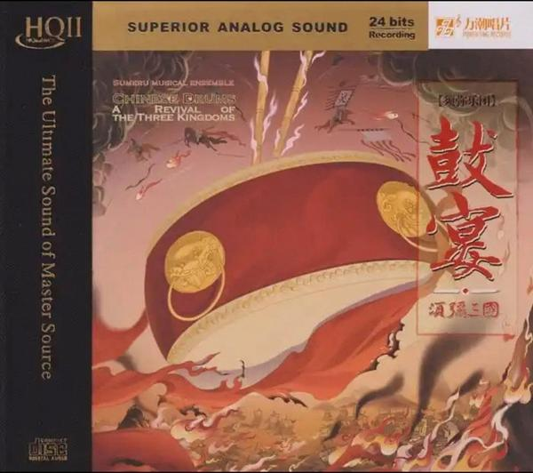

---

## miletMy

[2026-10-22 12:24] 来自：综合网盘资源频道

名称：milet「My Voice, My Life (2026) [FLAC 48kHz／24bit

描述：milet《My Voice, My Life》，日剧《经验派护士～数字化到底是什么啊！？～》主题歌，力量感人声搭配舒展编曲，唱出坚守本心、忠于自我的动人内核。

夸克网盘：https://pan.quark.cn/s/f58ee30bcea5

📁 大小：N

🏷 标签：#无损音乐 #音乐 #milet #FLAC #24bit #quark

---

## Danielle

[2026-10-22 12:21] 来自：无损音乐分享频道

名称：Danielle Riegel - Einaudi： Oltremare (2026) FLAC 24bit 192kHz qobuz

描述：Danielle Riegel《Oltremare》，以凯尔特竖琴重编艾诺第经典，灵感取自大西洋，澄澈舒缓，流水般的旋律构筑冥想音景，宁静治愈，带来沉浸式聆听感受。

夸克网盘：https://pan.quark.cn/s/f2fb988e40f9

📁 大小：2.5G

🏷 标签：#无损音乐 #音乐 #纯音乐

---

## Cyberpunk

[2026-10-22 08:41] 来自：综合网盘资源频道

名称：Cyberpunk -  Edgerunners 2 (Original Series Score)(2026) FLAC 24bit 48khz ：《赛博朋克：边缘行者2(剧集原声配乐)

描述：《赛博朋克：边缘行者2(剧集原声配乐)》，今堀恒雄打造，冷峻工业电子交织迷幻合成音色，勾勒夜之城霓虹喧嚣，藏着亡命者躁动又落寞的情绪。

夸克网盘：https://pan.quark.cn/s/a84256a4a440

百度网盘：https://pan.baidu.com/s/11B7mLLB0OmQpaXcyo5B4aQ?pwd=kick

📁 大小：1.2GB

🏷 标签：#无损音乐 #音乐 #原声带 #quark #baidu

---

## 孟庭苇

[2026-10-22 08:38] 来自：夸克云盘影视资源频道

名称：孟庭苇 - 谁的眼泪在飞 头版限量编号NEW XRCD - WAV+CUE

描述：曲目

01.誰的眼淚在飛

02.風裡的夢

03.你究竟有幾個好妹妹

04.羞答答的玫瑰靜悄悄地開

05.一個失戀的木偶

06.秋天的眼淚

07.化身為海

08.三生三世

09.原本今生以為

10.這一季有多長

夸克网盘：https://pan.quark.cn/s/5f889e81f1de

📁 大小：N

🏷 标签：#无损音乐 #音乐 #华语

---

## 群星

[2026-10-22 07:59] 来自：综合网盘资源频道

名称：群星 - 天选(一)(2026) 音响试音发烧天碟 [WAV+分轨］

描述：

《天遇音响试音发烧天碟(一)》精选跨类型曲目，覆盖大动态、高低频、人声、结像等多种试音项目，中西乐曲兼备，是HiFi发烧友调校器材的实用试音碟。

夸克网盘：https://pan.quark.cn/s/92fd9a8a3519

百度网盘：https://pan.baidu.com/s/115gQHk91DLSKm6iT-VSCCg?pwd=kick

夸克网盘：https://pan.quark.cn/s/e85a038fb621 来自：综合网盘资源频道 [2026-10-22 07:30] 名称：群星 - 1996 年国语流行畅销金曲 FLAC 16bit 44khz

📁 大小：663MB

🏷 标签：#无损音乐 #音乐 #纯音乐 #群星 #天选 #音响试音发烧天碟 #WAV #分轨 #quark #baidu

---

## 电子音乐

[2026-10-21 22:03] 来自：综合网盘资源频道

名称：电子音乐 - Beach Lounge Ibiza (2026) FLAC

描述：House 电子舞曲为主的合辑。

百度网盘：https://pan.baidu.com/s/12ozdvujJTzyGszCD5kf3ww?pwd=xp42

夸克网盘：https://pan.quark.cn/s/fdd1cc2b395f

迅雷网盘：https://pan.xunlei.com/s/VP4Tkt7VRO2P4mAl7tPDA7AzA1?pwd=8mn7

📁 大小：750MB

🏷 标签：#音乐 #电子音乐 #FLAC #baidu #quark #xunlei

---

## 肖战

[2026-10-21 21:06] 来自：夸克云盘影视资源频道

名称：肖战 异想天开 EP (2026) (FLAC 24bit 48khz)

描述：01.异想天开

02.不合时宜

03.遥远的不是爱

04.Allez, aimez!

夸克网盘：https://pan.quark.cn/s/a191e6fd6afb

📁 大小：N

🏷 标签：#无损音乐 #音乐 #华语

---

## 群星

[2026-10-21 15:33] 来自：肯德基の4K影视综合电影云盘站

名称：群星 女歌男翻，惊艳耳蜗 FLAC 192khz 24bit

描述：《粤语 女歌男翻，惊艳耳蜗》男声翻唱精选，集结多位粤语歌手重新演绎一众经典女声曲目。包含李克勤《给自己的情书》、区瑞强《容易受伤的女人》、张敬轩《滴汗》、林一峰《暗涌》、古巨基《垃圾》、陈奕迅《约定》等耳熟能详之作。以男声视角重塑原作情绪，或是温柔沉静，或是浓烈深情，不少收录现场版本，人声质感饱满，旧曲新唱，生出截然不同的动人韵味。

夸克网盘：https://pan.quark.cn/s/0e954d47fbae

📁 大小：7.1GB

🏷 标签：#无损音乐 #音乐 #粤语流行

---

## 梁静茹

[2026-10-21 14:50] 来自：夸克云盘影视资源频道

名称：梁静茹 2000.8.2勇气 FLAC 24bit 192khz

描述：1. 勇气

2. 如果有一天

3. 半个月亮

4. 没有水的游泳池

5. 最烂的理由

6. 爱你不是两三天

7. 爱计较

8. 昨天

9. 多数是晴天

10. 最后

夸克网盘：https://pan.quark.cn/s/75c1db325258

📁 大小：NG

🏷 标签：#无损音乐 #音乐 #华语

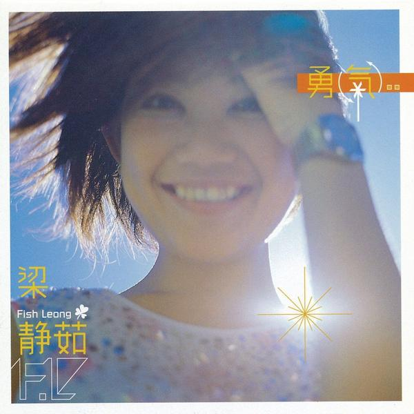

---

## The

[2026-10-21 14:33] 来自：无损音乐分享频道

名称：The Avalanches - No Bad Memories (2026) FLAC 24bit 48kHz

描述：The Avalanches《No Bad Memories》2026专辑。延续招牌拼贴采样美学，揉入复古广告音效、House与Neo‑Soul，碎片流转，迷幻怀旧，充满灵动跳跃的听觉趣味。

夸克网盘：https://pan.quark.cn/s/02aa965bd89d

📁 大小：647MB

🏷 标签：#无损音乐 #音乐 #欧美

---

## aiko

[2026-10-21 09:01] 来自：综合网盘资源频道

名称：aiko - 最後に熱い日々を狂わしき想いで (2026) FLAC

描述：日语新专辑。

百度网盘：https://pan.baidu.com/s/1ykxZQSS2ulgxqYxa0z9zsQ?pwd=hhd3

夸克网盘：https://pan.quark.cn/s/aece88943dad

迅雷网盘：https://pan.xunlei.com/s/VP4QxstEGjFnxg8qNIxvqganA1?pwd=mrmv

📁 大小：400MB

🏷 标签：#音乐 #最後に熱い日々を狂わしき想いて #FLAC #baidu #quark #xunlei

---

## 国乐至尊

[2026-10-21 07:11] 来自：综合网盘资源频道

名称：国乐至尊 HQCDII (2026) 头版限量编号 wav 分轨 16bit 44khz

描述：01.始终会行运

02.爱江山更爱美人

03.你怎么说

04.铁血丹心

05.鲜花满月楼

06.倚天屠龙记

07.阿郎恋曲

08.男儿当自强

09.独上西楼

10.尘缘

11.两忘烟水里

12.问情

13.一起走过的日子

夸克网盘：https://pan.quark.cn/s/b96d61858394

百度网盘：https://pan.baidu.com/s/1jm0frHdC4FycXMetKhSOgw?pwd=kick

📁 大小：547MB

🏷 标签：#无损音乐 #音乐 #国乐 #纯音乐 #国乐至尊 #头版限量编号 #wav #分轨 #16bit #quark #baidu

---

## 美人余

[2026-10-21 06:59] 来自：综合网盘资源频道

名称：美人余 (2026) 影视原声带 FLAC 24bit 48khz

描述：

《美人余》影视原声专辑 曲目.

1. 绝色 - 张靓颖

2. 蝴蝶 - VaVa毛衍七

3. 留在原地的人 - 李一桐

4. 我把未来写成歌 - 王靖雯

5. Lucky - 乔西

6. 一半 - 王赛罕娜

夸克网盘：https://pan.quark.cn/s/7ed1e3b0e507

百度网盘：https://pan.baidu.com/s/1bXsCURnIukNOkibyRs-UOQ?pwd=kick

📁 大小：N

🏷 标签：#无损音乐 #音乐 #华语 #美人余 #影视原声带 #FLAC #24bit #quark #baidu

---

## 美人余

[2026-10-21 00:01] 来自：百度网盘综合频道

名称：美人余 (2026) 影视原声带 FLAC 24bit 48khz

描述：

《美人余》影视原声专辑 曲目.

1. 绝色 - 张靓颖

2. 蝴蝶 - VaVa毛衍七

3. 留在原地的人 - 李一桐

4. 我把未来写成歌 - 王靖雯

5. Lucky - 乔西

6. 一半 - 王赛罕娜

链接：

百度网盘：https://pan.baidu.com/s/1bXsCURnIukNOkibyRs-UOQ?pwd=kick

夸克网盘：https://pan.quark.cn/s/7ed1e3b0e507 来自：夸克云盘影视资源频道 [2026-10-21 00:01] 名称：美人余 (2026) 影视原声带 FLAC 24bit 48khz

📁 大小：N

🏷 标签：#无损音乐 #音乐 #华语

---

## 黄启光夜阑人静头版限量24K金碟低速原抓WAVCUE

[2026-10-20 19:06] 来自：无损音乐分享频道

名称：黄启光《夜阑人静》头版限量24K金碟低速原抓WAV+CUE

描述：黄启光《夜阑人静》，经典民乐发烧天碟，收录多首传统国乐，录音通透醇厚，乐器音色细腻，静谧舒缓尽显中式雅致意境。

夸克网盘：https://pan.quark.cn/s/f233faca7cb3

📁 大小：NG

🏷 标签：#无损音乐 #音乐 #纯音乐

---

## MoeKoe音乐播放器免费开源多平台音乐聚合

[2026-10-20 17:32] 来自：综合网盘资源频道

名称：MoeKoe音乐播放器，免费开源+多平台音乐聚合

描述：一款免费开源的聚合音乐播放器，支持多平台音乐搜索与播放，界面简洁清爽，无广告干扰。可在线试听与下载高品质音乐，支持歌单管理、歌词显示和本地音乐导入。适合追求纯净听歌体验的音乐爱好者使用，是一款轻量实用的桌面音乐工具。

夸克网盘：https://pan.quark.cn/s/4e4a008b7bb4

百度网盘：https://pan.baidu.com/s/1-3GoDoeL8hZuAaLxQx1ONw?pwd=3jr2

📁 大小：NG

🏷 标签：#MoeKoe #音乐播放器 #音乐聚合 #开源播放器 #MoeKoe音乐播放器 #免费开源 #多平台音乐聚合 #quark #baidu

---

## 生化危机

[2026-10-20 16:00] 来自：无损音乐分享频道

名称：生化危机 爆发夜 (2026) 原声带 配乐 Hays Holladay, Ryan Holladay - Resident Evil (2026) FLAC HI-RES 24Bit - 44kHz qobuz

描述：Hays Holladay与Ryan Holladay为电影《生化危机：爆发夜》创作原声，实验电子配乐，层层渲染压抑惊悚氛围，烘托浣熊市的危机与恐怖感。

夸克网盘：https://pan.quark.cn/s/63d188dd862f

百度网盘：https://pan.baidu.com/s/1aOKdN1l1o7NX79RheJRdRw?pwd=kick 来自：综合网盘资源频道 [2026-10-20 15:57] 名称：生化危机 爆发夜 (2026) 原声带 配乐 Resident Evil (2026) FLAC HIRES 24Bit - 44kHz qobuz

📁 大小：394MB

🏷 标签：#无损音乐 #音乐 #ost #原声带

---

## 梁静茹

[2026-10-20 15:52] 来自：肯德基の4K影视综合电影云盘站

名称：梁静茹 1999.9.17 一夜长大 FLAC 24bit 192khz

描述：曲目

1 对不起我爱你

2 一夜长大

3 彩虹

4 迷路

5 快乐一整天

6 只能抱着你

7 转圈圈

8 纯情艳阳天

9 橡皮筋

10 纸条

夸克网盘：https://pan.quark.cn/s/830a92b8798b

📁 大小：1.5G

🏷 标签：#无损音乐 #音乐 #华语 #梁静茹 #一夜长大 #FLAC #24bit #quark

---

## MoeKoe

[2026-10-20 14:49] 来自：综合网盘资源频道

名称：MoeKoe Music音乐播放器，开源、简洁、高颜值的多平台音乐播放器，

描述：无广告无内购，无需强制联网，可批量管理本地曲库，支持多平台音乐搜索与播放，界面简洁清爽，无广告干扰。可在线试听与下载高品质音乐，支持歌单管理、歌词显示和本地音乐导入。适合追求纯净听歌体验的音乐爱好者使用，是一款轻量实用的桌面音乐工具。

夸克网盘：https://pan.quark.cn/s/38e857a43994

📁 大小：145.8M

🏷 标签：#软件 #MoeKoe #音乐播放器 #音乐聚合 #开源播放器 #Music音乐播放器 #简洁 #高颜值的多平台音乐播放器 #quark

---

## Sasha

[2026-10-20 13:45] 来自：无损音乐分享频道

名称：Sasha Stychkina - Debut (ALPHA) FLAC 24bit 96khz qobuz

描述：Sasha Stychkina《Debut》，2026首张钢琴独奏专辑，Alpha Classics发行，收录肖邦、拉威尔等作品，演奏张力充沛，录音细腻，展现新生代钢琴家精湛控制力。

夸克网盘：https://pan.quark.cn/s/26f68fb2fa67

📁 大小：1GB

🏷 标签：#无损音乐 #音乐 #古典

---

## 天外歌姬

[2026-10-20 12:10] 来自：影视动漫分享|SeedHub|夸克|网盘|🧲

名称：天外歌姬 (2025)

#电视剧 #喜剧 #传记 #音乐 #剧情 #夸克

主演: 诺伊斯·阿森西 英格丽·加西亚·荣松 纳塔利娅·德·莫利纳 

豆瓣: [0](https://movie.douban.com/subject/36728235/)

本剧集以21世纪初的乱象为背景,，用前所未有的方式重现了流行偶像塔玛拉的生平及其蜕变为尤蕾娜的过程。..

夸克网盘：https://pan.quark.cn/s/ef62f70e6d98

---

## 王菲

[2026-10-20 09:59] 来自：综合网盘资源频道

名称：王菲 - 《如愿》(纯银CD) WAV+CUE

描述：1. 如愿 4:21

2. 匆匆那年 3:58

3. 人间 4:44

4. 红豆 4:13

5. 传奇 4:45

6. 流年 4:31

7. 致青春 3:04

8. 你在终点等我 4:29

9. 因为爱情(王菲&陈奕迅)3:33

10. 执迷不悔 4:27

11. 约定 4:23

12. 暧昧 4:38

13. 爱与痛的边缘 4:30

14. 容易受伤的女人 4:18

15. 给自己的情书 4:25

夸克网盘：https://pan.quark.cn/s/0f170a840d73

📁 大小：N

🏷 标签：#无损音乐 #音乐 #华语 #王菲 #如愿 #纯银CD #WAV #quark

---

## NMIXX

[2026-10-20 07:51] 来自：综合网盘资源频道

名称：NMIXX - Strange Muse (2026) FLAC 24bit 96kHz Tidal

描述：NMIXX迷你六辑《Strange Muse》，延续MIXXTOPIA世界观，主打MIXXPOP。收录主打曲《Birthday Wish》与三首双人小分队曲目，曲风梦幻浪漫，演绎互为缪斯的叙事。

夸克网盘：https://pan.quark.cn/s/e40eb8d30f66

百度网盘：https://pan.baidu.com/s/1R6FU0u1Nu30pXhhzHbc3Jg?pwd=kick

百度网盘：https://pan.baidu.com/s/1xEr4qFcDjBgyy3wg_3Mk_Q?pwd=kick 来自：百度网盘综合频道 [2026-10-20 07:48] 名称：NMIXX - Strange Muse (2026) FLAC 24bit 96kHz Tidal

📁 大小：303M

🏷 标签：#无损音乐 #音乐 #韩国流行 #FLAC #24bit #quark #baidu

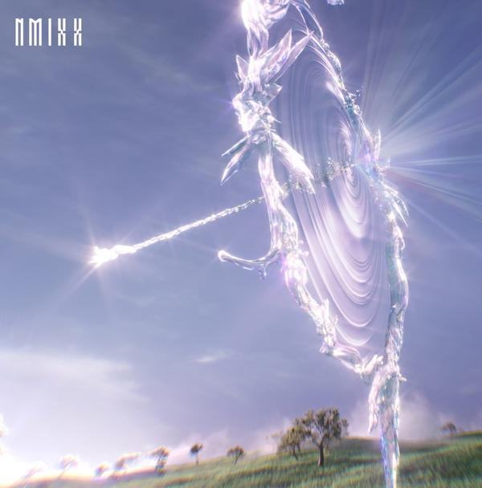

---

## 试音发烧天碟天选限量11黄金母盘直刻

[2026-10-20 02:04] 来自：夸克云盘影视资源频道

名称：试音发烧天碟《天选Ⅱ》限量1：1黄金母盘直刻 低速原抓WAV+CUE

描述：试音发烧天碟《天选Ⅱ》限量1：1黄金母盘直刻 低速原抓WAV+CUE

夸克网盘：https://pan.quark.cn/s/95b0bce51b36

📁 大小：N

🏷 标签：#无损音乐 #音乐 #华语

---

## 蔡琴

[2026-10-20 00:04] 来自：夸克云盘影视资源频道

名称：蔡琴 你不要那样看着我的眼睛 DSD

描述：蔡琴1992同名专辑《你不要那样看着我的眼睛》，融合日系City Pop与爵士。近期大量短视频选用此曲作为氛围感BGM走红，丝绒般醇厚嗓音，诉说成年人克制含蓄的暧昧心绪。

夸克网盘：https://pan.quark.cn/s/eac1b20c9e3d

📁 大小：G

🏷 标签：#无损音乐 #音乐 #华语

---

## 马兰士总工30周年纪念碟

[2026-10-20 00:04] 来自：夸克云盘影视资源频道

名称：马兰士总工30周年纪念碟 -《马兰士爵士精选》 FLAC 88,2kHz - 24bit

描述：石渡健30周年纪念SACD，马兰士原厂录制，收录12首经典爵士与Bossa Nova曲目，石渡健亲自母带调校，音色温润通透，是HiFi人声与乐器试音天碟。

夸克网盘：https://pan.quark.cn/s/373c4d7736d9

📁 大小：1.3G

🏷 标签：#无损音乐 #音乐 #爵士

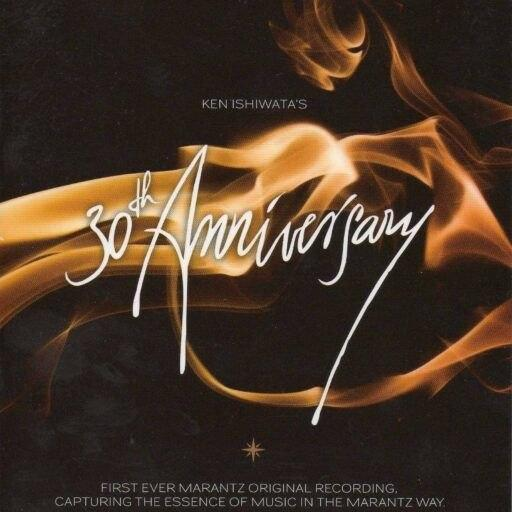

---

## NMIXX

[2026-10-19 23:20] 来自：综合网盘资源频道

名称：NMIXX - Strange Muse (2026) FLAC 24bit 96kHz Tidal

描述：NMIXX迷你六辑《Strange Muse》，延续MIXXTOPIA世界观，主打MIXXPOP。收录主打曲《Birthday Wish》与三首双人小分队曲目，曲风梦幻浪漫，演绎互为缪斯的叙事。

夸克网盘：https://pan.quark.cn/s/e40eb8d30f66

百度网盘：https://pan.baidu.com/s/1R6FU0u1Nu30pXhhzHbc3Jg?pwd=kick

📁 大小：303M

🏷 标签：#无损音乐 #音乐 #韩国流行 #FLAC #24bit #quark #baidu

---

## 古典

[2026-10-19 22:16] 来自：夸克云盘影视资源频道

名称：古典 Itzhak Perlman - Great Concertos for Violin (2026) FLAC 16 +24bit qobuz

描述：古典 Itzhak Perlman - Great Concertos for Violin (2026) 精选

夸克网盘：https://pan.quark.cn/s/2209713aa64c

📁 大小：NG

🏷 标签：#无损音乐 #音乐 #纯音乐

---

## 菊梓乔

[2026-10-19 22:16] 来自：夸克云盘影视资源频道

名称：菊梓乔 隨意瞞（新曲 + 精選）FLAC 24bit 48khz qobuz

描述：1. 随意瞒

2. 爱无余地

3. 你就是天下（剧《倚天屠龙记》片尾曲）

4. 我会害怕（剧《星空下的仁医》片尾曲）

5. 爱很美丽（剧《爱美丽狂想曲》主题曲）

6. 秘密花园（剧《逆天奇案》片尾曲）

7. 不相信别人（剧《刑侦日记》片尾曲）

8. 蝴蝶效应（剧《刑侦日记》插曲，菊梓乔 / 王浩信）

9. 我就像从前（剧《梦华录》主题曲）

10. 不悔的决心（剧《超能使者》片尾曲）

夸克网盘：https://pan.quark.cn/s/cfd9eace10cd

📁 大小：N

🏷 标签：#无损音乐 #音乐 #华语

---

## 电子音乐

[2026-10-19 20:08] 来自：综合网盘资源频道

名称：电子音乐 - Ibiza Winter Island 2027 (The Chill Out Edition) (2026) FLAC

描述：电子音乐放松舒缓版特辑。

百度网盘：https://pan.baidu.com/s/1TN0M9O_kEkORnqxyjmO9Bw?pwd=21gk

夸克网盘：https://pan.quark.cn/s/c40c165dbfb6

迅雷网盘：https://pan.xunlei.com/s/VP4J1TC7gR5AI8ZAOH84FzLYA1?pwd=gnia

📁 大小：750MB

🏷 标签：#音乐 #电子音乐 #baidu #quark #xunlei

---

## 古典

[2026-10-19 19:33] 来自：无损音乐分享频道

名称：古典 Itzhak Perlman - Great Concertos for Violin (2026) FLAC 16 +24bit qobuz

描述：古典 Itzhak Perlman - Great Concertos for Violin (2026) 精选

夸克网盘：https://pan.quark.cn/s/2209713aa64c

📁 大小：NG

🏷 标签：#无损音乐 #音乐 #纯音乐

---

## NMIXX

[2026-10-19 18:38] 来自：综合网盘资源频道

名称：NMIXX - Strange Muse (2026) FLAC

描述：韩女团新专辑。

百度网盘：https://pan.baidu.com/s/1l5v_EKK_Y1ainWTltoUsbg?pwd=c7u1

夸克网盘：https://pan.quark.cn/s/adb8a9407a1b

迅雷网盘：https://pan.xunlei.com/s/VP4IiJcM11VHfvIuGv54UVgKA1?pwd=xq7e

📁 大小：120MB

🏷 标签：#音乐 #FLAC #baidu #quark #xunlei

---

## 菊梓乔

[2026-10-19 12:13] 来自：综合网盘资源频道

名称：菊梓乔 隨意瞞(新曲 + 精選)FLAC 24bit 48khz qobuz

描述：

1. 随意瞒

2. 爱无余地

3. 你就是天下(剧《倚天屠龙记》片尾曲)

4. 我会害怕(剧《星空下的仁医》片尾曲)

5. 爱很美丽(剧《爱美丽狂想曲》主题曲)

6. 秘密花园(剧《逆天奇案》片尾曲)

7. 不相信别人(剧《刑侦日记》片尾曲)

8. 蝴蝶效应(剧《刑侦日记》插曲，菊梓乔 / 王浩信)

9. 我就像从前(剧《梦华录》主题曲)

10. 不悔的决心(剧《超能使者》片尾曲)

夸克网盘：https://pan.quark.cn/s/cfd9eace10cd

📁 大小：N

🏷 标签：#无损音乐 #音乐 #华语 #菊梓乔 #隨意瞞 #新曲 #精選 #FLAC #quark

---

## 如约而至

[2026-10-19 12:10] 来自：影视动漫分享|SeedHub|夸克|网盘|🧲

名称：如约而至 (2026)

#电视剧 #爱情 #喜剧 #音乐 #夸克 #百度

主演: 吴俊霆 赵尧珂 宗元圆 

豆瓣: [0](https://movie.douban.com/subject/37296323/)

本剧是一部都市音乐爱情轻喜剧，以音乐剧团为切入点，将一对性格迥异的青年男女联系到一起，讲述了以宁瑾、金禧为首的音乐剧从业者，积极通过音乐剧传承中华优秀传统文化，并在..

夸克网盘：https://pan.quark.cn/s/e3a5c4c73a68

百度网盘：https://pan.baidu.com/s/1Ks5hgOJhbGUqOD2KnshOrw?pwd=yyds

---

## 菊梓乔

[2026-10-19 11:33] 来自：无损音乐分享频道

名称：菊梓乔 隨意瞞（新曲 + 精選）FLAC 24bit 48khz qobuz

描述：

1. 随意瞒

2. 爱无余地

3. 你就是天下（剧《倚天屠龙记》片尾曲）

4. 我会害怕（剧《星空下的仁医》片尾曲）

5. 爱很美丽（剧《爱美丽狂想曲》主题曲）

6. 秘密花园（剧《逆天奇案》片尾曲）

7. 不相信别人（剧《刑侦日记》片尾曲）

8. 蝴蝶效应（剧《刑侦日记》插曲，菊梓乔 / 王浩信）

9. 我就像从前（剧《梦华录》主题曲）

10. 不悔的决心（剧《超能使者》片尾曲）

夸克网盘：https://pan.quark.cn/s/cfd9eace10cd

📁 大小：N

🏷 标签：#无损音乐 #音乐 #华语

---

## June

[2026-10-19 11:27] 来自：无损音乐分享频道

名称：June McDoom - Follow The Light (2026) FLAC 24bit 44khz

描述：June McDoom《Follow The Light》2026专辑，梦幻独立民谣，糅合Dub松弛低频与朦胧吉他。人声轻柔空灵，层次细腻，营造沉静迷幻、温柔治愈的听觉氛围。

夸克网盘：https://pan.quark.cn/s/bd731da3a4e4

📁 大小：NG

🏷 标签：#无损音乐 #音乐 #欧美

---

## 乐高好朋友心湖城音乐剧

[2026-10-19 10:38] 来自：综合网盘资源频道

名称：乐高好朋友：心湖城音乐剧(2026)NF 4K SDR 内封官中

描述：一个小女孩用乐高积木搭建了一个世界，却突然发现自己竟置身于心湖城 — 在那里，冒险和友谊正等着她！

夸克网盘：https://pan.quark.cn/s/8a843b005f1a

百度网盘：https://pan.baidu.com/s/1g6Tn5ojLex9JP_OQOWAgdQ?pwd=9hkf

📁 大小：5.88G

🏷 标签：#乐高好朋友 #心湖城音乐剧 #奇幻 #音乐 #歌舞 #NF #4K #SDR #内封官中 #quark #baidu

---

## AKB48

[2026-10-19 09:40] 来自：综合网盘资源频道

名称：AKB48 - Hokori no oka 誇りの丘 (2026) FLAC

描述：剧场公演歌曲。

百度网盘：https://pan.baidu.com/s/1_x8ajnVOSgpcS_bYUyS43Q?pwd=2ejk

夸克网盘：https://pan.quark.cn/s/b296a9436947

迅雷网盘：https://pan.xunlei.com/s/VP4GmFcBEQXnkiAJbKtTMgJ4A1?pwd=eni3

📁 大小：350MB

🏷 标签：#音乐 #誇りの丘 #FLAC #baidu #quark #xunlei

---

## Djrum

[2026-10-19 09:12] 来自：综合网盘资源频道

名称：Djrum - DJ-Kicks： Djrum (2026) FLAC

描述：电子音乐专辑.融合氛围、碎拍与古典，黑胶现场录制，层次丰富多变。

夸克网盘：https://pan.quark.cn/s/3a4ff7bda6a0

百度网盘：https://pan.baidu.com/s/1eRA6TK9xtdM5OhmveCmXOw?pwd=kick

📁 大小：1.9GB

🏷 标签：#无损音乐 #音乐 #欧美 #FLAC #quark #baidu

---

## Janis

[2026-10-19 08:41] 来自：无损音乐分享频道

名称：Janis Ian - Breaking Silence SACD

描述：发烧 名盘 Janis Ian - Breaking Silence打破沉默 专测脚采大鼓与吉他（棒喝95）

夸克网盘：https://pan.quark.cn/s/7c40a0b50ff8

📁 大小：N

🏷 标签：#无损音乐 #音乐 #欧美

---

## 彭佳慧

[2026-10-19 00:38] 来自：夸克云盘影视资源频道

名称：彭佳慧 2007 - 绝对收藏 2CD WAV分轨

描述：收录《旧梦》《敲敲我的头》《月亮使者》等经典曲目32首。嗓音极具爆发力，深情演绎多首传唱佳作，浓缩她的演唱风采。

夸克网盘：https://pan.quark.cn/s/6f21769ce144

📁 大小：NG

🏷 标签：#无损音乐 #音乐 #华语

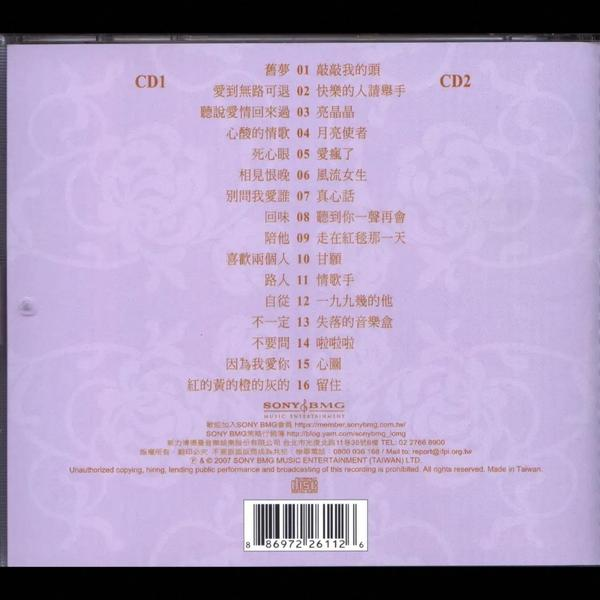

---

## 蛋堡

[2026-10-19 00:01] 来自：夸克云盘影视资源频道

名称：蛋堡（Soft Lipa）专辑 合集

描述：合集

夸克网盘：https://pan.quark.cn/s/44db5efbad9d

📁 大小：2.4GB

🏷 标签：#无损音乐 #音乐 #华语

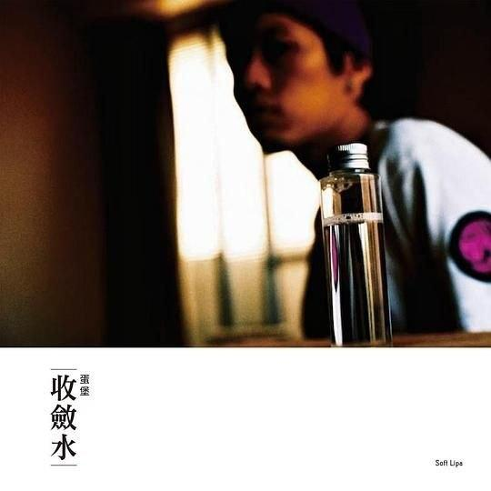

---

## The

[2026-10-18 21:02] 来自：综合网盘资源频道

名称：The Orient Collective – Marrakech Nights (2026) FLAC

描述：马拉喀什之夜 电子音乐专辑。

百度网盘：https://pan.baidu.com/s/11Out0CK2w8OPxS2Mk0299Q?pwd=7rw8

夸克网盘：https://pan.quark.cn/s/2ce680a29e34

迅雷网盘：https://pan.xunlei.com/s/VP4E5CHUSbDLcwVTUdxAgB3ZA1?pwd=xnp3

📁 大小：500MB

🏷 标签：#音乐 #FLAC #baidu #quark #xunlei

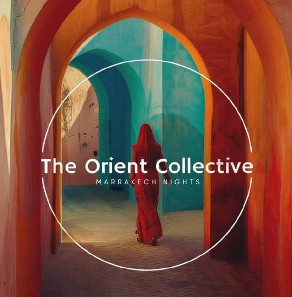

---

## Mara

[2026-10-18 18:26] 来自：无损音乐分享频道

名称：María Dueñas, Orchestre Metropolitain, Yannick Nézet-Séguin (2026) FLAC 24bit 96khz

描述：María Dueñas 2026专辑，与大都会管弦乐团、尼尔泽-塞金合作，录制哈沃尔森失传小提琴协奏曲，现场演绎，小提琴音色华丽饱满，浪漫浓烈富有北欧风情。

夸克网盘：https://pan.quark.cn/s/e1535ebb7a14

📁 大小：572MB

🏷 标签：#无损音乐 #音乐 #古典

---

## The

[2026-10-18 16:32] 来自：无损音乐分享频道

名称：The Beatles 2009 Mono Remaster Box Set ALAC

描述：披头士套装 The Beatles 2009 Mono Remaster Box Set ALAC

夸克网盘：https://pan.quark.cn/s/15ccfee83615

📁 大小：NG

🏷 标签：#无损音乐 #无损音乐 #欧美

---

## 成都国际音响展

[2026-10-18 15:49] 来自：无损音乐分享频道

名称：成都国际音响展 2026纪念CD WAV+cue 整轨

描述：01.人生就是戲（Life is a play）-蔡琴

 02.路易斯安娜1927（Louisiana 1927）-阿隆·内维爾

 03.知之甚少（Don't Know Much）-阿隆·納維、琳達

 04.女士（Lady）-肯尼·羅傑斯

 05.哈瓦涅拉舞曲（Havanalse）-魯傑羅·裡奇

 06.G大調第一小提琴奏鳴曲（Sonata No.1, G Major）-羅西尼

 07.流水（Running Water）-龔一

 08.燕子（Swallow）-迪裏拜爾

 09.辛德勒的名單 主題曲（Theme From Schindler's）-帕爾曼

 10.在密密的森林裡（In a Secret Forest）-李傳韻

 11.C升小調匈牙利狂想曲第2號（Hungarian Rhapsody No.2 in C）-李斯特

 12.《蘇格蘭幻想曲》序曲(莊嚴)（Bruch Scottish Fantasia Introduction(Grave)）-大衛·奧伊斯特拉赫

 13.莫斯科郊外的晚上（Night in Moscow's Suburb）-索洛維約夫·謝多

 14.田納西華爾滋（Tennessee Waltz）-伊娃·卡希迪

 15.真的結束了嗎（Is It Really Over）-吉姆·裡夫斯

夸克网盘：https://pan.quark.cn/s/113d838991a2

📁 大小：N

🏷 标签：#无损音乐 #音乐 #

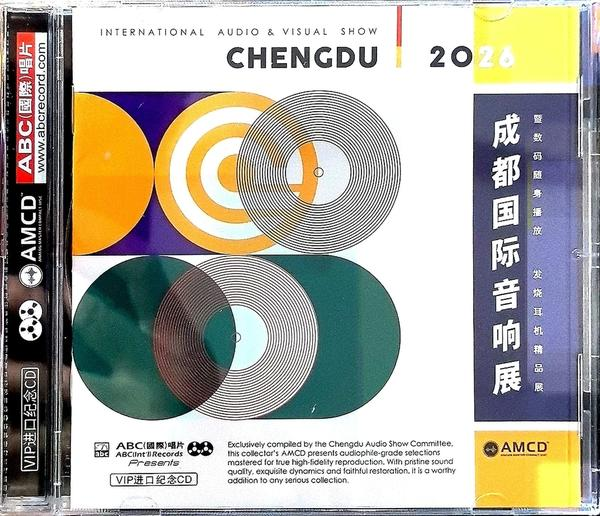

---

## 发烧宝鉴

[2026-10-18 15:38] 来自：无损音乐分享频道

名称：发烧宝鉴 顶级试音天碟 Opus3 Showcase 2005 SACD (ISO)

描述：这是一张任何发烧友都不能没有的顶级音响试碟，集爵士、古典、敲击、结他、合唱、蓝调等不同风格音乐，无敌的通透感完全突显了每首乐章的试音元素，是测试器材的绝佳软件

夸克网盘：https://pan.quark.cn/s/7f88512b3949

📁 大小：4.1GB

🏷 标签：#无损音乐 #音乐

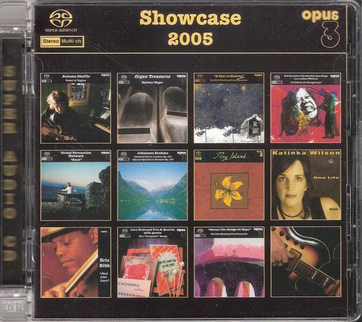

---

## Angle

[2026-10-18 12:59] 来自：综合网盘资源频道

名称：Angèle - Instinct(2026) FLAC 24bit 48khz qobuz

描述：Angèle《Instinct》2026第三张录音室专辑，法英双语电子流行。收录《What You Want》《Dis-le》等曲目，携手Justice、Caroline Polachek合作，合成器律动灵动，跟随直觉探索自我。

链接：

夸克网盘：https://pan.quark.cn/s/b6925f638b2f

百度网盘：https://pan.baidu.com/s/1D8dxRAtF_-n6wa_7qygXqg?pwd=kick

📁 大小：533MB

🏷 标签：#无损音乐 #音乐 #欧美流行 #FLAC #24bit #quark #baidu

---

## 群星新一人一首国语金曲天后篇2CD

[2026-10-18 12:59] 来自：百度网盘综合频道

名称：群星《新一人一首国语金曲·天后篇》2CD WAV 分轨

描述：群星《新一人一首国语金曲·天后篇》2CD精选专辑，汇集华语一众实力女歌手。收录王菲《匆匆那年》、蔡健雅《别找我麻烦》、郁可唯《时间煮雨》、那英《默》、陈洁仪《从前的我》、邓丽君《千言万语》、刘明湘《漂洋过海来看你》、张碧晨《年轮》、邓紫棋《泡沫》、丁当《猜不透》等三十首国语金曲。曲风多元，各款女声各具韵味.

百度网盘：https://pan.baidu.com/s/1RzdbtyqAjHX-jzsd5GMobA?pwd=kick

夸克网盘：https://pan.quark.cn/s/51cc88c83911 来自：综合网盘资源频道 [2026-10-18 12:48] 名称：群星《新一人一首国语金曲·天后篇》2CD WAV 分轨

📁 大小：1.3GB

🏷 标签：#无损音乐 #音乐 #华语

---

## Angle

[2026-10-18 10:54] 来自：无损音乐分享频道

名称：Angèle - Instinct(2026) FLAC 24bit 48khz qobuz

描述：Angèle《Instinct》2026第三张录音室专辑，法英双语电子流行。收录《What You Want》《Dis-le》等曲目，携手Justice、Caroline Polachek合作，合成器律动灵动，跟随直觉探索自我。

夸克网盘：https://pan.quark.cn/s/b6925f638b2f

📁 大小：N

🏷 标签：#无损音乐 #音乐 #欧美流行

---

## Troye

[2026-10-18 09:54] 来自：无损音乐分享频道

名称：Troye Sivan 合集 flac

描述：Troye Sivan 

夸克网盘：https://pan.quark.cn/s/1fe3e697f101

📁 大小：NG

🏷 标签：#无损音乐 #音乐 #欧美

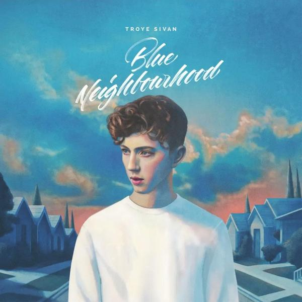

---

## Rachel

[2026-10-18 08:34] 来自：综合网盘资源频道

名称：Rachel Chinouriri - I think I spoke too soon 2026 FLAC

描述：最新流行专辑。

百度网盘：https://pan.baidu.com/s/1iebIJpw_WmzqKTe7o5Y4aQ?pwd=669c

夸克网盘：https://pan.quark.cn/s/4a4a1ff11394

迅雷网盘：https://pan.xunlei.com/s/VP4BQ6LKcZuIo3LoeMMtZzKNA1?pwd=nwrd

📁 大小：500MB

🏷 标签：#音乐 #FLAC #baidu #quark #xunlei

---

## 群星新一人一首国语金曲天后篇2CD

[2026-10-18 00:02] 来自：夸克云盘影视资源频道

名称：群星《新一人一首国语金曲·天后篇》2CD WAV 分轨

描述：群星《新一人一首国语金曲·天后篇》2CD精选专辑，汇集华语一众实力女歌手。收录王菲《匆匆那年》、蔡健雅《别找我麻烦》、郁可唯《时间煮雨》、那英《默》、陈洁仪《从前的我》、邓丽君《千言万语》、刘明湘《漂洋过海来看你》、张碧晨《年轮》、邓紫棋《泡沫》、丁当《猜不透》等三十首国语金曲。曲风多元，各款女声各具韵味.

夸克网盘：https://pan.quark.cn/s/51cc88c83911

📁 大小：1.3GB

🏷 标签：#无损音乐 #音乐 #华语

---

## 陈小春

[2026-10-18 00:02] 来自：夸克云盘影视资源频道

名称：陈小春 绝对收藏 2CD WAV分轨

描述：陈小春《绝对收藏》精选专辑，收录《我爱的人》《神啊救救我》《抱一抱》《下半辈子》等三十首金曲。

夸克网盘：https://pan.quark.cn/s/0738fbb27d31

📁 大小：1.25GB

🏷 标签：#无损音乐 #音乐 #华语

---

## 郑中基

[2026-10-18 00:01] 来自：夸克云盘影视资源频道

名称：郑中基 2026 演唱会 FLAC 24bit 96khz

描述：郑中基现场专辑，收录《无赖》《左右为难》《可惜我是水瓶座》《你的眼睛背叛你的心》等三十首现场曲目，舞台演绎丰富，人声鲜活，囊括多首经典代表作。

夸克网盘：https://pan.quark.cn/s/a21c62c6b41b

📁 大小：2.6GB

🏷 标签：#无损音乐 #音乐 #华语

---

## Ado

[2026-10-17 22:23] 来自：肯德基の4K影视综合电影云盘站

名称：Ado — Raven Sky (2026) FLAC 24bit 48kHz

描述：Ado《Raven Sky》2026单曲，是三池崇史.导演电影《坏中尉：东京》主题曲。日英双语摇滚，爆发力十足，借乌鸦意象，描绘深陷黑暗仍追寻生命力量。

夸克网盘：https://pan.quark.cn/s/2254061d1d71

📁 大小：N

🏷 标签：#无损音乐 #音乐

---

## 电子音乐

[2026-10-17 21:15] 来自：综合网盘资源频道

名称：电子音乐 - The Orient Collective Moon Over Marrakesh (2025) FLAC

描述：马拉喀什月夜 中东风味电子音乐专辑。

百度网盘：https://pan.baidu.com/s/1Hj1SZbNqYGfLsBTWkVB4uA?pwd=f938

夸克网盘：https://pan.quark.cn/s/295317aa7d38

迅雷网盘：https://pan.xunlei.com/s/VP48z2RtiCLwA7fq2PlkU7RjA1?pwd=dc46

📁 大小：490MB

🏷 标签：#音乐 #电子音乐 #baidu #quark #xunlei

---

## 河西走廊纪录片

[2026-10-17 20:45] 来自：夸克云盘影视资源频道

名称：《河西走廊》纪录片 原声音乐大碟 flac

描述：《河西走廊》纪录片原声音乐大碟，由雅尼、徐鲤联手打造。新世纪曲风，《河西走廊之梦》苍凉辽阔，东西乐韵交融，以旋律勾勒丝路千年风云，史诗氛围感十足。

夸克网盘：https://pan.quark.cn/s/89b5458fe03f

📁 大小：N

🏷 标签：#无损音乐 #音乐 #纯音乐

---

## David

[2026-10-17 17:06] 来自：综合网盘资源频道

名称：David Bowie - The Next Day (2025 Remaster, Reissue 2026) FLAC Hi-Res 24bit 96khz

描述：大卫鲍伊 David Bowie《The Next Day》，2025母带重制、2026再版发行。这是他蛰伏十年的复出摇滚专辑，歌词深沉充满思辨，新版音质优化，重现传奇的音乐锋芒。

链接：

夸克网盘：https://pan.quark.cn/s/8b026e039260

百度网盘：https://pan.baidu.com/s/1JdLIm8WbjRmCDzY1SdYl7Q?pwd=kick

迅雷网盘：https://pan.xunlei.com/s/VP485yassh4bjVwnfs79PTZIA1?pwd=m7vv

📁 大小：741MB

🏷 标签：#无损音乐 #音乐 #摇滚 #quark #baidu #xunlei

---

## 大卫鲍伊

[2026-10-17 16:17] 来自：综合网盘资源频道

名称：大卫鲍伊 David Bowie - The Next Day (2025 Remaster) 2026 FLAC

描述：重制版专辑。

百度网盘：https://pan.baidu.com/s/1Y58_Y0pfzljdMb1_POlsOg?pwd=8891

夸克网盘：https://pan.quark.cn/s/f20106b768b5

迅雷网盘：https://pan.xunlei.com/s/VP47vCk2YudTQGL7FRxOgQ9gA1?pwd=qy3n

📁 大小：700MB

🏷 标签：#音乐 #大卫鲍伊 #FLAC #baidu #quark #xunlei

---

## 高音天后邓紫棋精选歌曲合集

[2026-10-17 15:21] 来自：综合网盘资源频道

名称：高音天后邓紫棋精选歌曲合集 无损超高音质，值得收藏聆听的歌单！

描述：G.E.M邓紫棋最全版无损音质，小巨肺邓紫棋经典歌曲合集，本名邓诗颖，中国香港流行乐女歌手、词曲作者、音乐制作人。 2008年，发行个人首张音乐EP《G.E.M.》，凭该EP获得香港叱咤乐坛流行榜“叱咤乐坛生力军女歌手(金奖)”

夸克网盘：https://pan.quark.cn/s/7cf2ec5c8f1e

📁 大小：6.4GB

🏷 标签：#音乐 #邓紫棋 #精选 #歌曲 #合集 #无损 #歌单 #quark #高音天后邓紫棋精选歌曲合集 #无损超高音质 #值得收藏聆听的歌单

---

## Twice

[2026-10-17 15:09] 来自：综合网盘资源频道

名称：Twice - THIS IS FOR WORLD TOUR FINALE in SEOUL - LIVE - 2026 FLAC 24bit 96khz qobuz

描述：kpop新专

夸克网盘：https://pan.quark.cn/s/f011faed64cd

百度网盘：https://pan.baidu.com/s/1uHaSWN5QKE4LIKAqi-wN0A?pwd=kick

📁 大小：1.5GB

🏷 标签：#无损音乐 #音乐 #kpop #quark #baidu

---

## 成都国际音响展

[2026-10-17 15:08] 来自：综合网盘资源频道

名称：成都国际音响展 2026纪念CD WAV

描述：01.人生就是戲(Life is a play)-蔡琴

02.路易斯安娜1927(Louisiana 1927)-阿隆·内维爾

03.知之甚少(Don't Know Much)-阿隆·納維、琳達

04.女士(Lady)-肯尼·羅傑斯

05.哈瓦涅拉舞曲(Havanalse)-魯傑羅·裡奇

06.G大調第一小提琴奏鳴曲(Sonata No.1, G Major)-羅西尼

07.流水(Running Water)-龔一

08.燕子(Swallow)-迪裏拜爾

09.辛德勒的名單 主題曲(Theme From Schindler's)-帕爾曼

..

链接：

夸克网盘：https://pan.quark.cn/s/a42458080e28

百度网盘：https://pan.baidu.com/s/1CniWywSOiOGOu9PTSVy03g?pwd=kick

📁 大小：N

🏷 标签：#无损音乐 #音乐 #成都国际音响展 #2026纪念CD #WAV #quark #baidu

---

## 张国荣

[2026-10-17 14:40] 来自：综合网盘资源频道

名称：张国荣 爱情小孩 - Single (2026) ALAC 24bit 48khz FLAC 24bit 96khz

描述：张国荣《爱情小孩》，尘封二十余年国语遗作，是《春夏秋冬》国语版。保留1999年原版人声，梁荣骏重制配器

夸克网盘：https://pan.quark.cn/s/407301fe7c9a

百度网盘：https://pan.baidu.com/s/1F2RTP9L1LUNCOlJeW19Skg?pwd=kick

📁 大小：N

🏷 标签：#无损音乐 #音乐 #华语 #张国荣 #爱情小孩 #ALAC #24bit #FLAC #quark #baidu

---

## 金属之声

[2026-10-17 13:43] 来自：综合网盘资源频道

名称：金属之声 Sound of Metal (2019)

描述：在本片这个关于声音、愤怒与自我发现的故事中，里兹·阿迈德以全情投入的表演，诠释了情绪不稳定的鼓手鲁本。他与主唱女友露组成噪音金属二人组，在炽热的现场演出中找到了新的人生目标。当鲁本突然丧失大部分听力后，他被迫踏上了一场深刻的奥德赛之旅——经历否认、愤怒、悲伤，并逐渐学会接受——他开始理解身为聋人的意义，并认识到失聪并非一种残疾，而是一个丰富的文化与社群。

夸克网盘：https://pan.quark.cn/s/a61c578f5988

阿里云盘：https://www.alipan.com/s/Ns3XAkKVPy2

📁 大小：NG

🏷 标签：#剧情 #音乐 #金属之声 #quark #ali

---

## 成都国际音响展

[2026-10-17 10:40] 来自：无损音乐分享频道

名称：成都国际音响展 2026纪念CD WAV

描述：01.人生就是戲（Life is a play）-蔡琴

 02.路易斯安娜1927（Louisiana 1927）-阿隆·内维爾

 03.知之甚少（Don't Know Much）-阿隆·納維、琳達

 04.女士（Lady）-肯尼·羅傑斯

 05.哈瓦涅拉舞曲（Havanalse）-魯傑羅·裡奇

 06.G大調第一小提琴奏鳴曲（Sonata No.1, G Major）-羅西尼

 07.流水（Running Water）-龔一

 08.燕子（Swallow）-迪裏拜爾

 09.辛德勒的名單 主題曲（Theme From Schindler's）-帕爾曼

 10.在密密的森林裡（In a Secret Forest）-李傳韻

 11.C升小調匈牙利狂想曲第2號（Hungarian Rhapsody No.2 in C）-李斯特

 12.《蘇格蘭幻想曲》序曲(莊嚴)（Bruch Scottish Fantasia Introduction(Grave)）-大衛·奧伊斯特拉赫

 13.莫斯科郊外的晚上（Night in Moscow's Suburb）-索洛維約夫·謝多

 14.田納西華爾滋（Tennessee Waltz）-伊娃·卡希迪

 15.真的結束了嗎（Is It Really Over）-吉姆·裡夫斯

夸克网盘：https://pan.quark.cn/s/a42458080e28

📁 大小：N

🏷 标签：#无损音乐 #音乐 #

---

## The

[2026-10-17 09:10] 来自：综合网盘资源频道

名称：The Jimi Hendrix Experience - Magic Boy Live At Berkeley [First Show] - 2026 FLAC 24bit 192khz

描述：蓝调摇滚新专

夸克网盘：https://pan.quark.cn/s/d8d2c1a7574d

百度网盘：https://pan.baidu.com/s/1LMjXMwyvcnDxRbZwDpAlSw?pwd=kick

📁 大小：2.5GB

🏷 标签：#无损音乐 #音乐 #摇滚 #quark #baidu

---

## Twice

[2026-10-17 09:07] 来自：百度网盘综合频道

名称：Twice - THIS IS FOR WORLD TOUR FINALE in SEOUL - LIVE - 2026 FLAC 24bit 96khz qobuz

描述：kpop新专 

百度网盘：https://pan.baidu.com/s/1uHaSWN5QKE4LIKAqi-wN0A?pwd=kick

夸克网盘：https://pan.quark.cn/s/f011faed64cd 来自：夸克云盘影视资源频道 [2026-10-17 09:04] 名称：Twice - THIS IS FOR WORLD TOUR FINALE in SEOUL - LIVE - 2026 FLAC 24bit 96khz qobuz

📁 大小：1.5GB

🏷 标签：#无损音乐 #音乐 #kpop

---

## Tate

[2026-10-17 00:02] 来自：无损音乐分享频道

名称：Tate McRae - Housewife +FLAC 24bit 48khz + 4K mv

描述：Tate McRae《Housewife》2026全新流行单曲，带复古2000年代流行质感。歌词借反讽解构标签，传递女性独立自主，编曲利落抓耳，搭配奢华氛围感MV。

夸克网盘：https://pan.quark.cn/s/5f4546cb74d7

📁 大小：562MB

🏷 标签：#无损音乐 #音乐 #欧美流行

---

## 群星

[2026-10-17 00:01] 来自：百度网盘综合频道

名称：群星 - 1995 年国语流行畅销金曲 FLAC

描述：

1995华语金曲精选，收录一众传世金曲。张国荣《当爱已成往事》、林忆莲《伤痕》道尽情爱悲欢；张学友《一千个伤心的理由》、张信哲《过火》奠定华语情歌典范。王菲《但愿人长久》空灵悠远，那英《白天不懂夜的黑》深情炸裂。同时囊括刘若英《为爱痴狂》、许美静《城里的月光》、田震《执着》、张宇《一言难尽》、刘德华《真永远》等佳作，首首耳熟能详，尽显90年代乐坛黄金质感。

链接：

百度网盘：https://pan.baidu.com/s/1IOji4T38PgMEmMoTfMIEHQ?pwd=321k

夸克网盘：https://pan.quark.cn/s/d3e9587c04d6 来自：夸克云盘影视资源频道 [2026-10-17 00:01] 名称：群星 - 1995 年国语流行畅销金曲 FLAC

📁 大小：N

🏷 标签：#无损音乐 #音乐 #华语

---

## 接招吧制作人

[2026-10-16 21:17] 来自：综合网盘资源频道

名称：接招吧！制作人 接招吧！製作人 (2026) 【更新至09集】【1080p】【国语中字】【台剧】

描述：“流行音乐是一个人的狂欢，还是要大众喜欢？”

千禧年前后，大学刚毕业的廖苗君(9m88 饰)，误打误撞成为王牌音乐制作人吴培祖(杨祐宁 饰)的助理。一个坚韧但鲁莽，一个有才却难搞，这对相爱相杀的师徒，与不同大牌歌手碰撞出别样的创作火花。两人经历著冲突和磨合，共同面对各种挑战，肩负起音乐制作人的责任与使命。

夸克网盘：https://pan.quark.cn/s/11dbeff88786

📁 大小：NA

🏷 标签：#剧情 #音乐 #接招吧 #制作人 #製作人 #1080p #国语中字 #台剧 #quark

---

## 电子音乐

[2026-10-16 21:02] 来自：综合网盘资源频道

名称：电子音乐 - Ibiza Winter Island 2027 (The Melodic Techno Edition) (2026) FLAC

描述：电子音乐Melodic Techno专辑。

百度网盘：https://pan.baidu.com/s/1iN6F5ntu7xhmHhQ18_vpCg?pwd=annk

夸克网盘：https://pan.quark.cn/s/739b87757b98

迅雷网盘：https://pan.xunlei.com/s/VP43moRXcZuIo3LoeMMmUNLXA1?pwd=nt3y

📁 大小：800MB

🏷 标签：#音乐 #电子音乐 #baidu #quark #xunlei

---

## 大门

[2026-10-16 20:43] 来自：综合网盘资源频道

名称：大门 The Doors (1991)

描述：本片忠实地记述了1960年代美国迷幻摇滚代表乐队——大门乐队的灵魂主唱吉姆·莫里森(方·基默 Val Kilmer饰)从成名到自我毁灭的一生。在电影学校，莫里森结识了喜欢弹钢琴的键盘手雷·曼札克，两人一拍即合，决定组建一支令世界震惊的摇滚乐队：The Doors。

夸克网盘：https://pan.quark.cn/s/9d2577a672d7

阿里云盘：https://www.alipan.com/s/FMQCQBDkjPC

📁 大小：NG

🏷 标签：#剧情 #音乐 #传记 #大门 #quark #ali

---

## 王杰

[2026-10-16 19:43] 来自：夸克云盘影视资源频道

名称：王杰 - 一场游戏一场梦（2017年华纳XRCD限量版）WAV 分轨

描述：1 一场游戏一场梦

2 只因我爱你

3 别再说想我

4 惦记这一些

5 心里的呼喊

6 安妮

7 风和雾

8 故事的角色

9 说声珍重

10 一场游戏一场梦II

夸克网盘：https://pan.quark.cn/s/70b1ffe6aca9

📁 大小：N

🏷 标签：#无损音乐 #音乐 #华语

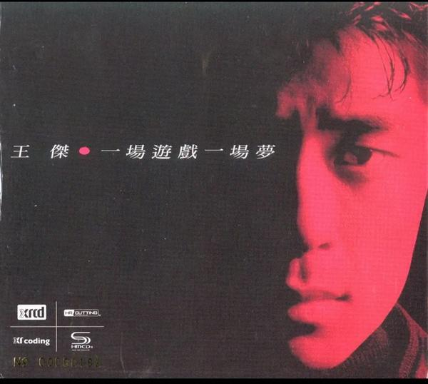

---

## 梁静茹

[2026-10-16 16:40] 来自：夸克云盘影视资源频道

名称：梁静茹 - 爱的大游行(2005) Live全纪录 WAV 分轨

描述：梁静茹《爱的大游行 Live全纪录》，2005年发行，收录台北演唱会现场录音。汇集《燕尾蝶》《勇气》等经典情歌，现场真挚动人，特别献唱《掌声响起》缅怀父亲，另附单曲《孤单北半球》，完整留存这场标志性的情歌盛宴。

夸克网盘：https://pan.quark.cn/s/4b5e8735ed09

百度网盘：https://pan.baidu.com/s/1O5i-BFQ_HydR6tqa2wXHsw?pwd=kick 来自：百度网盘综合频道 [2026-10-16 16:23] 名称：梁静茹 - 爱的大游行(2005) Live全纪录 WAV 分轨

📁 大小：1.2GB

🏷 标签：#无损音乐 #音乐 #华语

---

## 纵贯线

[2026-10-16 15:29] 来自：综合网盘资源频道

名称：纵贯线 再见(2026) flac 24bit 48khz

描述：纵贯线《再见(Live)》，取自2009台北收官演唱会现场录音。四人合唱这首张震岳作品，作为乐团限定巡演的告别曲目，2026单独发行数字现场单曲。

链接：

夸克网盘：https://pan.quark.cn/s/f0837e222881

百度网盘：https://pan.baidu.com/s/1lTh_0aThw04jY2mKvSdG8A?pwd=kick

📁 大小：40MB

🏷 标签：#无损音乐 #音乐 #华语 #纵贯线 #再见 #flac #24bit #quark #baidu

---

## 皇后乐队蒙特利尔现场演唱会慈善直播音乐会

[2026-10-16 14:20] 来自：综合网盘资源频道

名称：皇后乐队蒙特利尔现场演唱会&慈善直播音乐会 (2007)

描述：此张蓝光收录了皇后乐队在蒙特利尔的现场实录(Queen Rock Montreal)与“拯救生命”现场 (Queen: Live Aid)。

夸克网盘：https://pan.quark.cn/s/ebd1d7ee80c6

阿里云盘：https://www.alipan.com/s/dmuJRUkcqBK

📁 大小：NG

🏷 标签：#音乐 #皇后乐队蒙特利尔现场演唱会 #慈善直播音乐会 #quark #ali

---

## The

[2026-10-16 09:58] 来自：综合网盘资源频道

名称：The Avalanches - No Bad Memories 2026 FLAC

描述：澳大利亚电子音乐组合新专辑。

百度网盘：https://pan.baidu.com/s/1SGW2H6S0k2rxzfEFqYVyvw?pwd=cvwp

夸克网盘：https://pan.quark.cn/s/283c3b1c28ad

迅雷网盘：https://pan.xunlei.com/s/VP41QeVq5emWKvtPRRNtnqtYA1?pwd=4bmb

📁 大小：310MB

🏷 标签：#音乐 #FLAC #baidu #quark #xunlei

---

## 斯丹曼簇

[2026-10-16 09:09] 来自：综合网盘资源频道

名称：斯丹曼簇 合集 FLAC

描述：斯丹曼簇是中国内地藏族唱作女歌手，把高原的灵气与都市的敏感写进独立流行。2021 年以 EP《他》起步，2023 年《斯丹曼簇单身记》延续自我表达，2026 年推出第二张全长专辑《鲜花与牛粪》，把「牛粪」唱成关于生命与自我接纳的哲学；她还与 Alan Walker 合作了单曲《Fate》。嗓音清澈而带野性，民族色彩与现代编曲交织，是新生代里辨识度极高的一抹高原之声。

夸克网盘：https://pan.quark.cn/s/48b211dc4e4f

百度网盘：https://pan.baidu.com/s/1_mXYzgCAJzSNxXCnESzsjw?pwd=kick

📁 大小：3.1GB

🏷 标签：#无损音乐 #音乐 #华语 #斯丹曼簇 #合集 #FLAC #quark #baidu

---

## Gabriel

[2026-10-16 08:41] 来自：百度网盘综合频道

名称：Gabriel Mervine - I Wish You Love 2026 [SACD nativedsd

描述：Gabriel Mervine《I Wish You Love》，2026爵士人声SACD 温润醇厚的嗓音演绎经典情歌，伴奏简约雅致，录音细腻通透，温柔诠释爱意与美好祝愿。

百度网盘：https://pan.baidu.com/s/1cVqVv4ITzdkDzzWJSRyFbQ?pwd=kick

夸克网盘：https://pan.quark.cn/s/48dd21d2e98b 来自：综合网盘资源频道 [2026-10-16 08:16] 名称：Gabriel Mervine - I Wish You Love 2026 [SACD nativedsd

📁 大小：N

🏷 标签：#无损音乐 #音乐 #爵士 #baidu

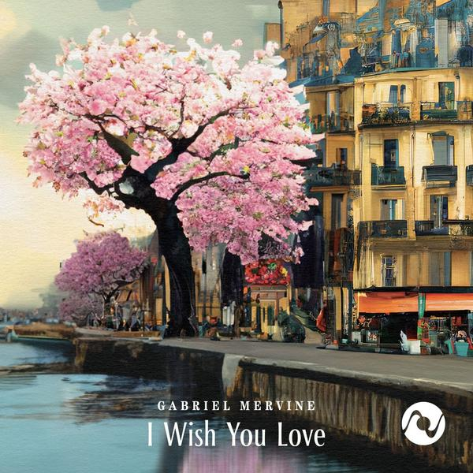

---

## 群星

[2026-10-16 07:57] 来自：综合网盘资源频道

名称：群星 - 1994 年国语流行畅销金曲 FLAC

描述：这张《群星 国语流行畅销金曲 · 1994》精选集汇集年度经典：刘德华《忘情水》《天意》、张学友《偷心》，周华健《风雨无阻》、张信哲《别怕我伤心》，伍佰《浪人情歌》、老狼《同桌的你》，王菲《我愿意》、辛晓琪《领悟》，还有李丽芬《爱江山更爱美人》、赵咏华《最浪漫的事》，曲风包罗万象，镌刻90年代华语乐坛的辉煌印记。

夸克网盘：https://pan.quark.cn/s/a6b4b25a14f7

百度网盘：https://pan.baidu.com/s/1RosKFjFLyaGFHrcAlQ2mgA?pwd=kick

📁 大小：NG

🏷 标签：#无损音乐 #音乐 #华语 #群星 #年国语流行畅销金曲 #FLAC #quark #baidu

---

## 李宗盛既然青春留不住还是做个大叔好2016年演唱会BluRay

[2026-10-16 06:50] 来自：综合网盘资源频道

名称：李宗盛:既然青春留不住,还是做个大叔好!2016年演唱会BluRay

描述：李宗盛既然青春留不住，还是做个大叔好 2016 年演唱会 BluRay 版本，完整收录本场现场演出，演绎多首经典代表作，呈现富有故事感的现场演唱，画面音质高清，适合喜爱李宗盛作品的歌迷收藏观看，重温经典华语现场。

光鸭云盘：https://www.guangyapan.com/s/1957954371937546240_aoWfvxBsbh4Ybo3W

📁 大小：25.4GB

🏷 标签：#音乐 #演唱会 #经典 #高清 #李宗盛 #既然青春留不住 #还是做个大叔好 #guangyapan

---

## FONTAINES

[2026-10-16 00:22] 来自：综合网盘资源频道

名称：FONTAINES D.C. - Dopamine Chamber (2026) FLAC 24bit 96khz qobuz

描述：爱尔兰后朋克乐队2026 新作。转向冷峻合成器音色，探讨数字时代的快感与焦虑，深沉叙事搭配氛围感编曲，充满末日反思色彩。

夸克网盘：https://pan.quark.cn/s/9f96c6894c12

百度网盘：https://pan.baidu.com/s/17KQfbjTecT0JCOz3Pgwxng?pwd=kick

📁 大小：983MB

🏷 标签：#无损音乐 #音乐 #摇滚 #FLAC #24bit #quark #baidu

---

## 群星

[2026-10-16 00:03] 来自：综合网盘资源频道

名称：群星 - 1993 年国语流行畅销金曲 FLAC

描述：这张《1993年国语流行畅销金曲》精选集，收录华语乐坛爆发之年的众多传世作品。张学友《吻别》、周华健《花心》、张信哲《爱如潮水》传唱一时；王菲、林忆莲唱出女性心声，黄安《新鸳鸯蝴蝶梦》、陈淑桦《笑红尘》等影视金曲韵味悠长。曲目风格多元，记录90年代华语乐坛的黄金盛景，一曲曲旋律唤醒一代人的青春记忆。

夸克网盘：https://pan.quark.cn/s/9042cd8a4138

百度网盘：https://pan.baidu.com/s/1Kiotwhn7bPhL5L4KAnNbmw?pwd=kick

📁 大小：1.35GB

🏷 标签：#无损音乐 #音乐 #华语 #群星 #年国语流行畅销金曲 #FLAC #quark #baidu

---

## 輕音樂睡眠Sleeping

[2026-10-15 23:00] 来自：综合网盘资源频道

名称：輕音樂睡眠Sleeping with light music and sound of ocean waves) FLAC

描述：以柔和钢琴搭配空灵旋律与枕畔海浪白噪音，曲风静谧舒缓。用温柔古典氛围，抚平心绪，助你放松身心、安然入眠。

夸克网盘：https://pan.quark.cn/s/8dbfb94393bc

📁 大小：N

🏷 标签：#无损音乐 #音乐 #纯音乐 #輕音樂睡眠Sleeping #quark

---

## 保罗西蒙

[2026-10-15 22:46] 来自：综合网盘资源频道

名称：保罗西蒙 Paul Simon - 2026 - The Quiet Celebration Concert (Live] FLAC 24bit 48khz qobuz

描述：Paul Simon《The Quiet Celebration Concert》现场专辑，民谣摇滚融合世界音乐与室内乐，演绎新作与传世经典，编曲沉静雅致，人声叙事感浓厚。

夸克网盘：https://pan.quark.cn/s/8bece9b936a9

百度网盘：https://pan.baidu.com/s/1XilwffL9NuLZcMKqrLVixw?pwd=kick

迅雷网盘：https://pan.xunlei.com/s/VP4-0bWyhEE--1BHxRQwJCrzA1?pwd=8mnd

📁 大小：1.2GB

🏷 标签：#无损音乐 #音乐 #民谣摇滚 #保罗西蒙 #quark #baidu #xunlei

---

## Angle

[2026-10-15 22:30] 来自：综合网盘资源频道

名称：Angèle - Instinct 2026 FLAC

描述：10月16法语新专辑。

百度网盘：https://pan.baidu.com/s/17TaQsc71Mr_T4QuDM2OKLw?pwd=i9j7

夸克网盘：https://pan.quark.cn/s/afb27b230d4c

📁 大小：500MB

🏷 标签：#音乐 #FLAC #baidu #quark

---

## Ellie

[2026-10-15 22:22] 来自：百度网盘综合频道

名称：Ellie Goulding - EG.0 (2026) FLAC 24bit 44khz qobuz

描述：新专 

Ellie Goulding《EG.0》，电子流行篇章。集结多首合作热单，融合动感舞曲与抒情旋律，清亮独特声线交织合成器音色，探索自我重塑，充满现代流行质感。

链接：

百度网盘：https://pan.baidu.com/s/1xvmy2f-7L6SOM8QFsLt6Sg?pwd=kick

夸克网盘：https://pan.quark.cn/s/b0d8ada4fbbf 来自：综合网盘资源频道 [2026-10-15 22:21] 名称：Ellie Goulding - EG.0 (2026) FLAC 24bit 44khz qobuz

百度网盘：https://pan.baidu.com/s/1l4imT4fBA4mYWYiKwLXUCg?pwd=5dxr 来自：综合网盘资源频道 [2026-10-15 21:04] 名称：Ellie Goulding - EG.0 2026 FLAC

夸克网盘：https://pan.quark.cn/s/927feaef894d 来自：综合网盘资源频道 [2026-10-15 21:04] 名称：Ellie Goulding - EG.0 2026 FLAC

迅雷网盘：https://pan.xunlei.com/s/VP3zeAzmIArMdrJ67zcP1P-rA1?pwd=feiu 来自：综合网盘资源频道 [2026-10-15 21:04] 名称：Ellie Goulding - EG.0 2026 FLAC

📁 大小：354MB

🏷 标签：#无损音乐 #音乐 #欧美流行

---

## Fontaines

[2026-10-15 22:05] 来自：综合网盘资源频道

名称：Fontaines D.C. - Dopamine Chamber (2026) FLAC

描述：爱尔兰摇滚乐队10月16新专辑。

百度网盘：https://pan.baidu.com/s/1lxOa_4su60wZ3KSZhCFjkA?pwd=r2ex

夸克网盘：https://pan.quark.cn/s/bcc4dfb940d5

迅雷网盘：https://pan.xunlei.com/s/VP3zroGupPK12bz2PfqUgROUA1?pwd=q3j5

📁 大小：350MB

🏷 标签：#音乐 #FLAC #baidu #quark #xunlei

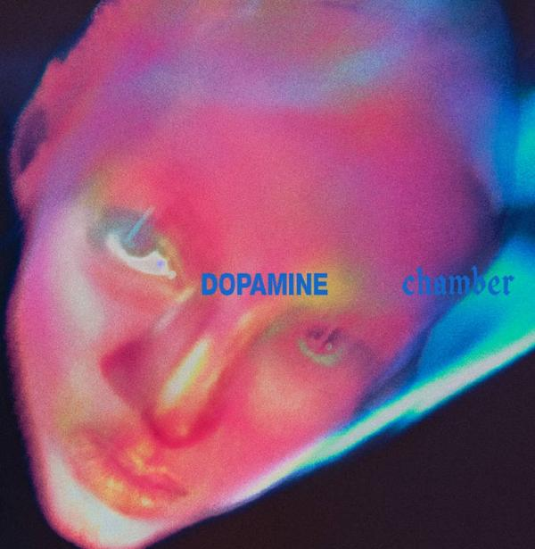

---

## 兰香如故

[2026-10-15 21:15] 来自：百度网盘综合频道

名称：兰香如故 (2026) 影视原声带 20首 FLAC 16bit qobuz

描述：《兰香如故》2026影视原声带，董冬冬、陈曦操刀，周深、郁可唯等献唱。歌曲与配乐交织，诉说人物命运浮沉，旋律细腻，满含岁月悲欢与成长释然。

链接：

百度网盘：https://pan.baidu.com/s/1-DFhN2LO3w96FfAn2ZJZSA?pwd=kick

夸克网盘：https://pan.quark.cn/s/6b81a57f7d39 来自：综合网盘资源频道 [2026-10-15 21:13] 名称：兰香如故 (2026) 影视原声带 20首 FLAC 16bit qobuz

📁 大小：454MB

🏷 标签：#无损音乐 #音乐 #华语 #兰香如故 #影视原声带

---

## 电子音乐

[2026-10-15 17:02] 来自：综合网盘资源频道

名称：电子音乐 - Top Best Trance September 2026 (FLAC)

描述：电子迷幻舞曲专辑。

百度网盘：https://pan.baidu.com/s/1AhQfPmzNZzK_5oplD_2ukQ?pwd=ij9o

夸克网盘：https://pan.quark.cn/s/71edcf7a1428

迅雷网盘：https://pan.xunlei.com/s/VP3ylynYdU29mvQSznJEIb0TA1?pwd=bwm5

📁 大小：800MB

🏷 标签：#音乐 #电子音乐 #FLAC #baidu #quark #xunlei

---

## Meovv

[2026-10-15 16:40] 来自：肯德基の4K影视综合电影云盘站

名称：Meovv - GO HARD (2026) (FLAC Hi-Res 24bit 48khz) qobuz

描述：kpop 女团MEOVV回归作品 包含两首曲目：同名主打《GO HARD》与B面曲《Indestructible》。

夸克网盘：https://pan.quark.cn/s/01eb32f3df1b

百度网盘：https://pan.baidu.com/s/1s1UaPrLjDMCzH13hfZuz0Q?pwd=kick

📁 大小：77MB

🏷 标签：#无损音乐 #音乐 #kpop

---

## 小红莓

[2026-10-15 13:12] 来自：无损音乐分享频道

名称：小红莓 乐队 精选 SACD

描述：小红莓 乐队 精选 The Cranberries - Stars- The Best of 1992 - 2002 {Universal Music Hong Kong - 5392287} {2021} [SACD]

夸克网盘：https://pan.quark.cn/s/a3a14f34f49f

📁 大小：3.2GB

🏷 标签：#无损音乐 #音乐 #欧美

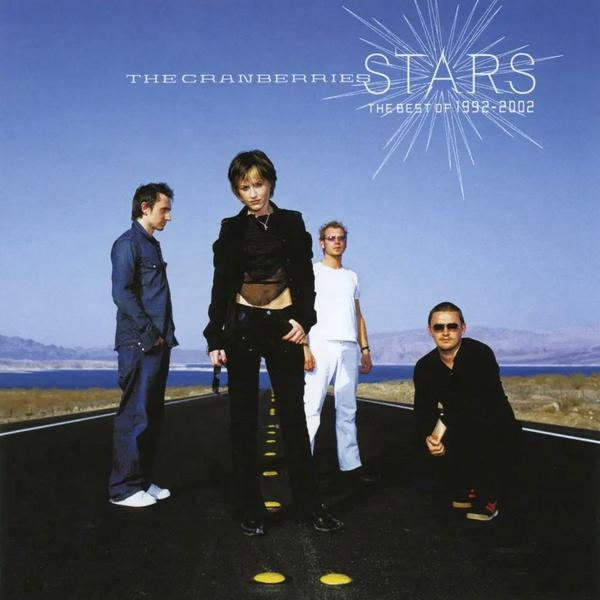

---

## 邓丽欣

[2026-10-15 09:37] 来自：肯德基の4K影视综合电影云盘站

名称：邓丽欣 一如 (2026) FLAC 24bit 48khz

描述：粤语新专

邓丽欣《一如（Tathātā）》，暌违十六年推出的粤语概念专辑。取自梵语“如其本然”，收录新作与重绎旧曲，在沉静流行曲风里，诉说岁月沉淀、回归本心的生命感悟。

夸克网盘：https://pan.quark.cn/s/a56edca6a711

百度网盘：https://pan.baidu.com/s/16CUnJFMuKD0V2fluUsKlvg?pwd=kick

📁 大小：380MB

🏷 标签：#无损音乐 #音乐 #华语

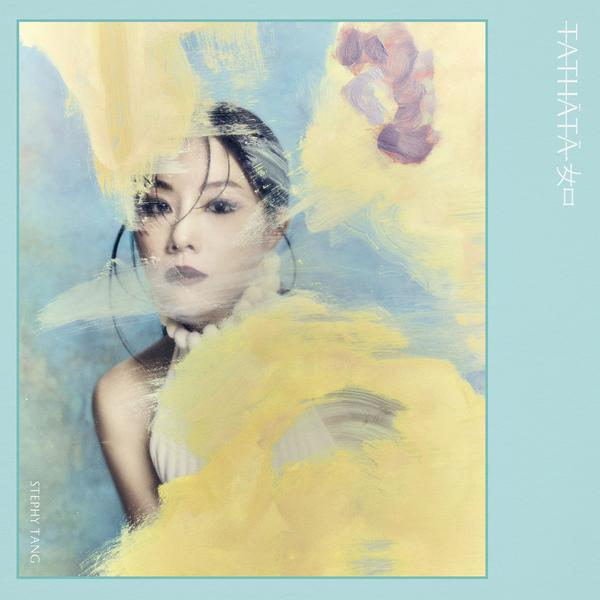

---

## 生化危机

[2026-10-15 07:30] 来自：肯德基の4K影视综合电影云盘站

名称：生化危机 爆发夜 (2026) 原声带 配乐 Hays Holladay, Ryan Holladay - Resident Evil (2026) FLAC HI-RES 24Bit - 44kHz qobuz

描述：Hays Holladay与Ryan Holladay为电影《生化危机：爆发夜》创作原声，实验电子配乐，层层渲染压抑惊悚氛围，烘托浣熊市的危机与恐怖感。

夸克网盘：https://pan.quark.cn/s/ff1fd6f9a67f

百度网盘：https://pan.baidu.com/s/1aOKdN1l1o7NX79RheJRdRw?pwd=kick

📁 大小：394MB

🏷 标签：#无损音乐 #音乐 #ost #原声带

---

## 群星

[2026-10-15 00:28] 来自：肯德基の4K影视综合电影云盘站

名称：群星 - 1993 年国语流行畅销金曲 FLAC

描述：1993年华语乐坛群星荟萃，这张《1993年国语流行畅销金曲》精选集，收录一众传世名作。张学友《吻别》、周华健《花心》、张信哲《爱如潮水》掀起情歌热潮；王菲《执迷不悔》、林忆莲《不必在乎我是谁》尽显女性心声。黄安《新鸳鸯蝴蝶梦》、陈淑桦《笑红尘》、万芳《新不了情》等影视金曲韵味悠长。首首皆是时代印记，循着旋律，重回蓬勃鲜活的九十年代。

夸克网盘：https://pan.quark.cn/s/b59267a98241

📁 大小：N

🏷 标签：#无损音乐 #音乐 #华语

---

## Jess

[2026-10-15 00:23] 来自：无损音乐分享频道

名称：Jess Williamson - A Mile South of Heaven (2026) FLAC Hi-Res 24bit 96kHz

描述：Jess Williamson《A Mile South of Heaven》，美式另类乡村专辑。由Shooter Jennings操刀制作，钢棒吉他与提琴铺展开阔编曲，借12首作品探讨人生取舍，嗓音细腻内敛，充满自省与温柔

夸克网盘：https://pan.quark.cn/s/11ceef1cd553

📁 大小：899MB

🏷 标签：#无损音乐 #音乐 #乡村

---

## 蛋堡

[2026-10-14 22:30] 来自：无损音乐分享频道

名称：蛋堡 2010 -《月光》WAV 分轨

描述：蛋堡《月光》，2010年与日本爵士乐团Jabber Loop合作的专辑。摒弃嘻哈采样，以现场爵士演奏为基底，蛋堡轻柔松弛的软说唱融入爵士编排。氛围静谧温润，描摹夜色下的思绪，入围金曲奖，是华语爵士嘻哈的经典之作。

夸克网盘：https://pan.quark.cn/s/25f5db81ed40

📁 大小：496MB

🏷 标签：#无损音乐 #音乐 #华语

---

## R

[2026-10-14 22:29] 来自：无损音乐分享频道

名称：R. Strauss & Bartók - Violin Concertos - Alena Baeva, Deutsche Kammerphilharmonie Bremen, Paavo Järvi (2026) (FLAC 24bit 96khz)古典 qobuz

描述： 

 阿莱娜·巴耶娃演绎理查·施特劳斯与巴托克小提琴协奏曲，帕沃·雅尔维执棒不来梅德意志室内爱乐。

夸克网盘：https://pan.quark.cn/s/af74f72e3e2c

📁 大小：NG

🏷 标签：#无损音乐 #音乐 #古典

---

## 电子音乐

[2026-10-14 22:13] 来自：综合网盘资源频道

名称：电子音乐 - Ibiza Winter Session 2027 (The Deep-House Smoothies) 2026 FLAC

描述： 电子专辑 以 Deep-House 为主，注重舒缓、深邃的氛围，适合冬季或休息场景聆听。

百度网盘：https://pan.baidu.com/s/1wBP7K3SUEY_gJC6OcAiAig?pwd=54x6

夸克网盘：https://pan.quark.cn/s/ccf5abb891a1

迅雷网盘：https://pan.xunlei.com/s/VP3ukFycIQdH2HlRn9VI0yR5A1?pwd=p2ve

📁 大小：800MB

🏷 标签：#音乐 #电子音乐 #baidu #quark #xunlei

---

## Verdi

[2026-10-14 17:08] 来自：无损音乐分享频道

名称：Verdi - Aida - Wiener Philharmoniker, Herbert von Karajan (2026) [SACD]

描述：

 ESSD-90327-28，ESOTERIC（二嫂）2026重制SACD，母带源自卡拉扬1959 Decca《阿依达》，是《阿依达》史上首部完整立体声歌剧录音，歌剧录音史标杆之作。

夸克网盘：https://pan.quark.cn/s/b7f3704a2d36

📁 大小：NG

🏷 标签：#无损音乐 #音乐 #古典

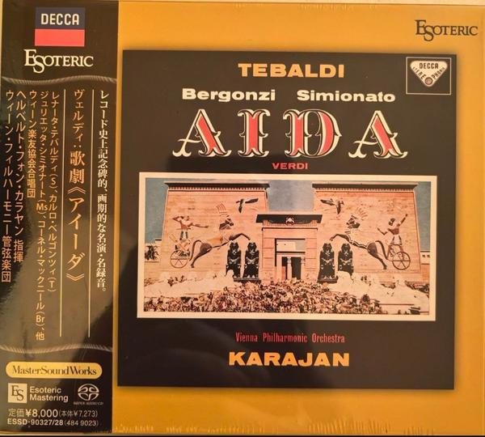

---

## 滚石群星

[2026-10-14 16:40] 来自：肯德基の4K影视综合电影云盘站

名称：滚石群星 祝你愉快 致家驹 台湾K1首版WAV+CUE

描述：

1. 真的爱你 周华健

2. 最想念你 齐豫

3. 命运是你家 杜德伟

4. 喜欢你 黄耀明

5. 大地 赵传

6. 关心永远在 陈升

7. 情人 林忆莲

8. 大地 DICK LEE

9. 光辉岁月 泰迪罗宾

夸克网盘：https://pan.quark.cn/s/690e2b594db6

百度网盘：https://pan.baidu.com/s/1SaWI8P8MO5wTD84nCy6xsw?pwd=kick

📁 大小：N

🏷 标签：#无损音乐 #音乐 #华语 #滚石群星 #祝你愉快 #致家驹 #台湾K1首版WAV #quark #baidu

---

## 樱坂46

[2026-10-14 15:11] 来自：综合网盘资源频道

名称：樱坂46 Sakurazaka46 - 愛MUST BE(Special Edition) (2026) FLAC

描述： 日语专辑。

百度网盘：https://pan.baidu.com/s/1qPUd31bin_SAKHU1MN8-Iw?pwd=qai4

夸克网盘：https://pan.quark.cn/s/1ae205e68c08

迅雷网盘：https://pan.xunlei.com/s/VP3tF59gEeVfu6kDTUtL4-r-A1?pwd=jcha

📁 大小：230MB

🏷 标签：#音乐 #樱坂46 #愛MUST #FLAC #baidu #quark #xunlei

---

## 保罗西蒙

[2026-10-14 14:42] 来自：百度网盘综合频道

名称：保罗西蒙 Paul Simon - 2026 - The Quiet Celebration Concert (Live] FLAC 24bit 48khz qobuz

描述：Paul Simon《The Quiet Celebration Concert》现场专辑，民谣摇滚融合世界音乐与室内乐，演绎新作与传世经典，编曲沉静雅致，人声叙事感浓厚。

链接：

百度网盘：https://pan.baidu.com/s/1XilwffL9NuLZcMKqrLVixw?pwd=kick

夸克网盘：https://pan.quark.cn/s/8bece9b936a9 来自：综合网盘资源频道 [2026-10-14 14:41] 名称：保罗西蒙 Paul Simon - 2026 - The Quiet Celebration Concert (Live] FLAC 24bit 48khz qobuz

📁 大小：1.2GB

🏷 标签：#无损音乐 #音乐 #民谣摇滚 #保罗西蒙

---

## Paul

[2026-10-14 13:54] 来自：综合网盘资源频道

名称：Paul Mauriat - Windy (1986) (FLAC 24bit 192khz) qobuz

描述：轻音乐

夸克网盘：https://pan.quark.cn/s/28a63fe49712

📁 大小：NG

🏷 标签：#无损音乐 #音乐 #纯音乐 #FLAC #24bit #quark

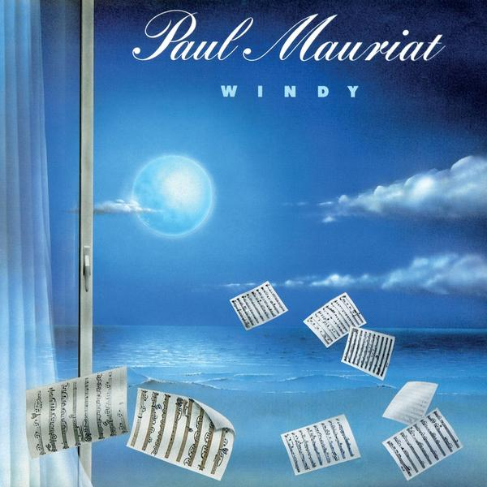

---

## Troye

[2026-10-14 13:35] 来自：肯德基の4K影视综合电影云盘站

名称：Troye Sivan - Shes the Best (2026) [24-bit 48 kHz] - ALAC 附 Apple music Hall精彩LIVE

描述：Troye Sivan 在 2026 年发行的《She's the Best》是他第四张同名录音室专辑的主打单曲。这首歌被他本人定义为献给生命中女性与酷儿群体的“情书”。‌

夸克网盘：https://pan.quark.cn/s/d7179e879d92

📁 大小：3.2GB

🏷 标签：#音乐 #无损音乐 #欧美流行

---

## 伊波杏樹

[2026-10-14 12:17] 来自：百度网盘综合频道

名称：伊波杏樹 5thシングル「やんなっちゃう」FLAC 48kHz 24bit

描述：日语新专辑

链接：

百度网盘：https://pan.baidu.com/s/1fztQ9FyJ6DKupYILM_ANUw?pwd=kick

夸克网盘：https://pan.quark.cn/s/82855be33cce 来自：综合网盘资源频道 [2026-10-14 12:12] 名称：伊波杏樹 5thシングル「やんなっちゃう」FLAC 48kHz 24bit

📁 大小：N

🏷 标签：#无损音乐 #音乐 #日语流行

---

## 生化危机

[2026-10-14 12:08] 来自：综合网盘资源频道

名称：生化危机 爆发夜 (2026) 原声带 配乐 Hays Holladay, Ryan Holladay - Resident Evil (2026) FLAC

描述：Hays Holladay与Ryan Holladay为电影《生化危机：爆发夜》创作原声，实验电子配乐，层层渲染压抑惊悚氛围，烘托浣熊市的危机与恐怖感。

夸克网盘：https://pan.quark.cn/s/75400ba63e48

百度网盘：https://pan.baidu.com/s/1WeAEWe2NexmxRXSzARa-LA?pwd=kick

📁 大小：N

🏷 标签：#无损音乐 #音乐 #ost #生化危机爆发夜 #电影配乐 #原声带 #quark #baidu

---

## Jhen

[2026-10-14 11:35] 来自：综合网盘资源频道

名称：Jhené Aiko - Westside Whimsy (2026) (24bit 48kHz) flac

描述：Jhené Aiko时隔六年推出专辑《Westside Whimsy》，氛围感慵懒R&B，以西海岸为底色，空灵声线诉说爱与疗愈，编曲柔和细腻。

夸克网盘：https://pan.quark.cn/s/4cc1ebb2c2a4

📁 大小：653MB

🏷 标签：#无损音乐 #音乐 #欧美流行 #24bit #flac #quark

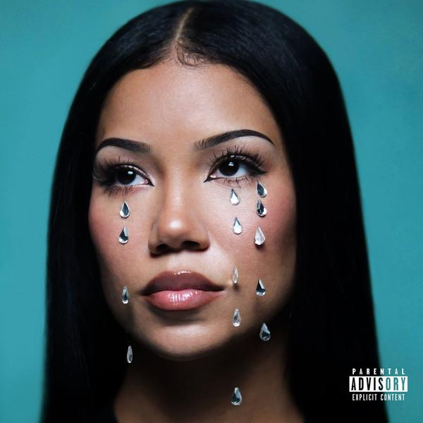

---

## 兰香如故

[2026-10-14 09:58] 来自：综合网盘资源频道

名称：兰香如故 (2026) 影视原声带 FLAC

描述：《兰香如故》2026影视原声带，董冬冬、陈曦操刀，周深、郁可唯等献唱。歌曲与配乐交织，诉说人物命运浮沉，旋律细腻，满含岁月悲欢与成长释然。

夸克网盘：https://pan.quark.cn/s/060dd60a7bfd

百度网盘：https://pan.baidu.com/s/1Cu7BTEEMwcUkv5-Q8isEkg?pwd=kick

📁 大小：N

🏷 标签：#无损音乐 #音乐 #华语 #兰香如故 #影视原声带 #FLAC #quark #baidu

---

## 龙珠超

[2026-10-14 07:29] 来自：综合网盘资源频道

名称：龙珠超 比鲁斯 OP ED FLAC

描述：《龙珠超 比鲁斯》OP《オノガミ》、ED《完璧のペキ》，摇滚曲风，旋律极具感染力。

夸克网盘：https://pan.quark.cn/s/b94504b7e6e0

📁 大小：N

🏷 标签：#无损音乐 #音乐 #摇滚 #龙珠超 #比鲁斯 #FLAC #quark

---

## YOASOBI

[2026-10-14 00:03] 来自：无损音乐分享频道

名称：YOASOBI — 咲き誇れ (2026) FLAC 24bit 96kHz

描述：YOASOBI 新单曲 

夸克网盘：https://pan.quark.cn/s/4bbe4c5a8d8f

📁 大小：N

🏷 标签：#无损音乐 #音乐 #日本流行

---

## 孙燕姿经典全纪录

[2026-10-14 00:02] 来自：夸克云盘影视资源频道

名称：孙燕姿—经典全纪录 主打精华版—DSD版本

描述：《My Story Your Song 经典全纪录（主打精华版）》，孙燕姿双CD精选集，收录36首出道经典主打，囊括《天黑黑》《遇见》《开始懂了》等代表作，浓缩其黄金时期流行佳作。

夸克网盘：https://pan.quark.cn/s/1cd41eb1fe9f

📁 大小：5.7GB

🏷 标签：#无损音乐 #音乐 #华语 #孙燕姿

---

## 群星

[2026-10-14 00:01] 来自：夸克云盘影视资源频道

名称：群星 - 1992 年国语流行畅销金曲 FLAC

描述：1992年是华语乐坛金曲爆发的黄金之年，这张《1992年国语流行畅销金曲》精选集荟萃时代名作。既有《千年等一回》《冬季到台北来看雨》等国民抒情金曲，也收录《当爱已成往事》《谢谢你的爱》，搭配郑智化、张楚、黑豹、唐朝的摇滚作品。曲风多元，一曲入耳，便能重回朝气蓬勃的90年代。

夸克网盘：https://pan.quark.cn/s/ca0d05bd8ff0

📁 大小：1.4GB

🏷 标签：#无损音乐 #音乐 #华语

---

## 甄嬛传

[2026-10-13 21:24] 来自：夸克云盘影视资源频道

名称：甄嬛传 影视音乐原声大碟 FLAC 24bit 192khz

描述：专辑曲目：

1 菩萨蛮

2 凤凰于飞

3 采莲

4 金缕衣

5 惊鸿舞

6 菩萨蛮（男声版）

7 红颜劫

8 君临天下

9 长夜孤枕

10 河边倾诉

11 妾随君去

12 秀女入宫

13 风雪山林

14 女儿泪涟

15 心心相依

夸克网盘：https://pan.quark.cn/s/bd4019af9236

📁 大小：1.4GB

🏷 标签：#无损音乐 #音乐 #华语 #刘欢 #原声带

---

## 甄嬛传影视音乐原声大碟

[2026-10-13 21:23] 来自：无损音乐分享频道

名称：甄嬛传影视音乐原声大碟 FLAC 24bit 192khz

描述：

专辑曲目：

1 菩萨蛮

2 凤凰于飞

3 采莲

4 金缕衣

5 惊鸿舞

6 菩萨蛮（男声版）

7 红颜劫

8 君临天下

9 长夜孤枕

10 河边倾诉

11 妾随君去

12 秀女入宫

13 风雪山林

14 女儿泪涟

15 心心相依

夸克网盘：https://pan.quark.cn/s/bd4019af9236

📁 大小：1.4GB

🏷 标签：#无损音乐 #音乐 #华语 #刘欢 #原声带

---

## Balearic

[2026-10-13 20:07] 来自：综合网盘资源频道

名称：Balearic Jazz (Flavoured Chill Out Tunes) 爵士 1-2 (2026) FLAC

描述： 休闲爵士音乐。

百度网盘：https://pan.baidu.com/s/1R1mE6VUpbMvBEied6I2HEA?pwd=hk38

夸克网盘：https://pan.quark.cn/s/40c3c7aa7299

迅雷网盘：https://pan.xunlei.com/s/VP3p9-XcofymrErqdfpTV2ERA1?pwd=w8v6

📁 大小：1.3G

🏷 标签：#音乐 #爵士 #baidu #quark #xunlei

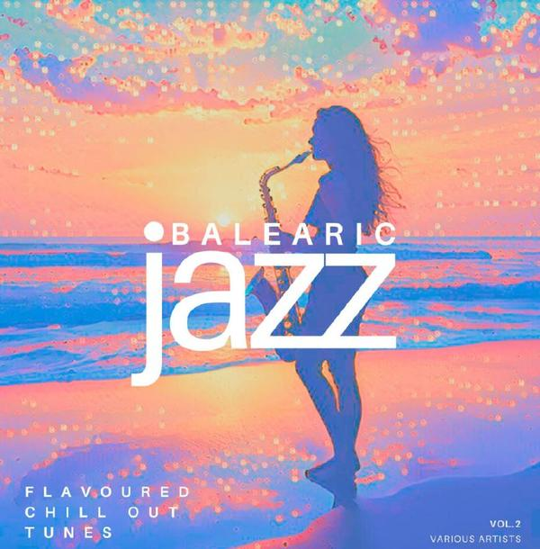

---

## Pet

[2026-10-13 19:55] 来自：百度网盘综合频道

名称：Pet Shop Boys - 2026 - A Man From The Future FLAC 24bit 44khz qobuz

描述：Pet Shop Boys2026年新作《A Man From The Future》，以电子与弦乐结合，讲述图灵一生。融合歌曲、旁白，改编自BBC逍遥音乐会旧作，兼具叙事感与前卫电子质感。

链接：

百度网盘：https://pan.baidu.com/s/1WyIP8qIWIsCY62_E2bKgMw?pwd=kick

夸克网盘：https://pan.quark.cn/s/4e93a607b7c5 来自：肯德基の4K影视综合电影云盘站 [2026-10-13 19:50] 名称：Pet Shop Boys - 2026 - A Man From The Future FLAC 24bit 44khz qobuz

📁 大小：1G

🏷 标签：#无损音乐 #音乐 #欧美流行

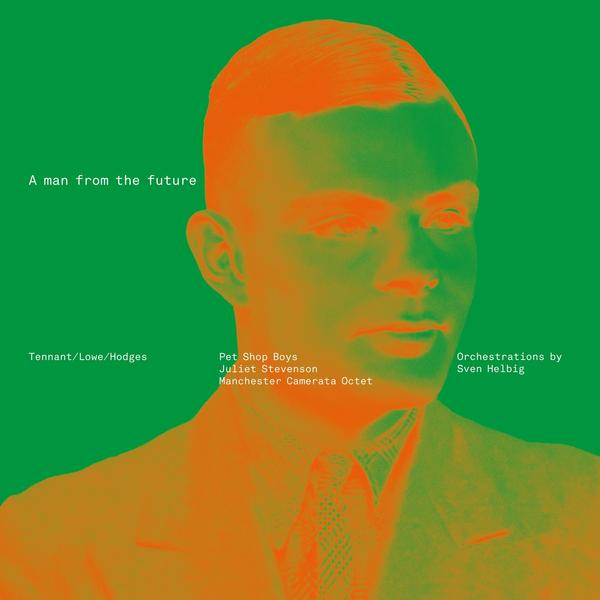

---

## 林忆莲

[2026-10-13 19:46] 来自：百度网盘综合频道

名称：林忆莲 - Love, Sandy（1995）杜比全景声

描述：

 01.伤痕

 02.这些那些

 03.听说爱情回来过

 04.知难不退

 05.有所谓

 06.为你我受冷风吹

 07.爱不了多久

 08.不爱的理由

 09.影子情人

百度网盘：https://pan.baidu.com/s/1WyIP8qIWIsCY62_E2bKgMw?pwd=kick

📁 大小：N

🏷 标签：#无损音乐 #音乐 #华语

---

## 林忆莲

[2026-10-13 18:06] 来自：夸克云盘影视资源频道

名称：林忆莲 - Love, Sandy（1995）杜比全景声

描述：01.伤痕

02.这些那些

03.听说爱情回来过

04.知难不退

05.有所谓

06.为你我受冷风吹

07.爱不了多久

08.不爱的理由

09.影子情人

夸克网盘：https://pan.quark.cn/s/06fa4b7bca9c

📁 大小：N

🏷 标签：#无损音乐 #音乐 #华语

---

## Pet

[2026-10-13 18:06] 来自：无损音乐分享频道

名称：Pet Shop Boys - 2026 - A Man From The Future FLAC 24bit 44khz qobuz

描述：Pet Shop Boys2026年新作《A Man From The Future》，以电子与弦乐结合，讲述图灵一生。融合歌曲、旁白，改编自BBC逍遥音乐会旧作，兼具叙事感与前卫电子质感。

夸克网盘：https://pan.quark.cn/s/4e93a607b7c5

📁 大小：1G

🏷 标签：#无损音乐 #音乐 #欧美流行

---

## MEOVV

[2026-10-13 09:21] 来自：综合网盘资源频道

名称：MEOVV 미야오 - GO HARD (2026) FLAC

描述： 韩语新单曲。

百度网盘：https://pan.baidu.com/s/12MJU9l07eySl1CXU6fO17g?pwd=auhd

夸克网盘：https://pan.quark.cn/s/9869e6ccb594

迅雷网盘：https://pan.xunlei.com/s/VP3mpsDVcD6kVi0fqnjFRBHhA1?pwd=ifhe

📁 大小：79MB

🏷 标签：#音乐 #FLAC #baidu #quark #xunlei

---

## ZARD

[2026-10-13 07:50] 来自：综合网盘资源频道

名称：ZARD 坂井泉水 合集 FLAC

描述：不论是《灌篮高手》的片尾曲《MY FRIEND》，还是《名侦探柯南》的片头曲《转动命运之轮》，擅长写歌词的她会为其他歌手提供作品，她的歌词中，珍贵的词语由内心而发，从而通过自己的歌曲向听众传递出了能量。

1991.12 - もう探さない

1992.09 - HOLD ME

1993.07 - 揺れる想い

1994.06 - Oh my love

1995.03 - forever you

1996.07 - Today is another day

1999.02 - 永遠

2001.02 - 時間の翼

2004.01 - 止まっていた時計が今動き出した

2005.09 - 君とのDistance

2011.02 - SINGLE COLLECTION ～20th ANNIVERSARY～24bit 48khz

链接：

百度网盘：https://pan.baidu.com/s/1sUc5_M_eUcefTHY1Lyye4Q?pwd=kick

夸克网盘：https://pan.quark.cn/s/be8f186a054e

📁 大小：NG

🏷 标签：#无损音乐 #音乐 #日本流行 #坂井泉水 #合集 #FLAC #baidu #quark

---

## Celine

[2026-10-13 07:09] 来自：综合网盘资源频道

名称：Celine Dion 席琳狄翁 合集 flac

描述：Céline Dion(席琳·迪翁，流行乐坛销量顶尖的传奇歌手，嗓音浑厚富有张力。《My Heart Will Go On》作为《泰坦尼克号》主题曲拿下奥斯卡、格莱美大奖，《The Power of Love》也火遍全球。

她可英法双语演绎，双语专辑常年横扫欧美与亚洲榜单。这套合集收录1982—2024年共43张作品，她的抒情大作堪称流行声乐标杆。

夸克网盘：https://pan.quark.cn/s/1ea9b262cd19

百度网盘：https://pan.baidu.com/s/1nvHJ80QpGTYRTOBKlo86lg?pwd=4632

📁 大小：19GB

🏷 标签：#无损音乐 #音乐 #欧美流行 #席琳狄翁 #合集 #flac #quark #baidu

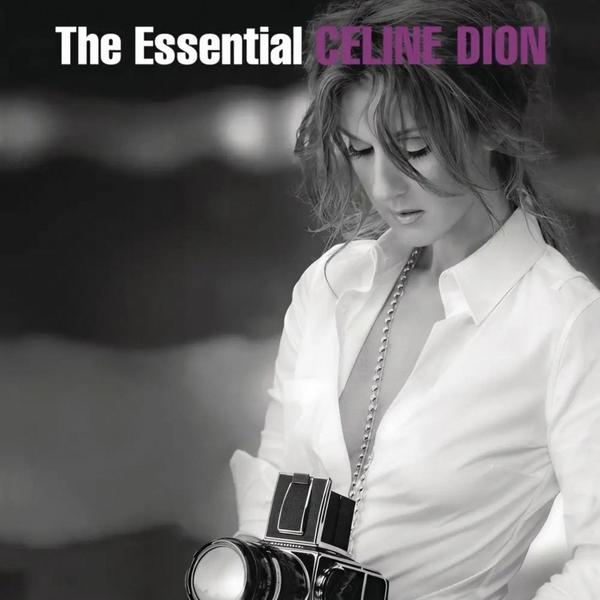

---

## 群星

[2026-10-13 07:08] 来自：百度网盘综合频道

名称：群星 - 1991 年国语流行畅销金曲 FLAC

描述：《1991年国语流行畅销金曲》精选集，定格华语乐坛新旧交替的黄金拐点。专辑阵容群星云集，既有罗大佑、Beyond、郑智化饱含人文力量的作品，也有周华健、陈淑桦、娃娃细腻深沉的都市情歌，小虎队、黄莺莺、黎明等歌手的曲目兼具青春悸动与时代质感。多元曲风交织，一把旋律化作时光钥匙，带领听众重返朝气满满的九十年代，重温那段无可复刻的华语黄金岁月。

链接：

百度网盘：https://pan.baidu.com/s/1NY1mbhn5bgk4IE6lKnQMaA?pwd=kick

夸克网盘：https://pan.quark.cn/s/a0a6c04cf06e 来自：肯德基の4K影视综合电影云盘站 [2026-10-13 07:07] 名称：群星 - 1991 年国语流行畅销金曲 FLAC

夸克网盘：https://pan.quark.cn/s/730f6f6461e8 来自：夸克云盘影视资源频道 [2026-10-13 02:01] 名称：群星 1997-《TVB30周年全纪录》 2CD 华星首版WAV

百度网盘：https://pan.baidu.com/s/1XooltfBp7xorZolN-Q3t9A?pwd=83r2 来自：综合网盘资源频道 [2026-10-12 20:54] 名称：群星 - Ibiza Autumn Melodic Techno Rockets from the Heart (2026) FLAC

迅雷网盘：https://pan.xunlei.com/s/VP3kA16UUu4SzcHDBWDmwHrfA1?pwd=s8hp 来自：综合网盘资源频道 [2026-10-12 20:54] 名称：群星 - Ibiza Autumn Melodic Techno Rockets from the Heart (2026) FLAC

📁 大小：NG

🏷 标签：#无损音乐 #音乐 #华语

---

## Paul

[2026-10-13 01:59] 来自：无损音乐分享频道

名称：Paul Mauriat - Summer Has Flown (1983) FLAC 24bit 192khz

描述：轻音乐 

夸克网盘：https://pan.quark.cn/s/152c6c76bf71

百度网盘：https://pan.baidu.com/s/1BVdR3luXdZEHw6cl54pi0Q?pwd=kick 来自：综合网盘资源频道 [2026-10-11 09:39] 名称：Paul Mauriat - Magic (1982) FLAC 24bit 192khz

夸克网盘：https://pan.quark.cn/s/1b633c877ef6 来自：综合网盘资源频道 [2026-10-11 09:39] 名称：Paul Mauriat - Magic (1982) FLAC 24bit 192khz

📁 大小：1.7G

🏷 标签：#无损音乐 #音乐 #纯音乐

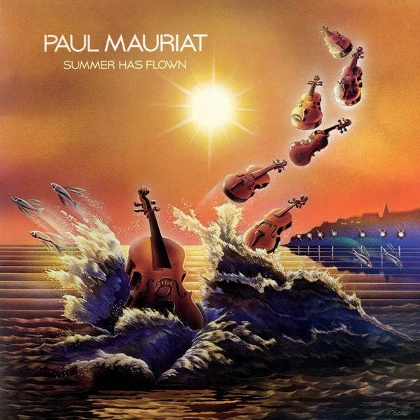

---

## 陈奕迅所有正规专辑精选辑

[2026-10-13 00:01] 来自：百度网盘综合频道

名称：陈奕迅所有正规专辑+精选辑 WAV

描述：歌手：陈奕迅

 专辑数量：67张

 唱片公司：华星唱片、英皇唱片、新艺宝唱片

 发行公司：环球唱片

 语种：粤语、国语

 格式：WAV+CUE

百度网盘：https://pan.baidu.com/s/16TgWtG_x9u-ugQJXg861YA?pwd=6tp6

📁 大小：50GB

🏷 标签：#无损音乐 #音乐 #陈奕迅

---

## SONGS

[2026-10-12 18:06] 来自：综合网盘资源频道

名称：SONGS OF JAPANESE TV (2CD) FLAC

描述：这套日剧原声精选分为双CD，收录《东京爱情故事》《悠长假期》《101次求婚》《爱情白皮书》等多部经典日剧主题曲与配乐。集结小田和正、藤田惠美、米米CLUB、中山美穗等众多日本歌手，曲风丰富动人。一首首熟悉旋律串联起日剧黄金年代，满是怀旧氛围感，重现九十年代日剧独有的温柔与悸动。

夸克网盘：https://pan.quark.cn/s/f76e3633e55f

百度网盘：https://pan.baidu.com/s/1E4VbNNamaKYG00C9KSheCQ?pwd=8zxv

📁 大小：N

🏷 标签：#无损音乐 #音乐 #日语流行 #2CD #FLAC #quark #baidu

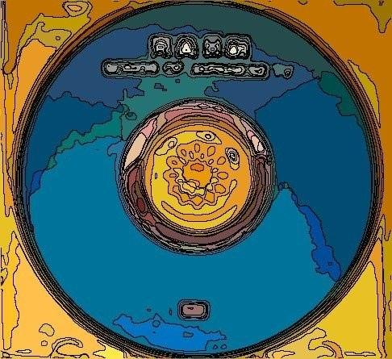

---

## 张悬

[2026-10-12 17:23] 来自：综合网盘资源频道

名称：张悬 my life will… FLAC 24bit 96khz

描述：曲目

1 Scream

2 宝贝 (In the Night)

3 迷惑

4 So?!…

5 Ain’t My Man

6 My Life Will

7 Live酒馆300秒

8 信任的样子

9 无状态

10 Malaimo

11 宝贝 (In a Day)

链接：

夸克网盘：https://pan.quark.cn/s/ff03d92087bc

百度网盘：https://pan.baidu.com/s/10w8UnM-3H2lKdibiRUN0mQ?pwd=x5u1

📁 大小：N

🏷 标签：#无损音乐 #音乐 #华语 #张悬 #FLAC #24bit #quark #baidu

---

## Carmen

[2026-10-12 12:53] 来自：无损音乐分享频道

名称：Carmen Gomes Inc. - Carmen Gomes Sings The Blues 2017 SACD iso

描述：发烧女声 

夸克网盘：https://pan.quark.cn/s/fa2a35f105ad

📁 大小：2.1GB

🏷 标签：#无损音乐 #音乐 #无损音乐

---

## 可爱尖牙小娜娜少年吸血鬼

[2026-10-12 12:10] 来自：影视动漫分享|SeedHub|夸克|网盘|🧲

名称：可爱尖牙小娜娜：少年吸血鬼 第一季 (2025)

#电视剧 #冒险 #歌舞 #家庭 #喜剧 #音乐 #奇幻 #夸克 #百度

主演: 肯齐·理查森 Jiwon Lee Shaun Dixon 

豆瓣: [0](https://movie.douban.com/subject/37254332/)

“Vampirina,”isbasedonthechildren’sbooksbyAnneMariaPaceandinspiredbytheDisneyJr.ani..

夸克网盘：https://pan.quark.cn/s/3aefbd87ff09

百度网盘：https://pan.baidu.com/s/1-hxLApQsYgR1FmoZSnNY6g?pwd=1314

---

## 香港盛声日本胜利

[2026-10-12 10:01] 来自：无损音乐分享频道

名称：香港盛声&日本胜利  母带模拟慢刻 WAV+CUE 整轨 113CD

描述：香港盛声联合日本胜利打造的母带模拟慢刻系列，是面向HiFi发烧友的精品唱片系列。作品依托日方成熟模拟音频技术，结合专业母带重新调校，采用低速CDR模拟慢刻工艺，复刻传统模拟音源温润饱满的听感，大幅减少数码生硬感。

系列精选华语乐坛黄金年代经典曲目，汇聚邓丽君、张国荣、谭咏麟、陈慧娴、Beyond、王菲、徐小凤、王杰等实力歌手代表作，从音源到刻录全程高标准把控，高度还原原始录音细节与声场氛围。兼具模拟韵味与高解析表现，音质扎实耐听，凭借出色的制作水准，成为发烧圈广受认可的收藏与聆听佳作。

夸克网盘：https://pan.quark.cn/s/d1a05564bc12

📁 大小：73GB

🏷 标签：#无损音乐 #音乐 #华语

---

## Esther

[2026-10-12 09:38] 来自：综合网盘资源频道

名称：Esther Abrami - Amour (2026) FLAC 24bit 96khz

描述：被誉为小提琴界奥黛丽·赫本的Esther Abrami，2026专辑《Amour》，携手布拉格城市爱乐乐团，以浪漫曲目诠释爱意，演奏细腻动人，充满优雅抒情的氛围感。

夸克网盘：https://pan.quark.cn/s/aaa869e6c9a6

百度网盘：https://pan.baidu.com/s/1aUt7KxxU7Pn7V7V37RbVMw?pwd=kick

📁 大小：1G

🏷 标签：#无损音乐 #音乐 #古典 #纯音乐 #FLAC #24bit #quark #baidu

---

## Jocelyn

[2026-10-12 09:36] 来自：综合网盘资源频道

名称：Jocelyn Gould - So Delighted (2026) FLAC 24bit 88.2

描述：JUNO奖爵士吉他手Jocelyn Gould 2026新专《So Delighted》，采用吉他、哈蒙德风琴与鼓三重奏，收录原创与爵士标准曲

夸克网盘：https://pan.quark.cn/s/3eb1e622bf0b

📁 大小：1GB

🏷 标签：#无损音乐 #音乐 #爵士 #FLAC #24bit #quark

---

## 梁咏琪

[2026-10-12 09:36] 来自：综合网盘资源频道

名称：梁咏琪 礼物 FLAC 24bit 96khz

描述：

1 Intro-礼物

2 礼物

3 错过

4 我是你的梁咏琪

5 一个地方

6 Interlude-一个地方

7 abcdefGG

8 爱得起

9 长岛冰茶

10 好好走

11 喜剧收场

12 Outro-喜剧收场

13 爱得起(粤)

14 心魔(粤)

夸克网盘：https://pan.quark.cn/s/9743d1ac0a65

百度网盘：https://pan.baidu.com/s/1eH6GmRZabuMlTOX66fXgbQ?pwd=vszk

📁 大小：980MB

🏷 标签：#无损音乐 #音乐 #华语 #梁咏琪 #礼物 #FLAC #24bit #quark #baidu

---

## 陈静琳

[2026-10-12 07:03] 来自：夸克云盘影视资源频道

名称：陈静琳 哪天的形状 (One day, I) (2026) FLAC 24bit 48khz

描述：陈静琳首张全长专辑《哪天的形状（One day, I）》，历时三年打磨，融合独立摇滚，书写二十代自我探寻，带着千禧摇滚气息，剖析成长脱壳的迷茫与自省。

夸克网盘：https://pan.quark.cn/s/8545d2b79313

📁 大小：N

🏷 标签：#无损音乐 #音乐 #华语

---

## Jess

[2026-10-11 21:16] 来自：综合网盘资源频道

名称：Jess Williamson - A Mile South of Heaven (2026) FLAC

描述： 乡村新专辑。

百度网盘：https://pan.baidu.com/s/1NF8QO-1Fqs2i6vsLZJCyaQ?pwd=2vgc

夸克网盘：https://pan.quark.cn/s/14ebd6f75329

迅雷网盘：https://pan.xunlei.com/s/VP3f5dof9V8GEVKarLhMhwthA1?pwd=867m

📁 大小：250MB

🏷 标签：#音乐 #FLAC #baidu #quark #xunlei

---

## 任贤齐

[2026-10-11 17:26] 来自：无损音乐分享频道

名称：任贤齐 - 2019年SACD系列：任贤齐精选   DSD DSF

描述：滚石sacd系列 : 任贤齐精选，首批1,000张印有限量编号, 极具珍藏价值!

01. 心太软 

02. 对面的女孩看过来 

03. 浪花一朵朵 

04. 春天花会开 

05. I Feel Good 

06. 我是一只鱼 

07. 伤心太平洋 

08. 小雪 

09. 依靠 

10. 我是一只小小鸟 

11. 任逍遥 

12. 好聚好散 

13. 心情车站 

14. 很受伤 

15. 烛光

夸克网盘：https://pan.quark.cn/s/889f643e2de1

📁 大小：2.67GB

🏷 标签：#任贤齐 #音乐 #无损音乐 #猪儿虫

---

## 林俊杰

[2026-10-11 10:40] 来自：百度网盘综合频道

名称：林俊杰  Rise Without A Sound (2026) FLAC 24bit 48khz

描述：林俊杰 2026最新单曲

链接：

百度网盘：https://pan.baidu.com/s/1U2K_3ZdLOrOoYhBq8NgepQ?pwd=kick

夸克网盘：https://pan.quark.cn/s/26c3fb5c4753 来自：综合网盘资源频道 [2026-10-11 10:39] 名称：林俊杰  Rise Without A Sound (2026) FLAC 24bit 48khz

📁 大小：N

🏷 标签：#无损音乐 #音乐 #华语 #林俊杰 #FLAC #24bit #quark #baidu

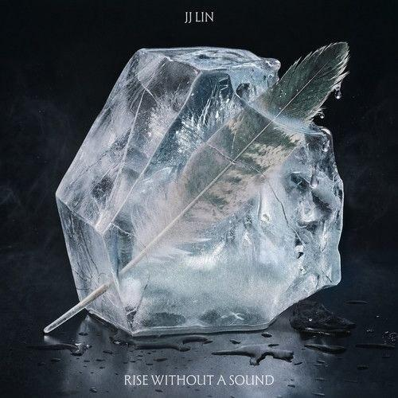

---

## IU

[2026-10-11 09:39] 来自：综合网盘资源频道

名称：IU - Can You Hear Me FLAC 24bit 96khz

描述：首张日文迷你专辑，多元J-Pop曲风，收录自作曲《Voice-mail》

夸克网盘：https://pan.quark.cn/s/beb28998c8b6

📁 大小：N

🏷 标签：#无损音乐 #音乐 #FLAC #24bit #quark

---

## 助眠音乐精选集

[2026-10-11 00:03] 来自：夸克云盘影视资源频道

名称：助眠音乐精选集 FLAC 24bit 48Khz

描述：触发来自心底的宁静，带你慢慢入睡，享受安然美梦。《助眠音乐精选集》是一张专为现代人设计的深度放松与睡眠引导音频专辑，融合自然白噪音、极简钢琴、氛围电子、疗愈弦乐与东方冥想音色，以科学节律（4–8 Hz θ波频段）为基础，营造安全、宁静、无干扰的听觉环境。所有曲目均去除突兀转调、强烈节奏或人声歌词，避免大脑激活。特别收录由神经声学团队监制的《Theta Flow No.3》，经临床测试可显著缩短入睡时间。

本专辑适合失眠、焦虑、冥想或午间小憩使用。戴上耳机，让声音成为你的夜之舟——载你穿越喧嚣，泊入深眠港湾

夸克网盘：https://pan.quark.cn/s/a4692cf1174d

📁 大小：N

🏷 标签：#无损音乐 #音乐 #纯音乐

---

## 神秘园

[2026-10-11 00:01] 来自：无损音乐分享频道

名称：神秘园 Secret Garden - Songs From a Secret Garden FLAC 24bit 192khz

描述：Secret Garden《Songs From a Secret Garden》，新世纪音乐经典专辑，以小提琴与钢琴交织，旋律空灵悠远，诉说静谧治愈的秘境诗意。

夸克网盘：https://pan.quark.cn/s/faeb4e99f10b

📁 大小：1.52GB

🏷 标签：#无损音乐 #音乐 #纯音乐

---

## 张玮伽

[2026-10-10 21:20] 来自：夸克云盘影视资源频道

名称：张玮伽 《海浪》头版限量1-1母盘直刻 WAV+CUE

描述：01.爱情没有那么美

02.海浪

03.你把我灌醉

04.吻别

05.特别的爱给特别的你

06.我的未来不是梦

07.无情伤

08.听到你一声再会

09.不甘寂寞

10.春天里

11.让我一次爱个够

12.最爱的人伤我最深

13.被伤过的心还可以爱谁

14.海浪(Remix)

夸克网盘：https://pan.quark.cn/s/55fe32055785

📁 大小：N

🏷 标签：#无损音乐 #音乐 #华语

---

## Remi

[2026-10-10 20:36] 来自：综合网盘资源频道

名称：Remi Wolf - Mud (2026) FLAC

描述： 乡村摇滚新专辑。

百度网盘：https://pan.baidu.com/s/1VxPRYLJvlwYLDXXOIMAPyw?pwd=vqkd

夸克网盘：https://pan.quark.cn/s/d12c1b45f666

迅雷网盘：https://pan.xunlei.com/s/VP3_nEGPASfYPelLKti11XoDA1?pwd=vds9

📁 大小：330MB

🏷 标签：#音乐 #FLAC #baidu #quark #xunlei

---

## Joyce

[2026-10-10 18:28] 来自：百度网盘综合频道

名称：Joyce Wrice - MACHIKO (2026) FLAC 24bit 48kHz qobuz

描述：Joyce Wrice《MACHIKO》2026新专辑，以她日文中间名命名，融合复古放克与新灵魂R&B，嗓音丝滑，探讨自我与亲密关系，收录多位艺人合作曲目。

百度网盘：https://pan.baidu.com/s/1oh92tOfK8W5aoM9UpIwfCA?pwd=kick

夸克网盘：https://pan.quark.cn/s/37536188fa1e 来自：无损音乐分享频道 [2026-10-10 18:20] 名称：Joyce Wrice - MACHIKO (2026) FLAC 24bit 48kHz qobuz

📁 大小：504MB

🏷 标签：#无损音乐 #音乐 #欧美流行

---

## 王菲

[2026-10-10 18:19] 来自：夸克云盘影视资源频道

名称：王菲 世界赠予我的 HiRes FLAC 192kHz 24bit

描述：曲目:

1 世界赠予我的

2 如愿

3 传奇

4 匆匆那年

5 归途有风

6 致青春

7 你在终点等我

8 人间

9 红豆

10 执迷不悔(国)

11 但愿人长久

12 容易受伤的女人(国)

13 因为爱情

夸克网盘：https://pan.quark.cn/s/4c4aba86513b

📁 大小：1.94GB

🏷 标签：#hires #flac #无损音乐 #华语流行 #音乐 #王菲

---

## 不再陌生

[2026-10-10 13:44] 来自：百度网盘综合频道

名称：不再陌生（2026）NF 4K DV&HDR 内封官中

描述：扬·博里塞维奇是波兰摇滚乐队 Lady Pank 的主唱。一连串的家庭悲剧塑造了他，而他用音乐影响了一代人。

百度网盘：https://pan.baidu.com/s/1NYL3nBqVxBecPfmJB8Edyw?pwd=37bq

夸克网盘：https://pan.quark.cn/s/e1f1b6e0c3d9 来自：综合网盘资源频道 [2026-10-10 13:43] 名称：不再陌生(2026)NF 4K DV&HDR 内封官中

📁 大小：17.8G

🏷 标签：#不再陌生 #剧情 #音乐 #传记

---

## 梁静茹

[2026-10-10 13:19] 来自：综合网盘资源频道

名称：梁静茹 - 我好吗？－太阳如常升起 FLAC 24bit 192khz

描述：1. 微光

2. 我好吗

3. 慢冷

4. 如爱所愿

5. 平行时空

6. 以你的名字呼喊我

7. 类情人

8. 太阳如常升起

9. 子非鱼

10. 完整的我

夸克网盘：https://pan.quark.cn/s/2d12d3a2ac32

百度网盘：https://pan.baidu.com/s/1BGJbNIqClb_4PDX2YdpN2Q?pwd=kick

📁 大小：1.4GB

🏷 标签：#无损音乐 #音乐 #梁静茹 #我好吗 #太阳如常升起 #FLAC #24bit #quark #baidu

---

## 檀健次

[2026-10-10 13:17] 来自：综合网盘资源频道

名称：檀健次 - TANGENT FLAC (2026) 24bit 48khz

描述：新专辑

夸克网盘：https://pan.quark.cn/s/726400a04629

📁 大小：N

🏷 标签：#无损音乐 #音乐 #华语 #檀健次 #FLAC #24bit #quark

---

## 陶喆

[2026-10-10 13:12] 来自：综合网盘资源频道

名称：陶喆 I'm OK wav 分轨

描述：陶喆《I'm OK》，1999年发行的第二张专辑，融合R&B、摇滚，收录《普通朋友》《小镇姑娘》等金曲，斩获金曲奖最佳专辑制作人，是华语经典之作。

夸克网盘：https://pan.quark.cn/s/e980192dd97d

📁 大小：N

🏷 标签：#无损音乐 #音乐 #华语 #陶喆 #wav #分轨 #quark

---

## 原神配乐

[2026-10-10 13:09] 来自：综合网盘资源频道

名称：原神配乐 合集 Genshin Impact - Original Game Soundtrack Hi-Res

描述：《原神》游戏原声Hi-Res合集，HOYO-MiX创作，管弦融合民族曲风，高解析录音还原提瓦特听觉世界。

夸克网盘：https://pan.quark.cn/s/42dbe068e29e

📁 大小：54GB

🏷 标签：#无损音乐 #音乐 #纯音乐 #原神 #原神配乐 #合集 #HiRes #quark

---

## 空灵女声

[2026-10-10 11:26] 来自：夸克云盘影视资源频道

名称：空灵女声 柯唯 合集 WAV

描述：主打空灵、治愈向女声，大量做经典老歌的AI翻唱版本 。

收录翻唱《情网》《月亮代表我的心》《风吹麦浪》等歌曲....

夸克网盘：https://pan.quark.cn/s/1b52af669422

📁 大小：2.2GB

🏷 标签：#无损音乐 #音乐 #华语 #ai

---

## Tchaikovsky

[2026-10-10 10:42] 来自：无损音乐分享频道

名称：Tchaikovsky - The Nutcracker - Berliner Philharmoniker, Mstislav Rostropovich (Remastered 2026) FLAC 24bit 192khz qobuz

描述：柴可夫斯基 胡桃夹子 2026版

夸克网盘：https://pan.quark.cn/s/ac6a7726480b

📁 大小：888MB

🏷 标签：#无损音乐 #音乐 #纯音乐

---

## Shania

[2026-10-10 09:24] 来自：百度网盘综合频道

名称：Shania Twain - 2026 - Little Miss Twain - The Places I'll Go FLAC 24bit 48khz

描述：Shania Twain《Little Miss Twain - The Places I'll Go》2026豪华版专辑，自传式乡村流行作品，融合摇滚与蓝草，嗓音洒脱充满故事感。

百度网盘：https://pan.baidu.com/s/1ldjOT6ghotmB-30DuvI9Hg?pwd=kick

夸克网盘：https://pan.quark.cn/s/c6c40c5f6e0d 来自：无损音乐分享频道 [2026-10-10 09:18] 名称：Shania Twain - 2026 - Little Miss Twain - The Places I'll Go FLAC 24bit 48khz

📁 大小：949MB

🏷 标签：#无损音乐 #音乐 #欧美乡村

