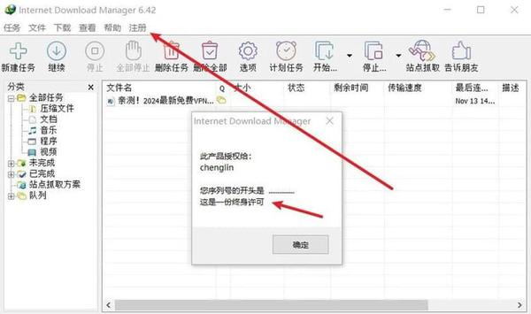
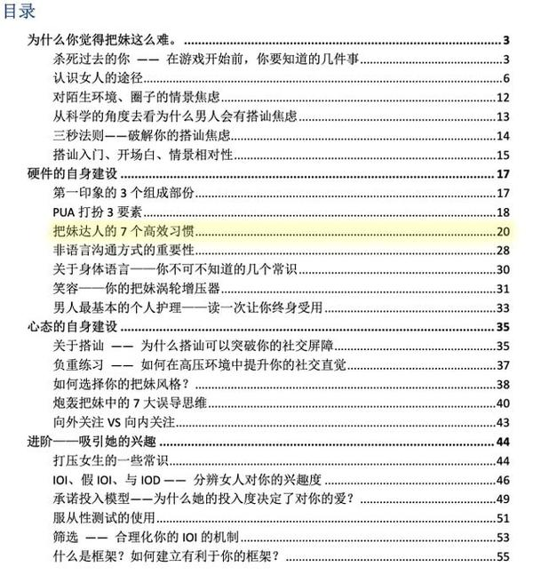
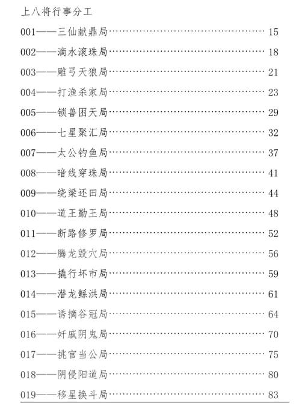
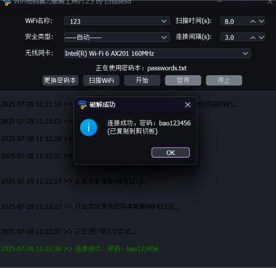
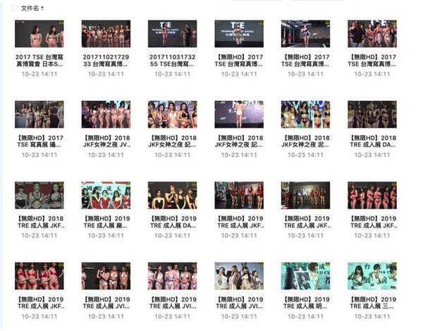
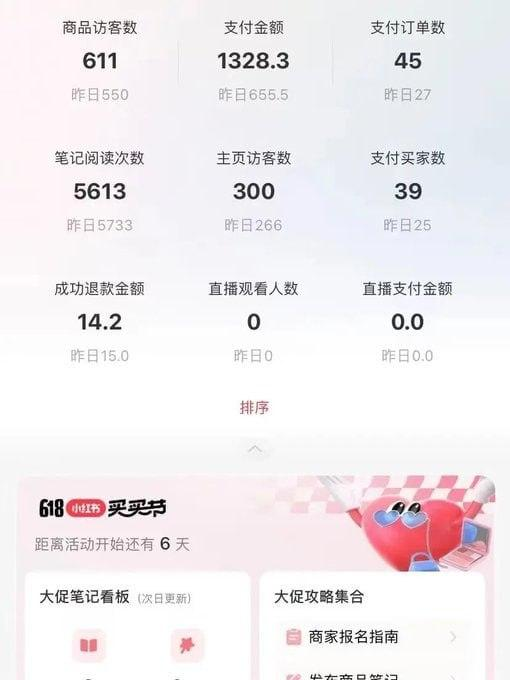
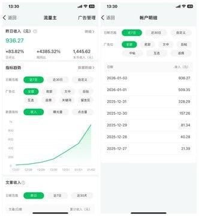

## 2026年中级消防操作员中监控

[2026-11-08 00:03] 来自：综合网盘资源频道

名称：2026年中级消防操作员【中监控】

描述：2026 年中级消防操作员中监控相关备考内容，围绕消防设施监控方向展开，覆盖考试对应的知识点、考点梳理，适合备考中级消防设施操作员监控方向的考生，帮助考生熟悉考试内容，掌握专业知识，做好考前复习，助力顺利通过相关职业资格考试。

夸克网盘：https://pan.quark.cn/s/33d14694c432

📁 大小：851.3MB

🏷 标签：#学习 #中级 #职业 #复习 #知识点 #中监控 #quark

---

## 中医人体骨骼肌肉学习3D动态讲解演示视频自学零基础中医人体结构

[2026-11-08 00:02] 来自：综合网盘资源频道

名称：中医人体骨骼肌肉学习3D动态讲解演示视频自学零基础中医人体结构

描述：中医人体骨骼肌肉学习 3D 动态讲解演示视频，借助三维动态演示形式解析人体骨骼与肌肉相关知识，讲解中医视角下的人体结构，内容适合零基础人群自学，直观展示人体构造细节，帮助学习者理解骨骼肌肉分布，夯实中医相关解剖基础，满足个人自学入门的学习需求。

夸克网盘：https://pan.quark.cn/s/cc80aa28e89c

📁 大小：0 B

🏷 标签：#教程 #视频 #零基础 #中医 #3D #quark

---

## 表情包制作课程

[2026-11-07 22:38] 来自：Fang的资源分享群

名称：表情包制作课程

围绕老年人需求的表情包制作课程，讲解从需求挖掘到表情包制作与用心服务的流程，适合想学习相关制作和需求分析的人参考。

夸克网盘：https://pan.quark.cn/s/22aa115dac52

#表情包制作 #老年人需求 #需求挖掘 #课程学习

---

## IDM最新版安装包

[2026-11-07 22:28] 来自：Fang的资源分享群

名称：IDM最新版安装包

IDM下载器安装包，适合需要下载工具的用户获取安装使用，提供安装包便于在电脑端完成安装和日常下载任务。

夸克网盘：https://pan.quark.cn/s/6c525aae3ead

#下载工具 #安装包 #电脑软件 #下载器

---

## RAZ分级阅读绘本大全套

[2026-11-07 22:27] 来自：Fang的资源分享群

名称：RAZ分级阅读绘本大全套

RAZ分级阅读绘本大全套，包含绘本、音频和视频，覆盖多个级别，适合家庭英语启蒙和分级阅读练习，便于按水平选读并配合听读。

夸克网盘：https://pan.quark.cn/s/37fdfbf8d041

#分级阅读 #英语启蒙 #绘本音频 #家庭学习 #英文读物

---

## 坏男孩日记把妹教父

[2026-11-07 20:06] 来自：Fang的资源分享群

名称：坏男孩日记把妹教父

整理坏男孩日记与把妹教父相关文字内容，适合在社交话题阅读和观点梳理场景中参考，帮助读者了解原文表达与思路。

夸克网盘：https://pan.quark.cn/s/9e8b8631cd9d

#坏男孩日记 #把妹教父 #社交话题 #两性关系 #阅读参考

---

## 知名女明星珍藏精彩电影

[2026-11-07 20:06] 来自：Fang的资源分享群

名称：知名女明星珍藏精彩电影  共16位人间尤物

收录多位知名女星经典电影合集，提供1080P内嵌中文字幕，共611GB，适合影迷收藏与回顾，便于集中观看和查找。

夸克网盘：https://pan.quark.cn/s/f11134332b70

#女星合集 #经典电影 #高清收藏 #中文字幕 #影视资源

---

## 心术全书

[2026-11-07 20:05] 来自：Fang的资源分享群

名称：心术全书

围绕心术主题整理的内容，适合对人际交往、处世方法和关系观察感兴趣的读者参考阅读，帮助梳理相关思路与看待问题的角度。

夸克网盘：https://pan.quark.cn/s/e8f3641399e7

#心术 #处世方法 #人际交往 #思维认知 #参考阅读

---

## AI短剧漫剧生成软件自动生成角色场景分镜合成视频

[2026-11-07 20:05] 来自：Fang的资源分享群

名称：AI短剧漫剧生成软件，自动生成角色场景+分镜+合成视频

该软件围绕AI短剧漫剧创作，可自动生成角色与场景，并完成分镜和视频合成，适合需要快速搭建短剧画面的创作场景，帮助减少手动绘制与剪辑环节。

夸克网盘：https://pan.quark.cn/s/3505ba895d29

#AI短剧 #漫剧生成 #分镜设计 #视频合成 #角色场景

---

## 车鱼视听v3201

[2026-11-07 20:05] 来自：Fang的资源分享群

名称：车鱼视听v3.20.1 车机影音软件 聚合抖音 汽水音乐 今日头条等平台

车鱼视听v3.20.1是一款车机影音软件，聚合抖音、汽水音乐、今日头条等平台内容，适合在车载场景中集中浏览和使用影音资源，减少多应用切换。

夸克网盘：https://pan.quark.cn/s/7bb42bbc3fe2

#车机影音 #车载软件 #影音聚合 #抖音 #汽水音乐

---

## 亢奋全三季附特别篇

[2026-11-07 20:05] 来自：Fang的资源分享群

名称：《亢奋》全三季附特别篇

收录《亢奋》全三季及特别篇，赞达亚主演，改编自以色列剧，围绕青少年以毒品和性爱逃避现实展开，适合剧集补看与主题讨论。

夸克网盘：https://pan.quark.cn/s/f77496fd6ed7

#亢奋 #美剧 #青春剧 #赞达亚 #特别篇

---

## AI原创手抄报项目用AI做手抄报实现副业收益

[2026-11-07 20:05] 来自：Fang的资源分享群

名称：AI原创手抄报项目，用AI做手抄报实现副业收益

围绕AI原创手抄报项目，介绍用AI制作手抄报并用于副业尝试的思路与流程，适合想探索手抄报副业的人群参考。

夸克网盘：https://pan.quark.cn/s/ed12e83c57b7

#AI手抄报 #手抄报项目 #副业探索 #AI创作 #手抄报制作

---

## 设计师接单赚钱全流程指南多渠道获客从零解锁稳定副业

[2026-11-07 16:04] 来自：综合网盘资源频道

名称：设计师接单赚钱全流程指南，多渠道获客，从零解锁稳定副业

描述：梳理开店渠道、各类平台接单渠道，还分享长期收益渠道与高端接单平台，真正会接单的设计师，不只是会做图，更要懂沟通、印刷、平台规范、运营与项目细节。本节课结合真实案例，讲解设计师接单必备能力及品牌、电商常见雷区，帮助你降低失误，提升客户信任。

百度网盘：https://pan.baidu.com/s/1xBfmYBdHaoblwnwfSynhwQ?pwd=2htc

📁 大小：338.7M

🏷 标签：#教程 #设计师接单赚钱 #全流程指南 #获客 #baidu #副业 #设计师接单赚钱全流程指南 #多渠道获客 #从零解锁稳定副业

---

## 恢复视力书籍你可以摆脱眼镜

[2026-11-07 16:04] 来自：综合网盘资源频道

名称：恢复视力书籍：你可以摆脱眼镜 77种亮眼好秘方 扫描版_PDF电子书

描述：缓解近视 提升视力，本书包括一不小心就伤害眼睛—错误的常识比比皆是、切勿忽视自己的视力状况、简便的方法也会产生极大的功效、恢复视力的根本治疗法等章节介绍了77 种亮眼好秘方。

夸克网盘：https://pan.quark.cn/s/be600f5596ee

📁 大小：10.3M

🏷 标签：#电子书 #恢复视力 #书籍 #你可以摆脱眼镜 #77种亮眼好秘方 #PDF #quark #恢复视力书籍 #扫描版 #PDF电子书

---

## 埃及女王纳芙蒂蒂

[2026-11-07 07:27] 来自：综合网盘资源频道

名称：《埃及女王纳芙蒂蒂》(azw3+epub+mobi+pdf)

描述：十五岁的她踏入王座阴影，与法老共燃一场颠覆旧神的革命。爱情是刀锋，生育是赌注，野心铸就黄金时代；阴谋逼近时，妹妹的眼泪揭开历史沉默的一页。来，凝视这位埃及女王！

百度网盘：https://pan.baidu.com/s/1rYHxJzM4DPzE28f4NzkiPw?pwd=jxwa

夸克网盘：https://pan.quark.cn/s/1c2c9f2591ce

阿里云盘：https://www.alipan.com/s/oC7ASMe73wR

📁 大小：N

🏷 标签：#历史小说 #外国文学 #女性传奇 #宫廷阴谋 #埃及女王纳芙蒂蒂 #azw3 #epub #mobi #pdf #baidu #quark #ali

---

## 产业政治超级企业与大国竞争

[2026-11-07 07:27] 来自：综合网盘资源频道

名称：《产业政治：超级企业与大国竞争》(azw3+epub+mobi+pdf)

描述：当芯片、工厂与供应链成为大国战场，超级企业正被推向政治与市场的撕裂边缘。《产业政治：超级企业与大国竞争》带你读懂霸权兴衰背后的产业惊雷。

百度网盘：https://pan.baidu.com/s/1CzgTUn6lqo6hQ9kkVuSb4g?pwd=jxwa

夸克网盘：https://pan.quark.cn/s/2e8d466e9d3f

阿里云盘：https://www.alipan.com/s/Ug25usvWCh3

📁 大小：N

🏷 标签：#产业政治 #大国竞争 #科技霸权 #超级企业 #超级企业与大国竞争 #azw3 #epub #mobi #pdf #baidu #quark #ali

---

## 盐见直纪的88个概念

[2026-11-07 07:26] 来自：综合网盘资源频道

名称：《盐见直纪的“88个概念”》(azw3+epub+mobi+pdf)

描述：想找回生活主动权吗？盐见直纪把人生关键词炼成88个概念，带你从“半农半X”看见环境、天职与社区的新可能，把脑中宝藏可视化，激发新点子，重新设计人生。

百度网盘：https://pan.baidu.com/s/1dm31zUTVlSqHKmPKoM5v2A?pwd=jxwa

夸克网盘：https://pan.quark.cn/s/c53fc8a135ca

阿里云盘：https://www.alipan.com/s/H4zucS8Er79

📁 大小：N

🏷 标签：#生活哲学 #自我探索 #社区建设 #半农半X #盐见直纪的88个概念 #azw3 #epub #mobi #pdf #baidu #quark #ali

---

## Github免费短剧神器手机电视电脑TV都能装

[2026-11-07 07:10] 来自：精选网盘资源

名称：Github免费短剧神器，手机电视电脑TV都能装

一款GitHub上热门的免费短剧工具，支持手机、电视和电脑多端安装，短剧资源丰富，播放流畅丝滑，全程无任何广告干扰。界面简洁，操作方便，适合喜欢追短剧的用户在各类设备上畅快观看，是免费的短剧神器。

夸克网盘：https://pan.quark.cn/s/32e7cf5a28d7

#MiniReel #免费短剧 #短剧神器 #短剧资源

---

## 辣条制作配方及教程摆摊开店都能复刻的童年味道

[2026-11-07 07:06] 来自：精选网盘资源

名称：辣条制作配方及教程，摆摊开店都能复刻的童年味道

一套辣条制作配方及教程，系统讲解面筋制作、香料配伍、辣椒油熬制、调味拌料与灭菌保存等关键工序。适合小吃创业者、夜市摊主及家庭烹饪爱好者学习，帮助快速掌握稳定出品的辣条制作技术，做出香辣过瘾、回味十足的童年味道。

夸克网盘：https://pan.quark.cn/s/49ecc0b8e7b1

#辣条制作 #辣条教程 #辣条配方 #辣条技术

---

## 说话艺术让每句话都说到点子上的实用口才课

[2026-11-07 07:01] 来自：精选网盘资源

名称：《说话艺术》：让每句话都说到点子上的实用口才课

为什么同样的话，有人说出来让人舒服，有人说出来让人反感？差别就在说话的“艺术”。本书把措辞分寸、表达节奏、倾听技巧与化解僵局的方法讲得明明白白——如何把话说得得体、如何让意见被接受、如何避免祸从口出。

夸克网盘：https://pan.quark.cn/s/a81419510692

#沟通方法 #说话技巧 #措辞分寸 #人际沟通 #实用口才

---

## 小红书AI虚拟电商矩阵50实战课从开店选品AI原创到批量测款

[2026-11-07 00:10] 来自：综合网盘资源频道

名称：小红书AI虚拟电商矩阵5.0实战课：从开店选品、AI原创到批量测款

描述：小红书 AI 虚拟电商矩阵 5.0 实战课完整讲解虚拟电商矩阵运营全流程，覆盖开店设置、选品分析、AI 原创内容生产以及批量测款等实操环节，讲解借助 AI 工具搭建多账号矩阵的运营方法，适合想要入局小红书虚拟电商的从业者，掌握从启动到测款落地的整套运营思路。

夸克网盘：https://pan.quark.cn/s/c67238a3e951

📁 大小：3.8GB

🏷 标签：#教程 #AI #电商 #小红书 #虚拟 #小红书AI虚拟电商矩阵 #从开店选品 #AI原创到批量测款 #quark

---

## 学车考场必备考试题库答案全科目文字版考试技巧全国通用

[2026-11-07 00:09] 来自：综合网盘资源频道

名称：学车考场必备《考试题库答案》全科目文字版考试技巧全国通用

描述：学车考场必备《考试题库答案》为全科目文字版内容，整理全国通用的驾考答题技巧，汇总各科目题库相关内容，梳理答题思路与应试要点，帮助学车人员熟悉考试题型，掌握答题窍门，适合准备参加驾照考试的学员，用来备考练习，提升驾考应试能力。

夸克网盘：https://pan.quark.cn/s/e4ba6bb79b62

📁 大小：38.5MB

🏷 标签：#教程 #技巧 #必备 #全科 #考试 #学车考场必备 #考试题库答案 #全科目文字版考试技巧全国通用 #quark

---

## 2026小红书AI实物电商矩阵60实战课从零开店AI选品批量上架

[2026-11-07 00:08] 来自：综合网盘资源频道

名称：2026小红书AI实物电商矩阵6.0实战课：从零开店、AI选品、批量上架

描述：2026 小红书 AI 实物电商矩阵 6.0 实战课讲解实物电商矩阵搭建的完整流程，涵盖从零开店、AI 选品分析、商品批量上架等实操环节，讲解借助 AI 工具搭建多账号矩阵的运营方法，适合想要入局小红书实物电商的从业者，掌握从开店到上架的整套落地运营思路。

夸克网盘：https://pan.quark.cn/s/5ca806f3d7a9

📁 大小：2.6GB

🏷 标签：#教程 #AI #电商 #小红书 #实战课 #2026小红书AI实物电商矩阵 #从零开店 #AI选品 #批量上架 #quark

---

## 30个哈佛学霸高效学习法系统提升学习力的秘诀

[2026-11-06 21:27] 来自：综合网盘资源频道

名称：30个哈佛学霸高效学习法，系统提升学习力的秘诀

描述：一套汇集30个哈佛学霸高效学习方法的课程合集，涵盖目标管理、时间规划、深度阅读、笔记整理、记忆技巧、专注力训练与应试策略等核心内容。课程结合真实学习场景与案例拆解，帮助学员建立可复用的学习系统，摆脱低效勤奋。

夸克网盘：https://pan.quark.cn/s/561894c6c784

百度网盘：https://pan.baidu.com/s/1LoJRGGDVa1VbYj5hAF-x6A?pwd=ai8y

📁 大小：NG

🏷 标签：#学霸秘籍 #哈佛学习法 #学习方法 #学习技巧 #30个哈佛学霸高效学习法 #系统提升学习力的秘诀 #quark #baidu

---

## 商业心理学做生意要懂心理学全集

[2026-11-06 20:14] 来自：综合网盘资源频道

名称：商业心理学：做生意要懂心理学全集(最新精华版)全集.pdf

描述：从生意人要懂得的人脉心理学、客户心理学、管理心理学以及自身必备的心理素质等方面。详尽地阐述了生意人需要掌握的心理学常识，商人有好几个层次，其中的大部分只停留在为了卖而卖的层次。这种人赚的钱肯定少；中层次的生意人由于洞察顾客的心理。

夸克网盘：https://pan.quark.cn/s/294f028a7a62

📁 大小：27.8M

🏷 标签：#书籍 #电子书 #商业 #心理学 #做生意要懂心理学 #pdf #商业心理学 #做生意要懂心理学全集 #quark

---

## 千门108局

[2026-11-06 20:06] 来自：Fang的资源分享群

名称：千门108局

围绕千门108局，揭露常见骗术，剖析流传千年的局如何利用人性弱点，帮助读者在识骗防骗和审视套路时看清设计逻辑。

夸克网盘：https://pan.quark.cn/s/32d8981d1e2f

#骗术解析 #人性弱点 #防骗识骗 #套路拆解 #千门文化

---

## WiFi密码暴力破解工具

[2026-11-06 20:06] 来自：Fang的资源分享群

名称：WiFi密码暴力破解工具

该工具提供图形界面，支持WPA/WPA2/WPA3，可多开并发、自动破解，并支持自定义密码本和自动生成密码字典，适合在授权测试场景中辅助检查无线网络密码强度。

夸克网盘：https://pan.quark.cn/s/b17e47029ef7

#WiFi安全 #密码破解 #图形界面 #密码字典 #并发破解

---

## 压缩包密码破解软件

[2026-11-06 20:06] 来自：Fang的资源分享群

名称：压缩包密码破解软件

该资源为压缩包密码破解软件，用于处理忘记密码或被加密的压缩包，帮助在需要查看或提取文件时尝试解锁，适合日常文件恢复场景使用。

夸克网盘：https://pan.quark.cn/s/bef861f5b8d0

#压缩包工具 #密码破解 #文件解压 #工具软件 #资源分享

---

## 台北成人展合集

[2026-11-06 20:06] 来自：Fang的资源分享群

名称：台北成人展合集

收录台北成人展现场影像合集，适合想了解展会现场氛围与视觉呈现的用户浏览参考，便于快速获取观展相关画面。

夸克网盘：https://pan.quark.cn/s/5a7bf40e3901

#台北成人展 #展会合集 #现场影像 #视觉参考 #浏览素材

---

## 控制论与科学方法论

[2026-11-06 20:06] 来自：Fang的资源分享群

名称：控制论与科学方法论

一本1983年出版、内容通俗的控制论与科学方法论读物，重点不是讲控制论，而是提供一套观察世界的方法，适合想建立系统思维与科学分析视角的读者阅读参考。

夸克网盘：https://pan.quark.cn/s/e69164b313a0

#控制论 #科学方法论 #系统思维 #科学分析 #读书推荐

---

## 三维山水全景地图v163高级版

[2026-11-06 20:06] 来自：Fang的资源分享群

名称：三维山水全景地图v1.6.3高级版 高清卫星3D地形探索 立体地形

三维山水全景地图v1.6.3高级版，提供高清卫星3D地形探索与立体地形查看，适合在旅行规划、地理学习或户外参考时直观了解地形地貌，辅助判断地势起伏与空间方位。

夸克网盘：https://pan.quark.cn/s/c25250ef3475

#三维地图 #卫星地形 #立体地形 #地形探索 #地理参考

---

## 小红书卖绝版电子书实战日峰值收益破千拆解

[2026-11-06 19:20] 来自：Fang的资源分享群

名称：小红书卖绝版电子书实战，日峰值收益破千拆解

围绕小红书卖绝版电子书的实战过程与日峰值收益破千案例展开拆解，适合关注电子书副业与小红书变现的人参考，帮助理解思路和关键环节。

夸克网盘：https://pan.quark.cn/s/b4aa62c49295

#小红书 #电子书 #副业实战 #变现拆解 #绝版资源

---

## 零成本中老年情感公众号的吸金新玩法跟着这套玩法走新手也能快速起号

[2026-11-06 19:19] 来自：Fang的资源分享群

名称：零成本！中老年情感公众号的吸金新玩法，跟着这套玩法走，新手也能快速起号

围绕中老年情感公众号的零成本起号新玩法，适合新手参考账号启动与运营思路，帮助快速理解玩法框架并着手尝试。

夸克网盘：https://pan.quark.cn/s/78121b590057

#中老年情感 #公众号运营 #零成本起号 #新手玩法 #内容创业

---

## 头条傻瓜式抄书玩法单号日入破百保姆级教程

[2026-11-06 19:19] 来自：Fang的资源分享群

名称：头条傻瓜式抄书玩法，单号日入破百+保姆级教程

该教程围绕头条抄书玩法与单号操作流程展开，适合想了解或尝试该玩法的创作者参考，帮助梳理执行步骤和注意事项。

夸克网盘：https://pan.quark.cn/s/742775c0f450

#头条抄书 #抄书玩法 #保姆级教程 #单号操作 #内容创作

---

## 20250915视频换脸

[2026-11-06 19:19] 来自：Fang的资源分享群

名称：20250915-视频换脸

该资源提供视频换脸相关工具，可用于视频人物面部替换等场景，帮助用户了解换脸的基本流程与操作思路，适合对视频换脸制作感兴趣的人参考使用。

夸克网盘：https://pan.quark.cn/s/aa45613a1b9c

#视频换脸 #换脸工具 #视频制作 #虚拟产品 #工具资源

---

## 剪映永久免费版

[2026-11-06 19:19] 来自：Fang的资源分享群

名称：剪映永久免费版

本资源为剪映永久免费版相关内容的整理，适合需要视频剪辑工具的用户了解与获取，便于日常短视频制作和素材处理时参考使用。

夸克网盘：https://pan.quark.cn/s/955affc98902

#剪映 #视频剪辑 #短视频制作 #素材处理 #剪辑工具

---

## AI情绪短片实战课用AI创作打动人心的短视频

[2026-11-06 19:19] 来自：Fang的资源分享群

名称：AI情绪短片实战课，用AI创作打动人心的短视频

课程围绕AI情绪短片创作展开，讲解从构思到成片的实战流程，适合想用AI制作短视频的创作者参考学习，帮助你梳理创作思路。

夸克网盘：https://pan.quark.cn/s/b83058d4979c

#AI短片 #情绪短片 #短视频创作 #AI创作 #实战课程

---

## 爆款Q版AI育儿短视频教学课程零基础掌握账号搭建与短视频实战

[2026-11-06 14:41] 来自：综合网盘资源频道

名称：爆款Q版AI育儿短视频教学课程，零基础掌握账号搭建与短视频实战

描述：手把手教学账号搭建、爆款文案撰写，包含7 秒短内容与长视频两类实景制作实操。偏落地实操，零基础也能跟着学习，快速产出Q 版育儿短视频，顺利运营账号。 课程目录： 1ai 带娃的优势和思路 2 账号搭建和框架 3 爆款文案和案例

夸克网盘：https://pan.quark.cn/s/c831cc323ee9

📁 大小：442.5M

🏷 标签：#副业 #教程 #Q版AI育儿短视频 #教学课程 #账号搭建 #短视频实战 #爆款Q版AI育儿短视频教学课程 #零基础掌握账号搭建与短视频实战 #quark

